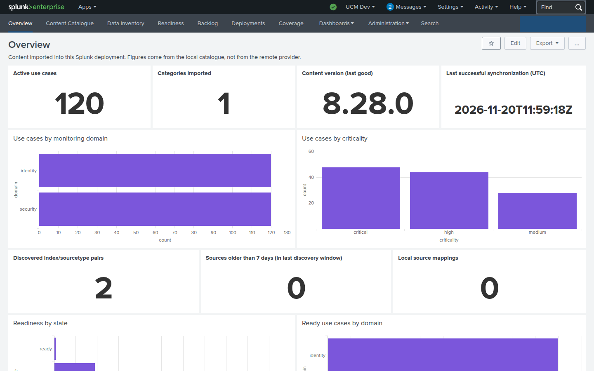
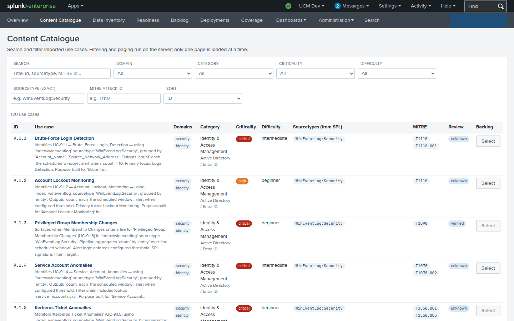
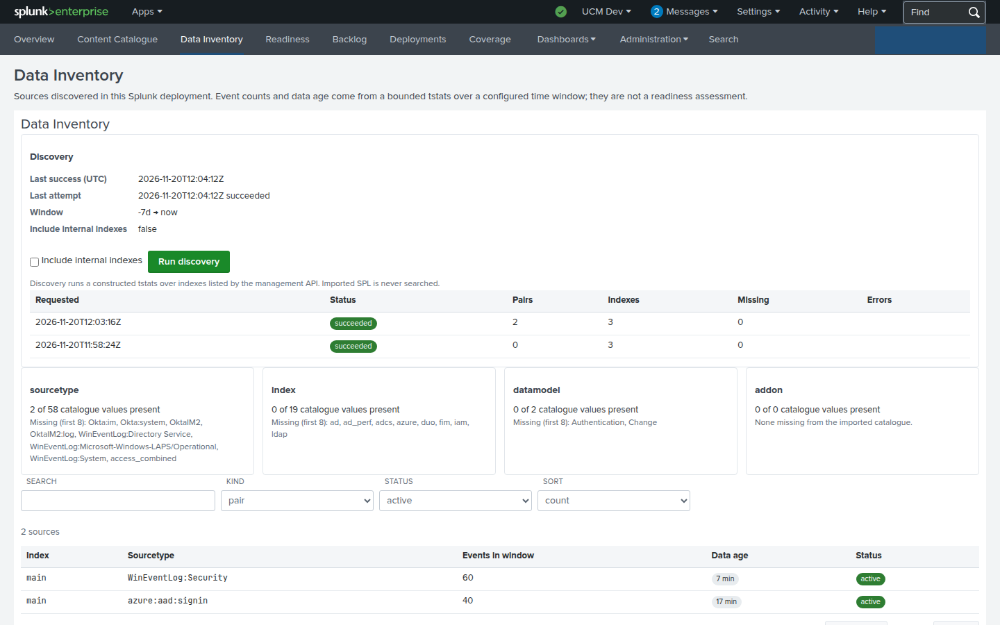
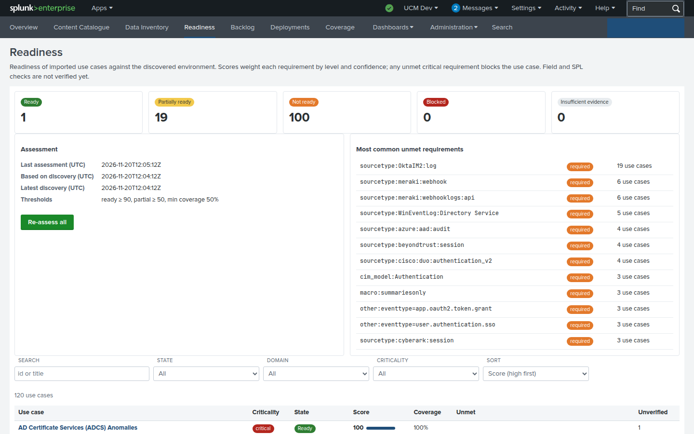
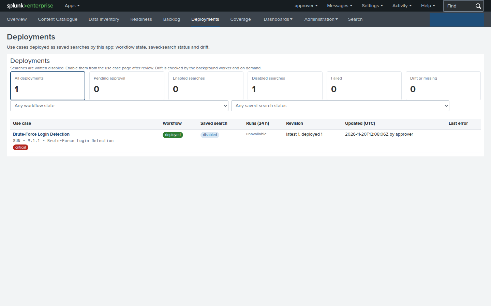
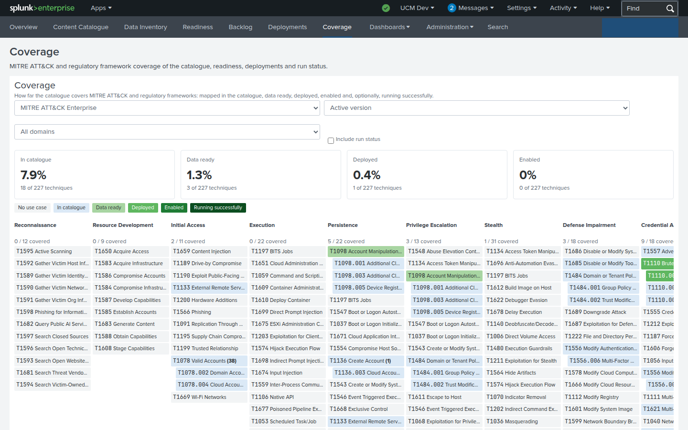

# SUNavigator (Splunk Use Case Navigator)

[](docs/OPERATOR_GUIDE.md#what-changed-in-09x)
[](docs/OPERATOR_GUIDE.md#2-requirements)
[](docs/DECISIONS.md#d-005-stdlib-only-python-compatible-with-39313)
[](tests/)
[](docs/DECISIONS.md#d-019-packaging-constraints-from-appinspect)

**SUNavigator** is a native Splunk application for Splunk Enterprise (Splunk Cloud: the package passes AppInspect, but runtime on a Cloud stack is not validated yet) that bridges the gap between external security detection catalogues and live production environments. It empowers SOC and detection engineering teams to **discover**, **assess**, **backlog**, **validate**, and **safely deploy** monitoring use cases with built-in four-eyes governance.

Content is ingested from pluggable detection providers, with out-of-the-box support for the [Fenre monitoring use-case catalogue](https://github.com/fenre/splunk-monitoring-use-cases).

---


*SUNavigator landing overview: tracking imported use-case metrics, data inventory status, and environment readiness.*

---

## Table of Contents

- [Key Capabilities](#key-capabilities)
- [Visual Tour](#visual-tour)
- [How It Works](#how-it-works)
- [Architecture & Design Principles](#architecture--design-principles)
- [Quick Start & Installation](#quick-start--installation)
  - [Prerequisites](#prerequisites)
  - [Building from Source](#building-from-source)
  - [CLI Installation (Recommended)](#cli-installation-recommended)
  - [First-Run Setup](#first-run-setup)
- [Offline & Air-Gapped Deployments](#offline--air-gapped-deployments)
- [Deployment Workflow & Governance](#deployment-workflow--governance)
- [Documentation Map](#documentation-map)
- [Repository Layout](#repository-layout)
- [Development & Testing](#development--testing)
- [Upgrades & Migrations](#upgrades--migrations)
- [Security & Trust Model](#security--trust-model)
- [Third-Party Attributions](#third-party-attributions)

---

## Key Capabilities

- 📥 **Curated Content Ingestion**: Synchronizes use cases from GitHub pinned to immutable commit hashes with per-record git blob SHA-1 verification. Each category is fetched and validated in full before anything is written (last-known-good), syncs are incremental, and records removed upstream are marked withdrawn. KV Store has no transactions: an interrupted write marks the category failed, and the next sync rewrites the affected records (D-009).
- 🔍 **Safe Bounded Data Discovery**: Discovers active index and sourcetype pairs, event volume, and data freshness using constructed, bounded `tstats` queries—never running untrusted imported SPL. Preserves local source mappings without overwriting operator customizations.
- 📊 **Evidence-Based Readiness Engine**: Evaluates whether required sourcetypes, fields, CIM data models, macros, and add-ons exist in your environment. Produces deterministic readiness scores (0–100) and enforces a veto when critical requirements are missing. Since 0.8.7 it also checks that the scheduler account (`[deployment] scheduled_owner`) is allowed to search the indexes a use case reads, so a scheduled search does not run blind (D-063). Since 0.9.1 a CIM data model requirement also shows whether the model held events in the last 24 hours at discovery (`populated: yes / no / unverified`, a separate chip that never changes a score, D-067).
- 🎯 **Operator Backlog & Syntax Validation**: Provides per-user selection, bookmarking, and triage. Validates SPL against Splunk's native search parser, adds an advisory lint for constructs Splunk accepts but never evaluates (an eval function used as a search term, D-065), inspects command syntax, and provides safe, bounded previews with `fieldsummary` sampling.
- 🛡️ **Four-Eyes Guided Deployment**: Maker-checker inside the app: a draft is submitted by one operator, approved by a second (unless `allow_self_approval` is set), and deployed as a disabled saved search. Live activation is gated on environment readiness and audited. The saved search is owned by a dedicated scheduler account (`ucm_scheduler`, D-051), so it runs as that account; administrators can still edit it in Splunk directly and the app reports such edits as drift. Since 0.9.1 an ESCU use case shows, read-only, the state of the search ESCU ships for it and what to do (enable it in ES Content Management when Enterprise Security is installed); SUN never creates ES-managed content and always deploys a plain scheduled search, with a non-blocking warning when a parallel copy would run. The ES-installed behaviour is unvalidated (no ES lab, issue #4).
- 🔄 **Drift Detection & Rollback**: Compares live saved searches against frozen deployment revisions. Automatically detects external modifications and provides one-click rollback to prior revisions or safe retirement.
- 🗺️ **Framework & Regulation Coverage**: Maps catalogue holdings and deployed detections against MITRE ATT&CK® Enterprise 20.1 and ICS 20.1 technique matrices, as well as compliance obligations, with execution run-status tracking.
- 📈 **Dynamic Domain Dashboards**: Generates Simple XML monitoring dashboards from vetted templates without embedding arbitrary upstream SPL.

---

## Visual Tour

| View | Screenshot | Description |
| --- | --- | --- |
| **Content Catalogue** |  | Server-side filtered and paged view of all imported use cases with domain, category, criticality, difficulty, and MITRE ATT&CK facets. |
| **Data Inventory** |  | Discovered data sources, event counts, freshness age, and catalogue sourcetype / index mapping coverage. |
| **Readiness Assessment** |  | High-level readiness breakdown (Ready, Partially Ready, Not Ready, Blocked) and the most common unmet telemetry requirements. |
| **Deployment Management** |  | Comprehensive tracking of all active, draft, and retired deployments with saved-search operational status and drift indicators. |
| **MITRE ATT&CK Coverage** |  | Interactive technique coverage matrix spanning In Catalogue, Data Ready, Deployed, Enabled, and Running Successfully states. |

---

## How It Works

```
┌───────────────────────────────┐
│ Upstream Catalogue (Fenre/Git)│
└───────────────┬───────────────┘
                │ Pinned commit + git blob SHA verification
                ▼
┌───────────────────────────────┐        ┌───────────────────────────────┐
│   Background Sync Worker      │◄───────┤ Data Inventory Discovery      │
│  (ucm_sync_worker modular in) │        │ (Bounded tstats, active pairs)│
└───────────────┬───────────────┘        └───────────────┬───────────────┘
                │ Category upserts (last-known-good)     │ Telemetry facts
                ▼                                        ▼
┌────────────────────────────────────────────────────────────────────────┐
│                      KV Store State Collections                        │
│  (uc_catalog, uc_requirements, uc_inventory, uc_readiness, uc_deploy)  │
└───────────────────────────────────┬────────────────────────────────────┘
                                    │
                                    ▼
┌────────────────────────────────────────────────────────────────────────┐
│                   SUNavigator REST API (/services/ucm/...)             │
│        Persistent Python Handler (Strict capability-based RBAC)        │
└───────────────────────────────────┬────────────────────────────────────┘
                                    │
         ┌──────────────────────────┴──────────────────────────┐
         ▼                                                     ▼
┌───────────────────────────────┐             ┌───────────────────────────────┐
│ Splunk Web Interface          │             │ Splunk Saved Searches Engine  │
│ (Simple XML 1.1 + JS Modules) │             │ (Disabled-first, SUN - <id>)  │
└───────────────────────────────┘             └───────────────────────────────┘
```

---

## Architecture & Design Principles

SUNavigator follows strict enterprise architectural constraints documented in [docs/DECISIONS.md](docs/DECISIONS.md):

1. **Zero External Python Dependencies (D-005)**: Built strictly with Python's standard library. Fully compatible with Splunk Enterprise 10.x running Python 3.9 through 3.13.
2. **Untrusted Upstream Content (D-006, D-007)**: All third-party detection definitions are treated as untrusted data. Schema validation, size caps, and commit-pinned blob checks occur before data enters the system.
3. **No Dynamic SPL Execution (D-020, D-026)**: Imported SPL is never dispatched or executed during discovery, catalogue viewing, or readiness checks. Read-only checks use Splunk's native parser and bounded `fieldsummary` queries.
4. **Splunk-Native Storage (D-004)**: All operational state, summaries, discovery metrics, and audit entries reside in Splunk KV Store collections; no non-standard local filesystem caches are used.
5. **Caller-Scoped Authorization (D-011)**: REST endpoints run under the calling user's session token and enforce granular Splunk capabilities (`ucm_view_content`, `ucm_manage_content`, `ucm_run_discovery`, `ucm_select_usecases`, `ucm_deploy`).

---

## Quick Start & Installation

### Prerequisites

- **Splunk Enterprise 10.2+** or **10.4+** (Single instance or distributed Search Head).
- **KV Store status**: `ready` (`$SPLUNK_HOME/bin/splunk show kvstore-status`).
  - *macOS Note*: If KV Store is stuck on `starting` with `CSSMERR_TP_CERT_SUSPENDED`, add `[kvstore] ocspValidation = false` to `server.conf` (see [Operator Guide §9.2](docs/OPERATOR_GUIDE.md#92-administration-kvstorestatus-unavailable--kv-get-failed)).

### Building from Source

Package the production `.tar.gz` bundle from this repository:

```bash
git clone https://github.com/cagdaskarabag/sun_navigator.git
cd sun_navigator
./tools/package.sh
# Output: dist/sunavigator-0.9.4.tar.gz
```

### CLI Installation (Recommended)

Splunk Web's UI upload times out on packages over standard browser HTTP limits. Install via the Splunk CLI:

```bash
$SPLUNK_HOME/bin/splunk install app dist/sunavigator-0.9.4.tar.gz \
  -auth "$SPLUNK_USER:$SPLUNK_PASSWORD"

$SPLUNK_HOME/bin/splunk restart
```

Verify installation:

```bash
$SPLUNK_HOME/bin/splunk display app sunavigator \
  -auth "$SPLUNK_USER:$SPLUNK_PASSWORD"
```

### First-Run Setup

1. Log into Splunk Web and navigate to **Apps → SUNavigator**.
2. Open **Administration**: verify that KV Store, Remote Content Sync, and Platform checks show green `available` badges.
3. Under **Remote synchronization**, click **Check provider for categories**, select Category `9` (Identity & Access Management), and click **Synchronize selected**.
4. Go to **Data Inventory** and click **Run discovery** to catalog active indexes and sourcetypes in your environment.
5. Visit **Readiness** to see automatic telemetry match rates, or open **Content Catalogue** to start selecting detections.

*(Optional)* Configure a GitHub personal access token to prevent API rate limiting:

```bash
curl -k -u admin https://localhost:8089/servicesNS/nobody/sunavigator/storage/passwords \
  -d name=github_token -d realm=sunavigator --data-urlencode password="YOUR_GITHUB_TOKEN"
```

---

## Offline & Air-Gapped Deployments

For environments without direct outbound internet access to GitHub, build an offline bundle on an internet-connected workstation:

```bash
git clone https://github.com/fenre/splunk-monitoring-use-cases /tmp/fenre
python3 tools/ucm_cli.py validate --repo /tmp/fenre --categories 9,10
python3 tools/ucm_cli.py build-bundle --repo /tmp/fenre --categories 9,10 --output bundle.json
```

In SUNavigator, navigate to **Administration → Offline import**, upload `bundle.json`, and click **Import bundle**. Every record is validated against its git blob SHA hash, matching remote sync integrity.

Splunk ES Content Update detections can be imported the same way as a second provider (`escu`), from the release package:

```bash
python3 tools/ucm_cli.py build-escu-bundle --package DA-ESS-ContentUpdate-latest.tar.gz --output escu.json
```

After a deployment, a control test can replay the Fenre sample events through the deployed search. Build the fixtures with `python3 tools/ucm_cli.py build-control-fixtures --samples <fenre>/samples --output fixtures.json`, import them as a content manager, then use **Run control test** on the deployment (see the operator guide, §6.6a). Since 0.8.8 the test window follows the sample's timestamps, the manifest's `max_count` and `fields` checks are applied, and a search that errors on the test data is reported as `content_error` (D-064). `tools/controltest_campaign.py` runs all fixtures on a lab; the results for the 94 Fenre fixtures and the findings for the content owner are in `docs/upstream/`.

Since 0.8.9 validation and the deployment card show an advisory SPL lint (five rules, each shown wrong on Splunk 10.2.9; it changes no score, approval or gate, D-065). `python3 tools/spl_lint_corpus.py --fenre <fenre> --escu <package>` measures a content collection; the Fenre results are in `docs/upstream/SPL_LINT_CORPUS.md`. A bundle over the 50 MB import cap can be split by category or by record ids (operator guide, §5.2).

Since 0.9.0 the catalogue is provider-aware (D-066): a provider badge and facet, ESCU analytic-story and data-source facets (the way to find the ESCU use cases in the category *Unassigned*), Fenre's maturity wave, a *Hide quality flag* filter (also an opt-in for Recommended next), and a link between a Fenre and an ESCU use case whose primary SPL is identical. The deployment form on the use-case page sits behind a **Plan deployment** button. After upgrading from 0.8.x, press **Reindex catalogue summaries** in Content Administration to fill the new fields (operator guide, *What changed in 0.9.x*).

---

## Deployment Workflow & Governance

SUNavigator implements a safe, four-eyes deployment state machine:

```
[Draft] ─── Submit ───► [Pending Approval] ─── Approve ───► [Approved]
                             │                                   │
                             └── Reject                          └── Deploy (Disabled)
                                                                     │
                                                                     ▼
                                [Active / Enabled] ◄─── Enable ─── [Deployed]
                                        │                             │
                                        ├── Verify Drift              ├── Rollback
                                        └── Retire                    └── Retire
```

- **Separation of Duties (in the app)**: The operator who drafts/submits a detection cannot approve it unless `allow_self_approval = true` is explicitly configured. Splunk permissions still let the owner of a deployed saved search, or an admin, edit it outside the app; the drift check (`[deployment] verify_interval_minutes`) reports such changes.
- **Disabled-First**: Newly deployed searches are always created in a `disabled = 1` state under the naming convention `SUN - <record_id> - <title>`.
- **Gated Activation**: Enabling a search requires an assessment score above threshold. Enabling a blocked search, or one whose scheduler account cannot search the indexes it reads, requires an audited override reason.
- **Continuous Drift Verification**: Periodic background jobs verify live saved search definitions against frozen KV Store deployment revisions to detect manual tampering.

---

## Documentation Map

| Guide | Description |
| --- | --- |
| 📖 **[Operator Guide](docs/OPERATOR_GUIDE.md)** | Comprehensive manual covering installation, configuration, role assignment, first-run sync, view-by-view usage, upgrading, and troubleshooting. |
| 🏗️ **[Architecture Specification](docs/ARCHITECTURE.md)** | Technical reference for software components, KV Store collection schemas, and REST endpoints. |
| 🔒 **[Security & RBAC Model](docs/SECURITY.md)** | Detailed trust boundaries, Splunk capability definitions, and credential handling. |
| 🗂️ **[Pending issues](docs/ISSUES_PENDING.md)** | Which GitHub issues the code resolves (with ready closing comments), which stay open, and drafts of new issues. |
| 📜 **[Architecture Decision Records (ADRs)](docs/DECISIONS.md)** | Recorded technical decisions and trade-offs (D-001 through D-067). |
| 📋 **[Implementation Plan](docs/IMPLEMENTATION_PLAN.md)** | Work package breakdown (WP0–WP8), what is deferred and why, and validation test matrices. |

---

## Repository Layout

```
sun_navigator/
├── sunavigator/                   # The packaged Splunk App
│   ├── app.manifest              # App packaging manifest
│   ├── default/                  # Default Splunk configurations (app, restmap, collections, etc.)
│   ├── bin/                      # REST entrypoints and modular input worker
│   ├── lib/splunk_ucm/           # Core Python engine (stdlib only)
│   │   ├── catalog/              # Catalogue search, summary, and query engine
│   │   ├── content/              # Ingestion, normalization, and bundle verification
│   │   ├── deployment/           # Four-eyes workflow, savedsearch writer, drift verifier
│   │   ├── discovery/            # Bounded tstats data discovery
│   │   ├── frameworks/           # MITRE ATT&CK & regulatory matrix engines
│   │   └── readiness/            # Deterministic requirement and score evaluator
│   └── appserver/static/         # Simple XML JS modules and styles
├── tools/                        # Development, packaging, and bundle CLI tools
├── tests/                        # Automated test suites
│   ├── unit/                     # 813 mocked unit tests (runs without Splunk)
│   ├── js/                       # Node tests of the browser modules (run by the unit suite when Node is present)
│   ├── fixtures/readiness/       # Readiness regression corpus and its baseline
│   └── live/                     # Integration tests against live Splunk instances
└── docs/                         # Specifications, ADRs, operator guide, and screenshots
```

---

## Development & Testing

Unit tests run out of the box with standard Python 3.9+ without needing Splunk installed:

```bash
cd tests
python3 -m unittest discover -s unit -t .
```

The readiness regression corpus (`tests/fixtures/readiness/corpus.json`) scores
synthetic use cases against a synthetic environment and compares every
requirement with its ground truth. `test_readiness_corpus.py` fails when the
counts move from `baseline.json`; print the per-case report with
`python3 unit/test_readiness_corpus.py` and rewrite the baseline with `--write`
in the same change.

The Node tests of the browser modules (`tests/js/`, no dependencies; they use a small fake DOM that throws on `innerHTML`) run inside the unit suite when `node` is on the path, and a static test fails the build if any view script uses `innerHTML`, `outerHTML`, `insertAdjacentHTML`, `document.write` or `eval`. Run one directly with `node tests/js/test_handoff.js`. They are not browser tests; Splunk Web itself is checked by hand on the lab (issue #15).

To run live integration tests against a test Splunk Enterprise instance (the ESCU-only tests need the ES Content Update app on that instance and skip without it; nothing covers an instance with Enterprise Security):

```bash
UCM_LIVE_SPLUNK=1 \
UCM_SPLUNK_USER=admin \
UCM_SPLUNK_PASSWORD="your-password" \
UCM_SPLUNK_VERIFY_TLS=0 \
python3 -m unittest discover -s live -t .
```

For rapid local search-head deployment during development:

```bash
SPLUNK_HOME=/opt/splunk ./tools/dev_deploy.sh --restart
```

---

## Upgrades & Migrations

- **Upgrading from 0.7.0 (`splunk_use_case_manager`)**: Version 0.7.1 introduces the official `sunavigator` app ID. Because Splunk treats this as a distinct application, follow the migration procedure in [Operator Guide §8](docs/OPERATOR_GUIDE.md#8-upgrade-and-uninstall) (retire previous deployments, remove old app, install SUNavigator, and resync).
- **Upgrading to 0.9.1**: install over the existing app as in the operator guide. No schema change. Run discovery once so data models get their `populated` value, and (from 0.8.x) press **Reindex catalogue summaries** once for the 0.9.0 filters. `[discovery] populated_check = false` turns the new per-model search off.
- **Upgrades within 0.7.1+**: Upgrades preserve `local/` configurations and automatically execute pending KV Store migrations via the background maintenance worker.

---

## Security & Trust Model

- **Least Privilege**: Pre-bundled roles `ucm_analyst`, `ucm_content_manager`, and `ucm_deployment_operator` enforce strict privilege separation.
- **Audit Logging**: All administrative actions (sync, discovery, approvals, overrides, deployments) generate records in both the `uc_audit` KV collection and `_internal` logs (`sunavigator.log`).
- **Interactive search runs as the user**: from the use-case page a user can run a use case's SPL in their browser with their own Splunk permissions, after an explicit click. This is outside the server-side preview guard rails and is not audited by the app; see [docs/SECURITY.md](docs/SECURITY.md#interactive-search-runs-as-the-user-d-058).
- **Credential Storage**: External API keys and tokens are stored solely in Splunk's native `storage/passwords` encrypted endpoint.

---

## Licence and Third-Party Attributions

SUNavigator is licensed under the [Apache License 2.0](LICENSE) ([NOTICE](NOTICE)). You may use, modify, redistribute and sell it, including as part of a commercial product, provided you keep the licence and notices. Third-party parts keep their own licences; [THIRD_PARTY_NOTICES.md](THIRD_PARTY_NOTICES.md) lists them with the licence texts.

- Detection content provided by the [Fenre Monitoring Use Cases project](https://github.com/fenre/splunk-monitoring-use-cases), Copyright (c) 2026 Fredrik Lima Sudmann, licensed under the MIT License. The app ships Fenre's use-case schema verbatim with that licence; the test fixtures are verbatim Fenre records.
- Splunk ES Content Update (`DA-ESS-ContentUpdate`) and [splunk/security_content](https://github.com/splunk/security_content), Copyright Splunk Inc., licensed under the Apache License 2.0. SUNavigator ships no ESCU content; it reads the ESCU package an operator supplies, and bundles built from it stay under the Apache License 2.0.
- MITRE ATT&CK® Enterprise and ICS matrices © The MITRE Corporation. Reproduced and distributed with the permission of The MITRE Corporation under the [ATT&CK terms of use](https://attack.mitre.org/resources/legal-and-branding/terms-of-use/).
