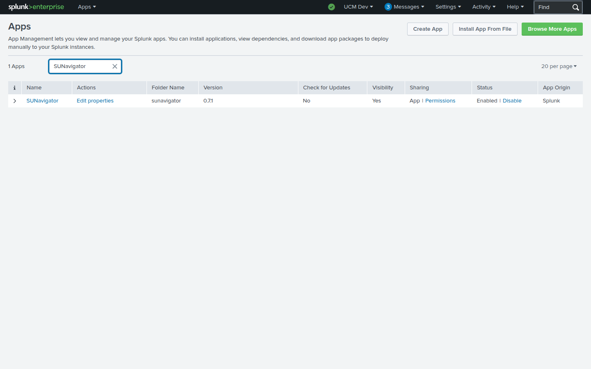
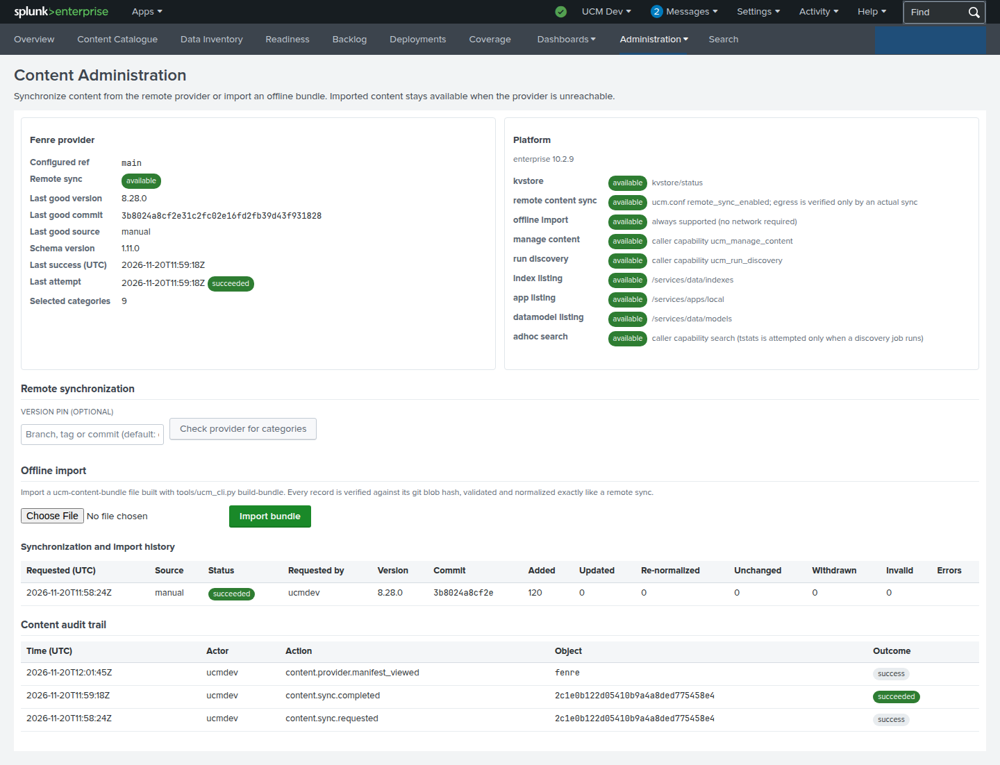
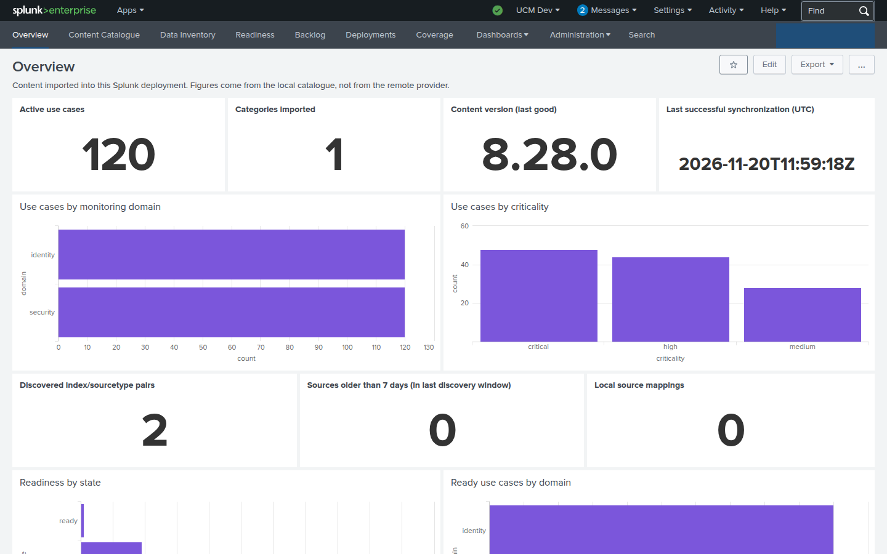
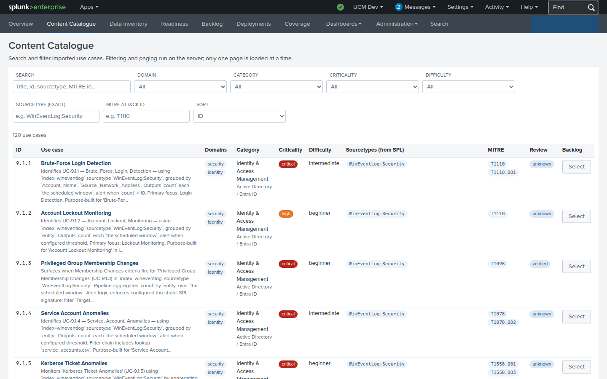
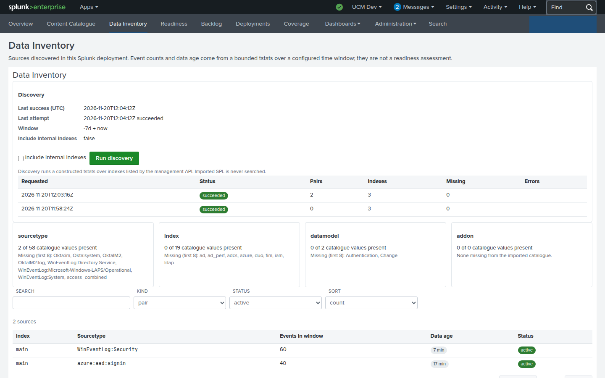
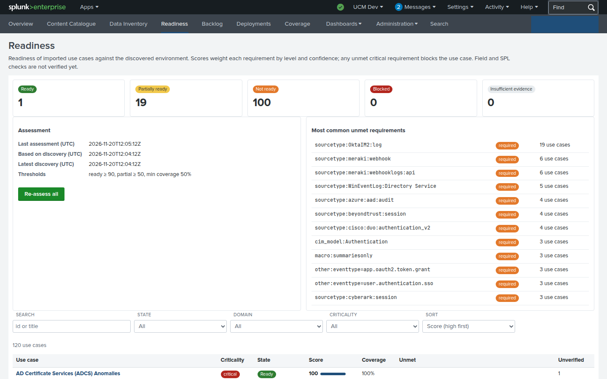
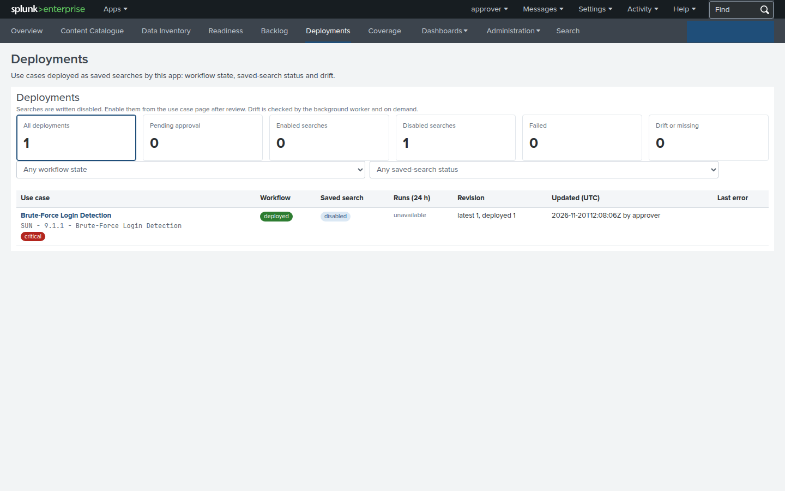
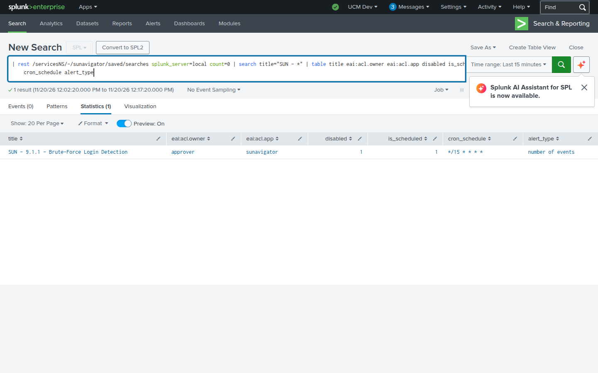
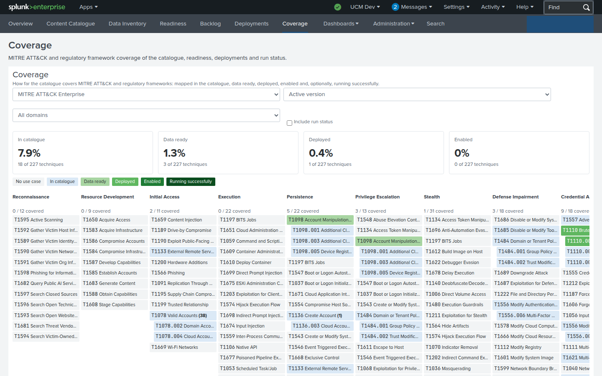
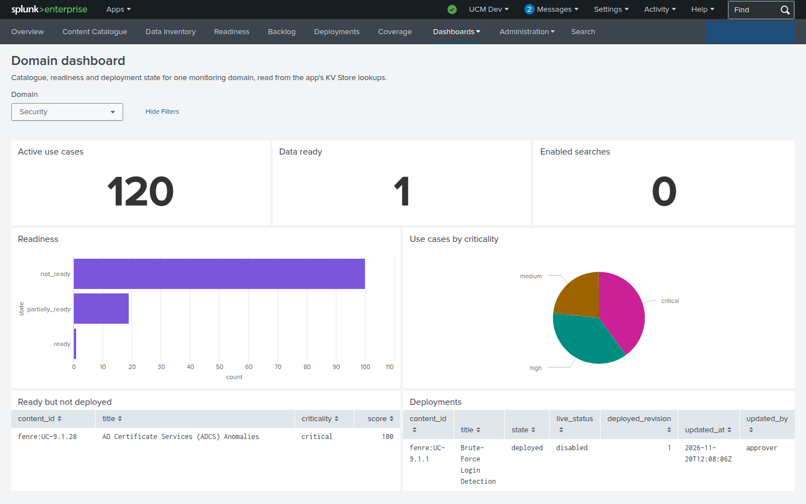

# SUNavigator 0.7.3 — operator guide

**SUNavigator** (short for **Splunk use case navigator**) discovers, assesses,
selects, validates and deploys monitoring use cases in Splunk.

This is the install, usage and troubleshooting guide for **SUNavigator
0.7.3**. It is written for a single Splunk Enterprise instance
(search head + indexer on one host), including a local macOS install. Search
head clusters and Splunk Cloud are **not** validated in this version.

Related documents (design, not how-to):

| Document | Contents |
| --- | --- |
| [README.md](../README.md) | Status, layout, packaging, tests |
| [ARCHITECTURE.md](ARCHITECTURE.md) | Components, KV collections, REST |
| [SECURITY.md](SECURITY.md) | Trust boundaries, roles, ACLs |
| [DECISIONS.md](DECISIONS.md) | Recorded product decisions |
| [IMPLEMENTATION_PLAN.md](IMPLEMENTATION_PLAN.md) | Work packages and validation status |

---

## 0. What changed in 0.7.3

0.7.3 makes readiness results trustworthy (no new features). An upgrade from
0.7.2 keeps your data; the worker re-derives catalogue summaries once
(migration `0002`). Existing readiness results show as stale
(`engine_upgraded`) until the next assessment: run **Re-assess** or discovery.

- **Fields the search creates are no longer reported missing.** A required
  field that the search itself produces (`eval`, `stats … as`, `rename`,
  `rex`, `spath output=`, `lookup … OUTPUT`, …) is shown as informational
  (`derived_in_spl`), is not sampled, and does not lower the score. A field
  the search reads before it produces it (`eval user=lower(user)`) is still a
  raw-data requirement (D-040).
- **Alternative sourcetypes.** `sourcetype=A OR sourcetype=B` and
  `sourcetype IN (A, B)` in one search clause form an "any of" group: the use
  case needs one of them. `join`, `append`, `multisearch` and subsearches
  still need every sourcetype (D-041).
- **Field sampling reads where the data is.** The sample covers the hour
  (`[validation] sample_window_minutes`) before the newest event discovery saw
  for each sourcetype, not the last 15 minutes, and only the requested fields.
  A window with no events leaves a field unverified (`sample_empty`) instead
  of absent (D-027).
- The app state now records the installed version after an upgrade that adds
  no migration (0.7.2 kept reporting 0.7.1).
- A readiness regression corpus (`tests/fixtures/readiness`) checks these
  cases on every change. On 0.7.2, 10 of its 11 ready cases were reported not
  ready; on 0.7.3 all 17 cases are classified correctly.

## 0.1 What changed in 0.7.2

0.7.2 fixes evidence integrity and trust boundaries (no new features). A clean
install is recommended; an upgrade within `sunavigator` keeps your data.

- **Search results are no longer cut at 100 rows.** Discovery, run status and
  field sampling used to stop at 100 rows and report the result as complete,
  so large environments showed sources as missing. Truncation is now explicit
  and shown in the inventory and coverage views (D-037). Re-run discovery
  after upgrading.
- **Validation and preview run in the `sunavigator` namespace**, like the
  deployed search. App-scoped macros resolve the same way in preview and in
  deployment. The app ships the Search app's no-op `comment(1)` macro, which
  many catalogue searches use (D-026).
- **SPL execution policy.** Preview also refuses commands that run other
  searches or reach outside the search (`map`, `savedsearch`, `loadjob`,
  `rest`, `dbxquery`) and commands outside SUN's read-only list. Approving such
  a deployment needs an explicit, audited acknowledgment. Side effects hidden
  in macros inside subsearches are now caught. Trusted read-only custom
  commands can be listed in `[spl] extra_safe_commands` (D-038).
- **Analysts can no longer write evidence directly.** `uc_readiness`,
  `uc_validation`, `uc_environment_sources`, `uc_source_mappings` and
  `uc_sync_state` are admin-write only; the REST API writes them after its
  capability check, and the worker rejects malformed jobs (D-039). Custom
  scripts that wrote these collections with a non-admin account must use
  the REST API instead.

## 0.2 What changed in 0.7.1

0.7.1 renames the application from **Splunk Use Case Manager** (0.7.0 and
earlier) to **SUNavigator**. The feature set is unchanged.

| Item | 0.7.0 and earlier | 0.7.1 |
| --- | --- | --- |
| Product name (UI, docs, manifest) | Splunk Use Case Manager | SUNavigator |
| App ID and folder | `splunk_use_case_manager` | `sunavigator` |
| Package file | `splunk_use_case_manager-0.7.0.tar.gz` | `sunavigator-0.7.1.tar.gz` |
| Deployed saved-search names | `UCM - <id> - <title>` | `SUN - <id> - <title>` |
| Generated dashboard labels and marker | "UCM … overview", "Generated by Splunk Use Case Manager" | "SUNavigator … overview", "Generated by SUNavigator" |
| App log file | `splunk_use_case_manager.log` | `sunavigator.log` |
| GitHub token realm | `splunk_use_case_manager` | `sunavigator` |

Internal identifiers keep the `ucm` prefix on purpose, so existing scripts and
documentation still work: `local/ucm.conf`, the `/services/ucm/...` REST
prefix, the `UCM_*` environment variables, the `splunk_ucm` Python package,
the `ucm_*` views and JavaScript, the `uc_*` KV collections and the
`ucm_gen_*` generated view names.

**Because the app ID changed, 0.7.1 is not an in-place upgrade of 0.7.0.**
Splunk treats `sunavigator` as a new app with its own KV collections, so the
catalogue, selections, deployments and audit trail of the old app are not
carried over. Follow §8, "Migrating from Splunk Use Case Manager 0.7.0".

**Screenshots in this guide** come from a lab instance (Splunk Enterprise
10.2.9 on Linux, SUNavigator 0.7.1, 20 Nov 2026). The lab had no real security
data, so the readiness scores come from synthetic sample events: 60
`WinEventLog:Security` lines and 40 `azure:aad:signin` JSON lines, loaded with
`splunk add oneshot` into the `main` index. The screenshots use two accounts:
an admin account that submits and browses, and an `approver` account with the
`ucm_deployment_operator` role that approves and deploys. Times in the app are
UTC.

## 1. What this version does

The app is a workflow around a monitoring-use-case catalogue (the first
provider is [Fenre](https://github.com/fenre/splunk-monitoring-use-cases)):

1. **Import** detections (GitHub sync or an offline JSON bundle).
2. **Discover** which indexes and sourcetypes exist on this Splunk instance.
3. **Score readiness** of each use case against that inventory.
4. **Select** use cases into a per-user backlog and **preview** SPL safely.
5. **Deploy** as a saved search that is always created **disabled**.
6. **Cover** MITRE ATT&CK (and regulation controls) from catalogue → running.

It never executes imported SPL as part of catalogue, discovery or coverage.
Preview and field sampling are explicit, bounded, and refuse side-effect
commands (`delete`, `outputlookup`, `collect`, script, and similar). Deployed
searches have **no email, webhook or script alert actions**; the default
alert mode only writes to Splunk's Triggered Alerts.

**Not in 0.7.3:** PDF export of coverage, a bundled regulation-control
catalogue, validated SHC behaviour, Splunk Cloud vetting submission.

---

## 2. Requirements

| Item | Requirement |
| --- | --- |
| Splunk | Enterprise 10.x (validated on 10.2.9 in development; tested by operators on 10.4.3 Darwin arm64). Python 3.9 or 3.13 in Splunk. |
| KV Store | Must reach `status: ready`. The app stores catalogue, inventory, readiness, selections, deployments and audit in KV collections. |
| Role | First-time setup needs `admin` (or `sc_admin` on Cloud). |
| Disk | The 0.7.3 package is a few megabytes. Category 9 of Fenre is about 120 records; the full Fenre corpus is tens of thousands of records. |
| Network | Optional. Remote sync needs HTTPS to `api.github.com` and `raw.githubusercontent.com`. Offline import needs none. |
| Browser | Splunk Web. The app is a set of Simple XML views plus JavaScript under `/en-US/app/sunavigator/`. |

Placeholders used below:

- `$SPLUNK_HOME` — on macOS typically `/Applications/splunk`; on Linux typically `/opt/splunk`.
- `$SPLUNK_USER` / `$SPLUNK_PASSWORD` — a Splunk admin. Never put the password in configuration files.

---

## 3. Install

### 3.1 Build the package (from this repository)

```bash
./tools/package.sh
# writes dist/sunavigator-0.7.3.tar.gz
```

The tarball has a single top-level folder `sunavigator/`
(`app.manifest`, `default/`, `bin/`, `lib/`, `appserver/`, `metadata/`).
`local/` and Python bytecode are excluded.

If you already have the `.tar.gz` from a GitHub release or a previous
packaging run, skip this step.

### 3.2 Install with the CLI (preferred)

Splunk Web's **Manage Apps → Install app from file** posts to
`/services/apps/local` and often **times out at 30 seconds**. The install
then fails in the UI with `500 Internal Server Error` even though splunkd is
still unpacking. Use the CLI:

```bash
$SPLUNK_HOME/bin/splunk install app /path/to/sunavigator-0.7.3.tar.gz \
  -auth "$SPLUNK_USER:$SPLUNK_PASSWORD"
# first install: omit -update
# upgrade of an existing copy:
$SPLUNK_HOME/bin/splunk install app /path/to/sunavigator-0.7.3.tar.gz \
  -update 1 -auth "$SPLUNK_USER:$SPLUNK_PASSWORD"

$SPLUNK_HOME/bin/splunk restart
```

Confirm:

```bash
$SPLUNK_HOME/bin/splunk display app sunavigator \
  -auth "$SPLUNK_USER:$SPLUNK_PASSWORD"
```

`state` should be `enabled`. Open Splunk Web → **Apps → SUNavigator**.




### 3.3 Install from Splunk Web (only if the CLI is unavailable)

**Apps → Manage apps → Install app from file** → choose the `.tar.gz` →
check **Upgrade app** if a previous version is present → **Upload**.

If the page returns **500** / “format of the request is invalid” after ~30 s,
do **not** retry the upload blindly. Check whether the app folder already
exists:

```bash
ls "$SPLUNK_HOME/etc/apps/sunavigator/default/app.conf"
```

If it exists, finish with `splunk restart`. If it does not, use the CLI
install in §3.2.

### 3.4 Development copy (maintainers)

```bash
SPLUNK_HOME=/opt/splunk ./tools/dev_deploy.sh --restart
```

This rsyncs the app tree into `$SPLUNK_HOME/etc/apps/` and restarts Splunk.
It is not the supported path for a production or laptop evaluation.

### 3.5 After install, check KV Store **before** using the app

```bash
$SPLUNK_HOME/bin/splunk show kvstore-status -auth "$SPLUNK_USER:$SPLUNK_PASSWORD"
```

You need `status : ready` on **This member**. `starting` for more than a
couple of minutes means the app cannot read or write its collections; the
Administration page will show `kvstore/status: unavailable` and
`Synchronization state: KV get failed`. See §9.2.

### 3.6 Optional GitHub token

Public Fenre content can be fetched without a token until GitHub rate-limits
anonymous requests. A token is stored in Splunk's credential store (realm
`sunavigator`, name `github_token`), never in `ucm.conf`.

```bash
curl -k -u "$SPLUNK_USER:$SPLUNK_PASSWORD" \
  https://127.0.0.1:8089/servicesNS/nobody/sunavigator/storage/passwords \
  -d name=github_token -d realm=sunavigator \
  --data-urlencode password@-
```

Paste the token on stdin (or put it in a file and use `password@/path`). Do
not put the token on the process argument list.

---

## 4. Users and roles

The app adds capabilities and roles in `default/authorize.conf`. `admin` and
`sc_admin` already receive every app capability.

| Role | Typical job | Can |
| --- | --- | --- |
| `ucm_viewer` | Read-only analyst | Catalogue, inventory, readiness, coverage. Own backlog. Cannot sync, discover, validate or deploy. |
| `ucm_analyst` | Inventory + validation | Viewer plus discovery, local source mappings, readiness re-assess, SPL parse/preview/field sample, draft and submit a deployment. |
| `ucm_content_manager` | Catalogue owner | Analyst plus GitHub sync, offline import, reindex, provider manifest, framework import/activate, audit read. |
| `ucm_deployment_operator` | Deployer | Analyst plus approve/reject/deploy/enable/disable/rollback/retire, generated dashboards. Also gets `schedule_search`. |
| `ucm_admin` | App admin | Content manager + deployment operator + `ucm_admin`. |

The discovery inventory (index and sourcetype names, counts, apps, data
models), readiness evidence and validation results are shared app metadata:
every user who can open the app sees them, regardless of their own index
permissions. Field values are never stored. To limit who sees them, narrow
the app's read permission to the `ucm_*` roles (docs/SECURITY.md, "Shared
environment metadata"; D-044).

**Four-eyes:** the user who **submits** a draft cannot **approve** it, unless
you change configuration (see §8). For a laptop with a single `admin`
account you either:

- create a second user with `ucm_deployment_operator` (recommended), or
- set `allow_self_approval = true` or `require_approval = false` in
  `local/ucm.conf` (lab only).

Create the second user in **Settings → Users → New User**. Assign
`ucm_deployment_operator` (it already imports `ucm_analyst` / `ucm_viewer`).
The built-in `user` role is included via `ucm_viewer`.

Capabilities are enforced on every POST in `/services/ucm/...`. A viewer
receives HTTP 403 for sync, import, discovery, deploy, and so on.

---

## 5. First-run: load content

Open **Apps → SUNavigator → Administration** (view `ucm_content_admin`).

Expected empty state:

- **Fenre provider**: configured ref `main`, last good version `none`.
- **Platform**: `kvstore/status` **available**, plus green pills for remote
  sync, offline import, manage content, run discovery, index/app/datamodel
  listing. Remote sync's evidence says egress is verified only by an actual
  sync — green here does **not** prove GitHub is reachable.

A background worker (`ucm_sync_worker`) runs every **60 seconds** and
processes at most one job per tick (sync, then discovery, readiness,
deployment verify, maintenance). After you queue a job, wait up to a minute.



### 5.1 Remote sync from GitHub (needs outbound HTTPS)

1. Under **Remote synchronization**, leave **Version pin** empty to use
   `main`, or enter a branch or tag listed in `[provider:fenre]
   allowed_refs` (default `main` only), or a 40-character commit. A commit
   is accepted only if GitHub's compare API shows it is on an allowed
   branch or tag; anything else is refused before content is fetched
   (D-043).
2. Click **Check provider for categories**.
3. Tick the categories you want. **9** (Identity / Access) is a good first
   load (~120 use cases).
4. Leave **Re-download all records** and **Accept a provider schema
   major-version change** unchecked unless you know you need them.
5. Click **Synchronize selected categories**.
6. The job appears under **Synchronization and import history**:
   `queued` → `running` → `succeeded`.

On success, **Last good version**, **Last good commit** and **Selected
categories** fill in. Open **Content Catalogue** and confirm the count
matches **Added** on the job (for a first import of category 9, 120 added,
0 invalid is the expected result at Fenre 8.28.0 / commit `3b8024a8cf2e`).

The **Content audit trail** on this page is loaded once. Refresh the
browser if it still says “No audit events yet” after a successful job.

If **Check provider** fails (no egress, TLS intercept, GitHub 403/429), use
§5.2. The message will say previously imported content remains available.

### 5.2 Offline bundle import (air-gapped or no GitHub)

On a machine that has git and Python 3, with this repository checked out:

```bash
git clone https://github.com/fenre/splunk-monitoring-use-cases /tmp/fenre
python3 tools/ucm_cli.py validate --repo /tmp/fenre --categories 9
python3 tools/ucm_cli.py build-bundle --repo /tmp/fenre --categories 9 \
  --output /tmp/ucm_bundle_9.json
```

`validate` must report `"invalid": 0`. Copy the JSON to the Splunk host.

In **Administration → Offline import**, choose the file → **Import bundle**.
Every record is verified against its git blob hash and validated the same
way as a remote sync.

CLI equivalent (bundle must be `Content-Type: application/json`):

```bash
curl -k -u "$SPLUNK_USER:$SPLUNK_PASSWORD" \
  -H "Content-Type: application/json" \
  --data-binary @/tmp/ucm_bundle_9.json \
  https://127.0.0.1:8089/services/ucm/import
```

A bundle built with `--records` is marked **partial** and never withdraws
records it does not list. Default maximum size is 50 MB (`[import]
max_bundle_mb`).

If `python3` cannot import `splunk_ucm`, use Splunk's interpreter:

```bash
PYTHONPATH="$PWD/sunavigator/lib" \
  "$SPLUNK_HOME/bin/python3.13" tools/ucm_cli.py validate --repo /tmp/fenre --categories 9
```

### 5.3 Scheduled sync

Default `[sync] schedule_interval_hours = 0` (off). To poll Fenre on a
timer, set the interval in `$SPLUNK_HOME/etc/apps/sunavigator/local/ucm.conf`
and restart, or reload the `ucm` stanza. Pin `ref` to a tag or SHA for
reproducible content; `main` moves. A pinned SHA must be reachable from a
name in `allowed_refs`; a pinned tag must itself be listed there.

---

## 6. Using the app

Work top-to-bottom in the left nav. Each step depends on the previous.

### 6.1 Overview

Landing dashboard (`ucm_overview`). Counts and recent sync jobs come from
lookups over KV collections. Empty until content is imported.



### 6.2 Content Catalogue

View `ucm_catalogue`. Server-side filter and paging (one page at a time;
default max 100 rows).

| Filter | Matches |
| --- | --- |
| Search | Case-insensitive substring on a precomputed field: id, title, sourcetypes, tags, MITRE ids. **Descriptions are not searched.** All terms must match. |
| Domain, category, criticality, difficulty | Exact facets from the canonical model. |
| Sourcetype (exact) | Exact sourcetype string. |
| MITRE ATT&CK ID | Technique id such as `T1110`. |

Click a title (or open `/app/sunavigator/ucm_usecase?id=fenre:UC-9.1.1`)
for the use-case page: requirements, SPL (labelled untrusted, not run),
MITRE and regulation mappings, add-ons, references, readiness, validation
and the **Deployment** card. Regulation rows link the clause (http/https
links only), flag "SME review required", and expand to the control
objective, evidence artifact and assurance rationale. **Scope and testing**
shows the crawl / walk / run wave, what is out of scope and the control
test (what should fire, what should stay quiet). **Dependencies** lists
equipment tags and the hardware note. Any other provider field is listed
verbatim under **Provenance → Other provider fields**.

**Select** on a row writes a per-user backlog intent. Sync never overwrites
another user's selections.



### 6.3 Data Inventory

View `ucm_inventory`.

1. Optionally tick **Include internal indexes** (`_internal`, `_audit`, …).
   Default is off (`[discovery] include_internal = false`).
2. Click **Run discovery**. Needs `ucm_run_discovery`.
3. Wait for the worker (up to ~60 s). The job runs a **constructed
   `tstats`** over indexes from `/services/data/indexes`, with a relative
   time window (default `-7d` → `now`) and a pair cap (default 5000).
   Imported SPL is never searched.

When the job succeeds you see index/sourcetype pairs, event counts in the
window, and data age. Coverage cards compare catalogue requirement values
(sourcetype, index, datamodel, add-on) with what was found.

**Source mappings** (same page): a **local** mapping (kind + value →
discovered source) is never overwritten by discovery. Auto matches are
medium/low confidence and are **not** used as readiness evidence. Only
analysts can create or delete local mappings; auto mappings cannot be
deleted.



### 6.4 Readiness

View `ucm_readiness`. After a successful discovery (and by default after
content sync), the worker auto-assesses every imported use case
(`[readiness] auto_assess = true`).

| State | Meaning |
| --- | --- |
| Ready | Score ≥ 90 (default), no unmet required/critical requirement, enough coverage. |
| Partially ready | Score ≥ 50, not ready. |
| Not ready | Below partial, or a required/critical miss. |
| Blocked | A **critical** requirement is unmet (veto). Enable of a deployed search in this state needs an audited override. |
| Insufficient evidence | Too little of the weighted requirements have a decided status (default min coverage 50%). |

Click **Re-assess all** to queue a full run. Open a use case for per-
requirement evidence. Field presence and SPL parse results are filled in
only after you run validation on that use case (next section).

A sourcetype whose newest event is older than `[readiness] stale_hours`
(default 24) is treated as partial (stale), not fully met.




### 6.5 Backlog

View `ucm_backlog`. Lists use cases **this user** selected or deferred.
Bookmarks are not listed here.

From a use-case page you can Select / Defer / Reject and add notes. From
the same page, with `ucm_run_discovery`:

- **Validate** — Splunk's search parser, in the `sunavigator` namespace, plus optional field sample
  (`fieldsummary` over discovered index/sourcetype pairs, not the imported
  pipeline). The sample reads the hour (`[validation] sample_window_minutes`)
  before the newest event discovery saw for each pair.
- **Preview** — dispatches the imported SPL only after a successful parse
  and a side-effect gate. Time range is forced to `[validation] earliest/latest`
  (default `-15m` → `now`) and `preview_max_events` (default 50). Event
  payloads are not stored.

Searches with `delete`, `outputlookup`, `collect`, `script` and similar
commands are refused. So are searches with commands that run other searches or
reach data the SPL does not show (`map`, `savedsearch`, `loadjob`, `rest`,
`dbxquery`), and commands outside SUN's read-only list, such as MLTK `apply` or
an add-on's custom command. The validation panel lists them as "commands
needing review". Approving such a deployment needs an explicit acknowledgment,
which is audited. To trust a read-only custom command, add it to
`[spl] extra_safe_commands` in `local/ucm.conf` (decision D-038).


### 6.6 Deployments

View `ucm_deployments` lists every deployment. The workflow lives on the
**use-case page** (Deployment card).



State machine (D-029):

```
draft ──submit──▶ pending_approval ──approve──▶ approved ──deploy──▶ deployed
                         │
                         └──reject──▶ rejected
deployed ──enable/disable, rollback, retire, verify
failed after a deploy error; retry deploy from approved/failed
```

**Steps**

1. Open a use case that is at least partially ready (you *can* draft a
   blocked one; enabling it later will demand an override).
2. **Save draft** — choose primary / CIM / custom SPL, cron, time range,
   schedule window, alert mode (`track` = Triggered Alerts only, `none` =
   scheduled report), severity, threshold and, for alerts, optional
   suppression (period such as `1h`, optionally per field such as
   `user,src`). Splunk parses the SPL. Unparsable SPL cannot be submitted.
   New drafts default to `-20m@m` → `-5m@m` (15 minutes, ending 5 minutes
   ago so late events are counted) and schedule window `auto`. If the SPL
   sets `earliest`/`latest` itself, the card warns that it overrides the
   scheduled range.
3. **Submit for approval**.
4. A **different** user with `ucm_deploy` opens the same use case and
   clicks **Approve** (optional audit note) or **Reject**. The submitter
   does not see Approve while `allow_self_approval = false`.
5. **Deploy (disabled)** — creates or updates a saved search in this app,
   named `SUN - <record id> - <title>`, owned by the operator, **disabled**.
   The app reads it back and compares. Failure → `failed` plus `last_error`.
6. **Enable** — separate action. If readiness is in
   `block_enable_states` (default `blocked`), Splunk Web prompts for an
   override reason of at least 10 characters; the reason is audited.
7. **Verify now** — compare the live saved search with the frozen revision.
   The worker also verifies on `[deployment] verify_interval_minutes`
   (default 60). External edits show as **drift**.
8. **Roll back** — writes the previous deployed revision, again disabled.
9. **Retire** — deletes the saved search from Splunk.

The screenshots below follow the steps above on `fenre:UC-9.1.11` and
`fenre:UC-9.1.1`:


The approved SPL is copied into the revision. Later Fenre updates only set
`content_changed`; they do not rewrite what was approved.

**Single-admin lab:** either approve as a second user (§4) or set in
`local/ucm.conf`:

```
[deployment]
require_approval = false
```

Then submit auto-approves (`approval: not_required`). Alternatively
`allow_self_approval = true` keeps an explicit Approve click but lets the
submitter do it. Restart Splunk (or reload `ucm`) after editing.

To confirm the deployed search, run this in **Search & Reporting** as an admin
account (the `rest` command requires it):

```
| rest /servicesNS/-/sunavigator/saved/searches splunk_server=local count=0
| search title="SUN - *"
| table title eai:acl.owner eai:acl.app disabled is_scheduled cron_schedule alert_type
```



The **Settings → Searches, reports, and alerts** page did not list these
searches in the lab, even for their owner. Use the REST search as the
reliable check (see §9.14).

### 6.7 Coverage

View `ucm_coverage`. Bundled frameworks: MITRE ATT&CK **Enterprise 20.1**
and **ICS 20.1**. Other versions can be imported as `ucm.framework/1` JSON
from Administration (content-manager capability) and activated.



Levels (filters at the top):

| Level | Meaning |
| --- | --- |
| In catalogue | At least one active use case maps to the technique. |
| Data ready | A mapped use case is readiness-ready. |
| Deployed | A mapped use case has a saved search. |
| Enabled | That search is enabled. |
| Running successfully | Scheduler log in `_internal` shows a successful run in the selected window. |

Sub-technique mappings also count toward the parent. Revoked techniques are
remapped where the bundled STIX says so (for example T1562 → T1685).

**Run status** needs the caller to search `index=_internal sourcetype=scheduler`.
Most non-admin roles cannot. The UI then reports run status **not
available**, not “no runs”. Tick **Include run status** only if your role
can search `_internal`.

Regulation controls have no bundled catalogue in 0.7.3; only controls that
appear on imported use cases are listed.

### 6.8 Dashboards

**Dashboards → Domain** (`ucm_domain`) is a fixed Simple XML dashboard over
lookups (counts by domain, criticality, deployments).

**Dashboards → Generated dashboards** (`ucm_dashboards`): pick a template,
set allowlisted parameters (for example a domain), **Preview**, then
**Create or regenerate**. Needs `ucm_deploy`. Views are written into this
app with a generation marker (`ucm_gen_…`) and listed under the Dashboards
collection. Delete only from this page (the app refuses to overwrite
unmarked views).

Imported SPL never appears in a generated dashboard. Values are escaped.




---

## 7. Configuration

Override defaults in:

```
$SPLUNK_HOME/etc/apps/sunavigator/local/ucm.conf
```

Never edit `default/ucm.conf` on an installed instance (upgrades overwrite
it). Full keys: `sunavigator/README/ucm.conf.spec`.

Reload after edits:

```bash
$SPLUNK_HOME/bin/splunk restart
# or, for the ucm stanza only, the app declares reload.ucm = simple
```

Common stanzas:

| Stanza / key | Default | When to change |
| --- | --- | --- |
| `[provider:fenre] ref` | `main` | Pin a tag or commit for reproducible sync. |
| `[provider:fenre] allowed_refs` | `main` | Branches and tags (`*` wildcard) a sync may use; commits must be reachable from a listed name. |
| `[provider:fenre] remote_sync_enabled` | `true` | `false` on air-gapped stacks; offline import still works. |
| `[provider:fenre] proxy_url` / `ca_bundle` | empty | Corporate HTTPS proxy or custom CA. |
| `[sync] schedule_interval_hours` | `0` | Periodic Fenre pull. |
| `[sync] max_invalid_ratio` | `0.2` | Category is not updated if more than this share of records fail validation. |
| `[discovery] earliest` | `-7d` | Inventory window. |
| `[readiness] ready_threshold` | `90` | What “Ready” means. |
| `[readiness] stale_hours` | `24` | When discovered data is treated as stale. |
| `[deployment] require_approval` | `true` | `false` skips four-eyes (submit auto-approves). |
| `[deployment] allow_self_approval` | `false` | Submitter may click Approve. |
| `[deployment] block_enable_states` | `blocked` | Readiness states that need an enable override. |
| `[deployment] default_earliest` / `default_latest` | `-20m@m` / `-5m@m` | Time range proposed for new drafts. |
| `[deployment] default_schedule_window` | `auto` | Schedule window proposed for new drafts (`auto` or 0–1440 minutes). |
| `[retention] audit_days` | `365` | `0` keeps audit forever. Also indexed in `_internal` via the app log. |

The worker interval is 60 seconds (`default/inputs.conf`). Do not disable
`ucm_sync_worker://default` unless you intend to stop all background jobs
(sync, discovery, readiness, deploy verify, migrations, retention).

---

## 8. Upgrade and uninstall

### Migrating from Splunk Use Case Manager 0.7.0

0.7.1 has a new app ID (`sunavigator`), so it cannot be installed over
`splunk_use_case_manager`. Remove the old app and install SUNavigator as a new
app. Do the steps in this order:

1. **Retire the old deployments** while the old app still runs. On its
   Deployments page, retire every deployment. Then confirm that no `UCM - …`
   saved searches are left:

   ```
   | rest /servicesNS/-/splunk_use_case_manager/saved/searches splunk_server=local count=0
   | search title="UCM - *"
   ```

   The query should return no rows. A `UCM - …` search left behind keeps
   running after the app is removed, under its owner.
2. **Record what you need.** Selections (Backlog), notes, deployment history
   and the audit trail are stored in the old app's KV collections. They are
   **not** migrated, and removing the app deletes them.
3. **Remove the old app**, then restart:

   ```bash
   $SPLUNK_HOME/bin/splunk remove app splunk_use_case_manager \
     -auth "$SPLUNK_USER:$SPLUNK_PASSWORD"
   $SPLUNK_HOME/bin/splunk restart
   ```

4. **Install SUNavigator 0.7.3** as in §3.2. The first install omits
   `-update`, because `sunavigator` is a new app ID.
5. **Re-create the GitHub token** if you use one (§3.6). It must be stored in
   realm `sunavigator`. The 0.7.0 token in realm `splunk_use_case_manager` is
   not used any more. Delete it if you no longer need it, for example with
   `DELETE /servicesNS/nobody/splunk_use_case_manager/storage/passwords/<realm>:github_token:`.
6. **Load content again** (§5), then run discovery and readiness (§6.3–6.4).
   Readiness is computed from the imported content and the discovered data, so
   the same content and the same data give the same scores.
7. **Re-deploy** the use cases you still need through the approval workflow
   (§6.6). New saved searches are named `SUN - …`.

### Upgrade within 0.7.1 and later

```bash
$SPLUNK_HOME/bin/splunk install app /path/to/sunavigator-<new>.tar.gz \
  -update 1 -auth "$SPLUNK_USER:$SPLUNK_PASSWORD"
$SPLUNK_HOME/bin/splunk restart
```

`local/` is kept. Within one worker interval the maintenance worker applies
pending migrations (for example re-deriving catalogue summaries) and records
the version in KV (`uc_sync_state` key `app::state`).

**Downgrades are not supported.** Splunk drops KV collection data for
fields the older `collections.conf` does not define.

### Uninstall

```bash
$SPLUNK_HOME/bin/splunk remove app sunavigator \
  -auth "$SPLUNK_USER:$SPLUNK_PASSWORD"
$SPLUNK_HOME/bin/splunk restart
```

This removes the app directory. KV collections for a removed app are
dropped. Deployed saved searches live in this app, so they disappear with
it. Retire deployments first if you need a clean saved-search list.

Do **not** run `splunk clean kvstore` to “fix” this app. That wipes **all**
KV data on the instance (other apps included).

---

## 9. Troubleshooting

Times in Splunk logs are often UTC. Convert to the host timezone when
comparing with the UI (Administration timestamps are labelled UTC).

### 9.1 Splunk Web 500 while uploading the `.tar.gz`

**Symptom:** Manage Apps → Install from file → Internal Server Error /
“format of the request is invalid” after about 30 seconds.

**Cause:** Splunk Web's HTTP client times out talking to splunkd
`POST /services/apps/local`. Common on first install when the archive is
unpacked slowly.

**Fix:** Install with the CLI (§3.2). Confirm
`$SPLUNK_HOME/etc/apps/sunavigator` exists, then `splunk restart`.

**Check:**

```
index=_internal source=*python.log* OR sourcetype=splunkd_ui_access \
  /services/apps/local
```

A `read timeout` to splunkd on that POST is this issue, not a corrupt
tarball.

### 9.2 Administration: `kvstore/status: unavailable` / `KV get failed`

**Symptom:** Platform pill red/amber; Synchronization state error
`storage_error`. Catalogue empty even after a “successful” install.

**Cause:** KV Store is not `ready`. On macOS this is often **not** a Splunk
app bug. `mongod.log` shows:

```
SSL peer certificate validation failed; connection rejected
Certificate trust failure: CSSMERR_TP_CERT_SUSPENDED
```

Splunk 10 on Darwin uses the Keychain and OCSP (`ocspEnabled=true` on the
mongod command line). Apple's trust evaluation can reject
`CN=SplunkServerDefaultCert` (SplunkCommonCA) as suspended. `show
kvstore-status` then stays at `status : starting` while
`replicationStatus : KV store captain`.

**Fix (local / lab macOS):** disable OCSP for KV Store.

```bash
grep -n "^\[kvstore\]" "$SPLUNK_HOME/etc/system/local/server.conf" \
  || echo "no [kvstore] stanza"

# If no stanza:
printf '\n[kvstore]\nocspValidation = false\n' >> \
  "$SPLUNK_HOME/etc/system/local/server.conf"

$SPLUNK_HOME/bin/splunk restart
sleep 60
$SPLUNK_HOME/bin/splunk show kvstore-status \
  -auth "$SPLUNK_USER:$SPLUNK_PASSWORD"
```

You want `status : ready`. `btool` may print nothing for `ocsp` on some
builds; trust `show kvstore-status`, not the grep.

A restart may also log `New certs have been generated in
'$SPLUNK_HOME/etc/auth'`. That is Splunk regenerating default TLS material,
not the app.

**Do not** run `splunk clean kvstore --local` for this error. It does not
fix certificate trust and destroys KV data.

**If it is still `starting` after two minutes:**

```bash
tail -50 "$SPLUNK_HOME/var/log/splunk/mongod.log"
grep -i kvstore "$SPLUNK_HOME/var/log/splunk/splunkd.log" | tail -40
```

On Linux, `CSSMERR_*` does not apply. Then look for disk full, port 8191
in use, or `disabled = true` under `[kvstore]`.

**Optional inspection of the macOS cert** (does not replace the OCSP
setting):

```bash
security find-certificate -a -c SplunkServerDefaultCert -p \
  | openssl x509 -noout -subject -serial -dates
security dump-trust-settings
```

A Keychain trust override of “Never trust” will keep breaking mongod even
with OCSP off.

### 9.3 Sync job stays `queued`

**Cause:** worker disabled, not captain (SHC), or the previous job is still
running (`max_jobs_per_run = 1`).

**Fix:**

```bash
$SPLUNK_HOME/bin/splunk btool inputs list ucm_sync_worker --debug
# interval = 60, disabled = 0

tail -50 "$SPLUNK_HOME/var/log/splunk/sunavigator.log"
```

On a search head cluster only the captain runs jobs (not validated in
0.7.3). On a single instance `standalone = 1` is expected.

### 9.4 Provider could not be reached

**Typical causes:** no outbound HTTPS, GitHub rate limit (no token), TLS
intercept without `ca_bundle`, proxy required, `remote_sync_enabled = false`.

**Fix:** set a GitHub token (§3.6); or set `proxy_url` / `ca_bundle` under
`[provider:fenre]`; or use offline import (§5.2). Confirm:

```bash
python3 tools/ucm_cli.py manifest
# uses UCM_GITHUB_TOKEN from the environment if set
```

### 9.5 Import / sync `invalid` records or category skipped

A category whose invalid ratio exceeds `[sync] max_invalid_ratio` (0.2) is
not written; last-known-good stays in place. Inspect the job **Errors**
column and the audit trail. Re-run with a smaller category set. Schema
major-version changes are refused unless **Accept a provider schema
major-version change** is ticked.

### 9.6 Catalogue empty after a succeeded job

Hard-refresh the catalogue view. Confirm the job **Added** count. Check KV:

```bash
curl -k -u "$SPLUNK_USER:$SPLUNK_PASSWORD" \
  "https://127.0.0.1:8089/servicesNS/nobody/sunavigator/storage/collections/data/uc_catalog?limit=1"
```

If this 404s, collections did not load — restart Splunk after install. If
it 503s, KV Store is not ready (§9.2).

### 9.7 Discovery succeeded but almost everything is Not ready

Expected on a lab with Windows-centric Fenre category 9 and little matching
data. Readiness is evidence against **this** instance. Example: 1 ready /
1 partial / 118 not ready with missing `WinEventLog:Security` is consistent
when that sourcetype is absent.

**Include internal indexes** only if you want `_internal` pairs in the
inventory; they rarely satisfy Fenre Windows/Azure requirements.

Add **local source mappings** when a catalogue sourcetype name does not
match yours (for example CIM-normalized names). Auto mappings are not
readiness evidence.

If **Data Inventory** shows "The last discovery hit its result limit", the
run found more index/sourcetype pairs than `[discovery] max_pairs`
(default 5000). Pairs beyond the limit are not in the inventory, and that run
marked nothing missing. Raise `max_pairs` (at most 20000) in
`local/ucm.conf`, or narrow the window, and run discovery again. Fields
shown as `sample_truncated`, `sample_failed` or `sample_empty` are
unverified, not absent. `sample_empty` means the sampled window held no
events: run discovery again so the newest event time is current, then
**Validate**.

### 9.8 No Approve button on a pending deployment

You are logged in as the submitter and `allow_self_approval` is false. Sign
in as another user with `ucm_deploy` (§4, §6.6), or change the lab settings
in §6.6.

If **neither** Approve nor Reject appears, the account lacks `ucm_deploy`
(`admin` has it; `ucm_analyst` does not).

### 9.9 Deploy fails / saved search `absent`

Read **Last error** on the deployment card. Common causes: SPL failed
re-parse, side-effect commands, review commands the approver did not acknowledge
(`unacknowledged_commands`: start a new revision), missing `schedule_search` (the
`ucm_deployment_operator` role grants it; a custom role may not), or the
search name colliding with an unmanaged search.

Only searches carrying the app's marker are updated. An operator-created
search of the same name that the app did not write is treated as
`unmanaged`.

### 9.10 Enable blocked

Readiness is in `block_enable_states` (default `blocked`). Enter an
override reason (≥ 10 characters) when prompted, or fix the unmet critical
requirement and re-assess first.

### 9.11 Coverage run status “not available”

The role cannot search `index=_internal`. Use an admin account, grant
`indexes._internal`, or ignore run status. This is intentional (D-031):
the app never discloses scheduler data the user could not search themselves.

"The scheduler log result was truncated" means more than 5000 managed
searches had scheduler rows in the window. Searches without a row are shown
as `unknown` rather than "no runs". Pick a shorter window.

### 9.12 App looks installed but nav is missing

```bash
$SPLUNK_HOME/bin/splunk display app sunavigator \
  -auth "$SPLUNK_USER:$SPLUNK_PASSWORD"
```

If `visible` is 0, enable it in Manage Apps. Clear the browser cache /
bump `?bust=` by restarting Splunk so `appserver/static` JS is re-fetched.

### 9.13 Old `splunk_use_case_manager` app still listed after the migration

**Symptom:** both **Splunk Use Case Manager** and **SUNavigator** appear in
Apps, or `UCM - …` searches still run.

**Cause:** the 0.7.0 app was not removed. The two apps do not share data, but
both run background workers and both can own saved searches.

**Fix:** follow §8, "Migrating from Splunk Use Case Manager 0.7.0", from step 1.
Then confirm that the old app is gone from **Apps → Manage apps**, and re-run
the REST search in step 1.

### 9.14 Settings → Searches does not list `SUN - …` searches

**Symptom:** a deployment shows **deployed** and **saved search disabled** in
SUNavigator, but **Settings → Searches, reports, and alerts** does not list it,
even when filtered to the `sunavigator` app.

**What we saw:** in the lab, the REST check in §6.6 returned the search, with
`disabled = 1`, the expected cron, and owner `approver`. The Settings listing
still did not show it.

**Fix:** treat the REST search in §6.6 and the Deployments page as the source
of truth. Do not re-deploy only because the Settings page is empty. If REST also
returns nothing, check **Deployments → Verify now** for drift or a missing
search, and see §9.9.

### 9.15 Logs to collect

| File | What |
| --- | --- |
| `$SPLUNK_HOME/var/log/splunk/sunavigator.log` | App JSON log (sync, discovery, deploy, audit echo). Indexed in `_internal`. |
| `$SPLUNK_HOME/var/log/splunk/splunkd.log` | KV Store / MongodRunner, REST. |
| `$SPLUNK_HOME/var/log/splunk/mongod.log` | KV Store TLS and replica-set errors. |
| `$SPLUNK_HOME/var/log/splunk/web_service.log` | Splunk Web 500s, upload timeouts. |

SPL:

```
index=_internal source=*sunavigator.log
index=_internal sourcetype=splunkd kvstore OR MongodRunner
```

REST smoke (replace path):

```bash
curl -k -u "$SPLUNK_USER:$SPLUNK_PASSWORD" \
  "https://127.0.0.1:8089/services/ucm/platform"
curl -k -u "$SPLUNK_USER:$SPLUNK_PASSWORD" \
  "https://127.0.0.1:8089/services/ucm/sync"
```

Errors look like `{"error":{"code":"...","message":"...","details":{...}}}`.

---

## 10. REST (optional)

Base path: `/services/ucm/...` (also `/splunkd/__raw/services/ucm/...` from
Splunk Web). `Content-Type: application/json` is required on POST.

Examples:

```bash
# Catalogue page
curl -k -u "$SPLUNK_USER:$SPLUNK_PASSWORD" \
  "https://127.0.0.1:8089/services/ucm/catalog?category=9&count=25"

# Queue discovery
curl -k -u "$SPLUNK_USER:$SPLUNK_PASSWORD" \
  -H "Content-Type: application/json" \
  -d '{"include_internal":false}' \
  https://127.0.0.1:8089/services/ucm/discovery

# Deploy workflow (second user)
curl -k -u "approver:$SPLUNK_PASSWORD" \
  -H "Content-Type: application/json" \
  -d '{"id":"fenre:UC-9.3.16","note":"lab approval"}' \
  https://127.0.0.1:8089/services/ucm/deployment/approve
```

Full table: [ARCHITECTURE.md §6](ARCHITECTURE.md).

---

## 11. Security reminders for operators

- Upstream Fenre JSON is untrusted. The app size-caps, schema-validates and
  git-blob-verifies it. Do not paste it into saved searches by hand.
- Deployed searches run as their **owner** (the operator who clicked
  Deploy). Treat that account as you would any scheduled-search owner.
- No alert actions are configured by the app. If you add email/webhook in
  Settings afterwards, the next **Verify** will report drift; the app will
  not send those actions itself until someone copies them into a revision
  (it will not: alert actions are out of scope).
- GitHub tokens belong in `storage/passwords` only.
- Audit records older than `[retention] audit_days` (365) are purged. The
  same events are in `sunavigator.log` / `_internal`.

---

## 12. Known limitations (0.7.3)

- Catalogue total counts are bounded by KV `max_rows_per_query` (50,000).
- Catalogue search does not rank and does not search descriptions.
- Requirements derived from SPL are lexical hypotheses, not proof the
  search will fire.
- Coverage is computed on read (about 0.5 s at 20,000 use cases).
- Search head clustering and Splunk Cloud are unvalidated.
- Regulations: only controls present on imported records are shown.
- The Settings → Searches listing did not show `SUN - …` searches in the lab
  (§9.14). Use the REST search in §6.6.
- Default four-eyes blocks a single `admin` from approving their own draft.

---

## 13. Quick start checklist

1. `splunk install app sunavigator-0.7.3.tar.gz` then `splunk restart`.
2. `splunk show kvstore-status` → `ready` (macOS: §9.2 if stuck on `starting`).
3. Open **SUNavigator → Administration**; all platform pills green.
4. **Check provider for categories** → tick **9** → **Synchronize**, **or**
   import an offline bundle.
5. **Content Catalogue** shows the added count.
6. **Data Inventory → Run discovery** (include internal only if you need it).
7. **Readiness** populates within a worker interval.
8. Open a use case → Save draft → Submit.
9. Approve as a **second** user (or lab `require_approval = false`).
10. **Deploy (disabled)** → confirm `SUN - …` with the REST search in §6.6.
11. Enable only after reviewing SPL and readiness.
12. **Coverage** for ATT&CK; **Dashboards** if you want a generated view.
