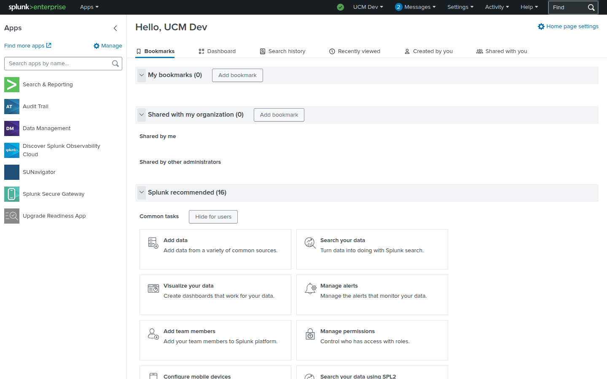
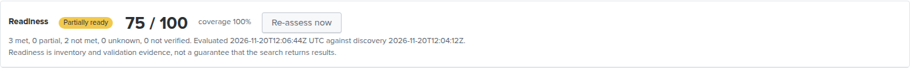
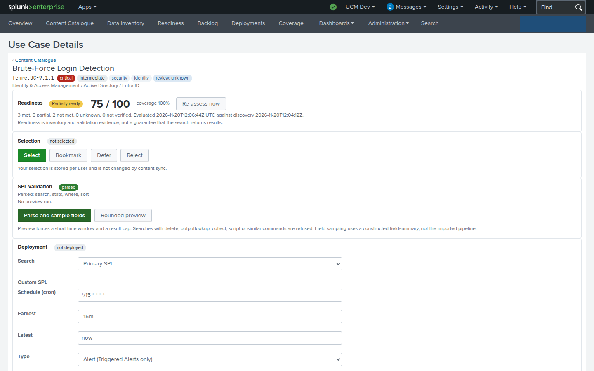
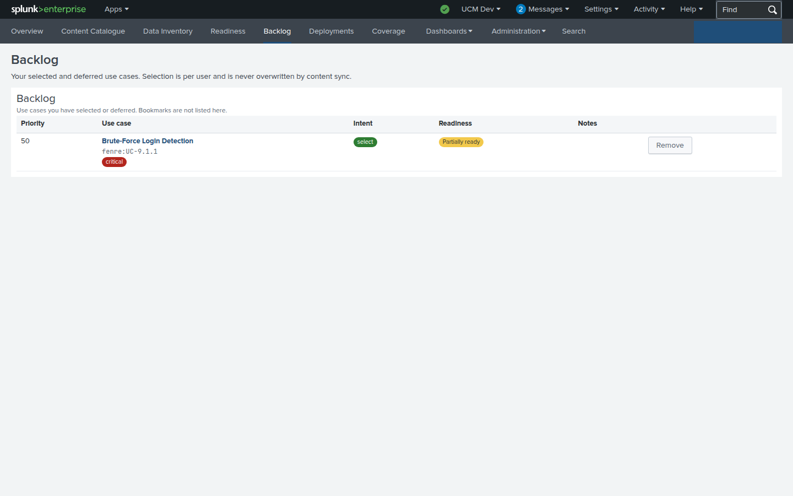
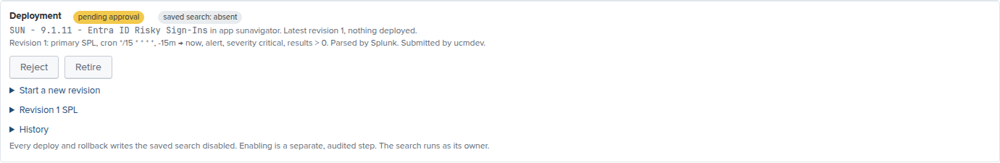
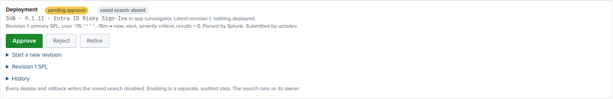
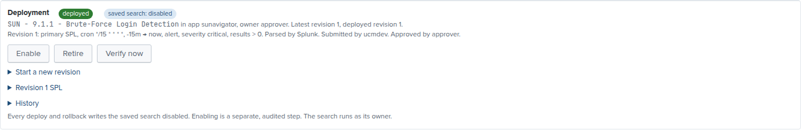
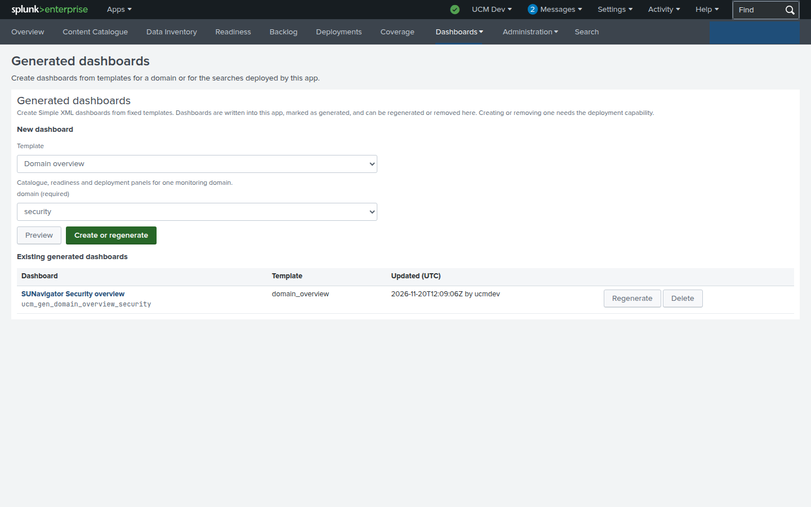

# SUNavigator 0.11.1 — operator guide

**SUNavigator** is a use-case navigator for Splunk Enterprise. It discovers, assesses,
selects, validates and deploys monitoring use cases.

This is the install, usage and troubleshooting guide for **SUNavigator
0.11.1**. It is written for a single Splunk Enterprise instance
(search head + indexer on one host), including a local macOS install. Search
head clusters with a deployer, Splunk Cloud and Splunk Enterprise Security are **not** validated and not planned
(no lab; D-078).

Related documents (design, not how-to):

| Document | Contents |
| --- | --- |
| [USER_GUIDE.md](USER_GUIDE.md) | Step-by-step use of every page with screenshots, by role |
| [FEATURE_STATUS.md](FEATURE_STATUS.md) | What works, what does not, what is planned |
| [README.md](../README.md) | Status, layout, packaging, tests |
| [ARCHITECTURE.md](ARCHITECTURE.md) | Components, KV collections, REST |
| [SECURITY.md](SECURITY.md) | Trust boundaries, roles, ACLs |
| [DECISIONS.md](DECISIONS.md) | Recorded product decisions |
| [IMPLEMENTATION_PLAN.md](IMPLEMENTATION_PLAN.md) | Work packages and validation status |
| [ISSUES_PENDING.md](ISSUES_PENDING.md) | Issues the code resolves, issues that stay open, drafts of new issues |

---

## What changed in 0.9.x to 0.11

### 0.11.1

0.11.1 fixes six defects (D-081). It adds no feature, no setting and no migration.

- **Redirects.** Outbound requests to a content provider (GitHub, or a custom provider host) used to follow a redirect
  without checking where it went. Each redirect is now checked against the same HTTPS-only rule and host allowlist, and
  a redirect to another host drops `Authorization`, `Cookie` and `Proxy-Authorization`, so the provider token is not
  sent to a host you did not list. A redirect to a host that is not allowed fails like any other refused URL.
- **Verify reports more drift.** Besides the earlier fields, Verify now compares the alert trigger (`alert_type`,
  `alert_comparator`, `alert_threshold`, `alert.track`, `alert.severity`), the email message and the results-link flag.
  After the upgrade, a search deployed earlier can show drift on one of these fields if it was edited in Settings. The
  report names the field and the expected and observed values. A revision that records no alert mode is not compared on
  the trigger.
- **Control tests.** The test index replaces the index of a search. A search with a clause that names no index (a
  subsearch, or `append` or `join` next to a scoped clause) used to run that clause on your default indexes; it is now
  `not_runnable`, with the reason. A few searches that ran before may therefore report `not_runnable` now.
- **Run search.** A search that returns no rows says so and the button is enabled again.
- **POA&M banner.** When the score reaches 0.8 of 110 but the system security plan (CA.L2-3.12.4) is not implemented,
  the banner is a warning and says the result is not a pass. The score response has `can_pass` and `blocked_by` in the
  programme block.
- **Name.** The description in `app.conf` and `app.manifest` no longer expands the name with a Splunk trademark; the
  export file header reads "Generated by SUNavigator (ucm.export/1)" and the HTTP user agent is `sunavigator/<version>`.
  `NOTICE` has the trademark notice.

### 0.11.0

0.11.0 closes gaps found in a review of 0.10.0 (D-080). It adds no feature. The upgrade runs one migration
(`0006_catalog_facets_v5`) that rebuilds the catalogue summary.

- **Search guard.** The guard in the browser now refuses a command it does not know, unless the server has validated the
  search and cleared it. If a search you expect to work is refused as "not on the read-only list", add the command to
  `extra_safe_commands` under `[spl]` only after checking that it cannot write, delete or send.
- **Approve with an access gap.** If the scheduler role cannot read an index the search uses, the request and the
  approval dialog say so. Approving anyway needs a reason; it is recorded as *approved with access gap*.
- **Overrides need a second person.** `[deployment] override_second_person = true` (default). Enabling a search that a
  gate blocks is requested by one person and confirmed by another. Set it to `false` if one person runs the app.
- **Refused requests are audited.** A refused governance request writes `refused.<route>` to the audit trail. Limits:
  the same request inside `refusal_window_seconds` (300) is written once; `refusal_actor_per_hour` (20) per user,
  `refusal_total_per_hour` (200) overall; the first request over a limit writes one `refused.rate_limited` row for the
  hour. `[audit] refusals = false` turns it off. The latest rows are on Content administration, under *Refused requests*.
  The verification of the chain does not treat them differently from other rows.
- **POA&M eligibility note (CMMC Level 2).** A plan item now says whether its control is one of the six that 32 CFR
  170.21(a)(2) keeps off a plan, is worth more than one point, or takes the score under 0.8 of 110, and shows the
  180-day closeout rule. It is information; it blocks nothing and is not a CMMC status.
- **Older records after an upgrade.** If the catalogue was imported by an older release, some records have no analytic
  stories or data sources. Content administration and the catalogue page count them. Reindex cannot add them: import the
  ESCU bundle again, or sync Fenre.
- **Score fields.** The CMMC score response has `all_assessed` and `can_pass`; `complete` is kept as an alias of
  `all_assessed`.
- **For the Fenre maintainer.** `python3 tools/fenre_report.py --fenre <checkout> --output <dir>` writes the findings
  about the Fenre content as one Markdown document and one CSV. A copy for Fenre `0e21f019` is in
  `docs/upstream/for-fenre-owner/`. The app files nothing upstream.
- **Still not built.** CMMC conditional status, objectives for 800-53 and CMMC, signed snapshots.

### 0.10.0

0.10.0 lets a person record whether a control is met (D-077). No migration is needed; three collections are created on
upgrade.

- **Who.** Give the user the role `ucm_compliance_assessor` (or `ucm_admin`). Without the capability `ucm_assess` the
  Coverage page shows no assessment at all.
- **Assess (Coverage, Control catalogues).** Each control has **Assess** or **Edit**. Choose a status and say why (the
  reason is required). The row shows the status, who and when are kept, and **History** lists earlier answers.
- **Per objective.** For SP 800-171 Rev. 3 the dialog lists the assessment objectives. Mark each met, not met or not
  applicable; the requirement's status follows from them (all met: implemented; a mix: partially implemented; none met: not implemented). Until every objective has a result it is flagged *incomplete* and shows at most *partially implemented*.
- **CMMC Level 2.** A new catalogue with the DoD methodology's score: 110 at best, -203 at worst. Anything not assessed
  counts as not implemented, so the score rises as you record work. *Best possible score* shows what is reachable. A plan
  of action does not lift the score. If 3.12.4 (system security plan) is not implemented the page says so.
- **Plan of action and milestones.** Add a plan item for a weakness with an owner, a due date and milestones. Start it,
  close it with a note, or accept the risk with a longer note. Overdue items are flagged.
- **Evidence snapshots.** **Take a snapshot** freezes the assessment, coverage and plan items with a SHA-256. Download
  checks that the stored copy still matches. Copy the SHA-256 into a ticket: that is what protects against someone
  rewriting the KV Store.
- **Older catalogue version.** After a catalogue update, assessments made on the previous version are marked; open each
  and confirm it still applies.
- **Still manual.** CMMC conditional status rules, objectives for 800-53 and CMMC, and signed snapshots are not built.

### 0.9.9

0.9.9 adds reference catalogues of whole standards, so controls that no use case covers are visible (D-076). No
migration is needed.

- **Control catalogues (Coverage).** Below the other frameworks you find NIST SP 800-53 Rev. 5.2.0, SP 800-171 Rev. 3
  and CSF 2.0. Each family opens to its controls and shows how many are mapped, data ready or enabled. Use **No mapped
  use case** to list the controls nothing covers, **Gaps** for those below *data ready*, and the search box to find one.
  Withdrawn controls are hidden unless a use case still maps to one (or you tick **Show withdrawn**).
- **Mapped is not met.** A use case mapped to a control is the content provider's mapping. It does not say the control is
  satisfied.
- **Clauses we cannot place.** If use cases map clauses that are not in the catalogue (usually another revision's
  numbering), they are listed separately and not counted.
- **Your own catalogue.** A content manager can import a `ucm.framework/2` file (Content administration, or
  `POST ucm/frameworks/import`). It needs `version_label` (text), `sort_key` (numbers) and the list of controls in tree
  order. See `docs/ARCHITECTURE.md`.

### 0.9.8

0.9.8 adds safer lifecycle steps and a way to prove the audit trail was not edited (D-075). No migration is needed.

- **Verify audit chain (Content administration).** Every audit row now links to the one before it. The button re-checks
  all of them and says how many rows are intact, edited, or missing a predecessor. Rows from before 0.9.8 show as
  *legacy*. Copy the *head* value into a ticket after each check: that is what lets you notice later that the newest rows
  were removed, which the check cannot see by itself.
- **Withdraw approval.** On an approved revision that is not deployed yet, **Withdraw approval** (reason of 5 characters or
  more) sends it back for review.
- **Request enable and confirm.** With `[deployment] enable_second_person = true`, *Enable* becomes **Request enable** and a
  second person presses **Confirm enable (asked by ...)** within 24 hours (`enable_request_hours`). Default off. Independently, `override_second_person` (default on, since 0.11.0) makes an
  override of a blocked search need the same request and confirmation.
- **Overrides expire.** An override to enable a blocked search lasts 14 days (`override_days`). Afterwards the use case
  shows a red box, and with `override_expiry_action = disable` the search is switched off by the worker.
- **Outcome.** On a deployed use case, set *Needs tuning* or *Waiting on data* with a note. The Deployments page counts them
  and filters by them. *Waiting on data* is the cue to check ingestion.
- **Pipeline (Deployments).** Draft, pending approval, approved, deployed, enabled, plus the needs-attention counts.
  Click one to filter.
- **Compare revisions (use case page).** Choose two revisions to see the changed settings and the SPL difference. Older
  revisions that were trimmed show only their hash.

### 0.9.7

0.9.7 helps with an environment that already runs detections, and makes coverage easier to read (D-074). After upgrading,
click **Reindex** in the catalogue (the data maturity facet needs it) and run discovery once.

- **Detections already running here (Data Inventory).** Discovery now lists the saved searches it can read in other apps
  (for example the ES Content Update) and proposes which catalogue use cases they implement: *same search text*, *same
  title and technique* or *same title only*. Review them at the bottom of Data Inventory. **Accept** marks the use case
  as *enabled elsewhere*; **Reject** hides it; **Reset** reopens it. Needs `ucm_run_discovery`. Only names and a hash
  are kept, never the search text. If a search is edited, its proposal is reset and says so. Turn it off with
  `[discovery] external_match = false`.
- **Enabled elsewhere is not "enabled".** Coverage shows it as a dashed outline on the technique, a card and a tag in the
  gap lists. The percentages and levels stay what SUNavigator deployed itself, because a search it did not deploy has no
  revision, approval or drift check. The use-case page says which searches are matched, to people who may manage discovery.
- **Graded coverage and gaps (Coverage).** Each technique gets a grade from its best use case: level (ready 0.25,
  deployed 0.5, enabled 0.9, ran without error 1.0) times how directly it maps (this technique 1.0, sub-technique 0.6,
  parent 0.4). Below the matrix, *Coverage gaps* lists techniques where data is ready but nothing is deployed, where
  content exists but data is missing, and where there is no content.
- **Data maturity (Catalogue).** A new facet: raw, normalized, enriched, correlated. It is SUNavigator's own scale
  (events only; reads a data model; also reads a lookup; reads Enterprise Security data or three or more sourcetypes).
- **Catalogue and use-case navigation.** A strip shows each provider's version, number of use cases and import date; a
  button copies a link to the current filters; an unmet requirement shows a hint and an **Open in Search** link with a
  bounded search for the missing source.

### 0.9.6

0.9.6 makes ESCU content more useful (D-073). Upgrade as usual; stored assessments are recomputed once.

- **A richer ESCU bundle (optional).** `build-escu-bundle` accepts `--security-content <checkout>`, a pinned checkout of
  <https://github.com/splunk/security_content> (needs PyYAML on the build machine only). The bundle then
  carries, per detection: the data sources with their sourcetypes, the supported add-ons (name, Splunkbase link,
  tested version), the event type each data source is told apart by (for example `eventName=DescribeImageScanFindings`),
  drilldowns, risk entities, links to attack data, ESCU's reference macro definitions, "how to implement", known
  false positives and the upstream status. Without the option the bundle is as before.
- **The use-case page** gains *Provider guidance* (status, supported add-ons, data sources, risk entities,
  drilldowns, test-data links) and a deprecation badge. Test data is never downloaded; the app shows the link only.
  The macro help shows ESCU's reference definition as a starting point.
- **Event-level data check.** Discovery now asks, for each event type the catalogue reads (most used first,
  `event_max_checks`, default 100), whether events of that type exist in the busiest index of that sourcetype in the last
  `freshness_days` (7 if 0). One bounded search each; only a count is stored. Readiness: seen is *met*; the sourcetype
  present but the event type not seen is *partial* with the reason "normal for a rare event; otherwise check the add-on's
  input settings"; the sourcetype absent is *unverified*. The requirement is *recommended*, so it lowers the score less than a
  required one. Settings: `[discovery] event_check`, `event_max_checks`, `event_timeout_seconds`, `event_budget_seconds`.
- **Fix: the field profile now runs.** In 0.9.4 and 0.9.5 the profiling search was refused by the app's own
  search guard, so fill and placeholder rates were never stored and readiness used the older sample rule. Run discovery
  once after upgrading.
- Records imported before this release have none of these fields; re-import an enriched bundle to get them.

### 0.9.5

0.9.5 acts on the owner's decisions (D-072). Upgrade as usual; stored assessments are recomputed once
(engine `ucm.readiness/6`).

- **An empty data model lowers the score.** A CIM data model that is installed but held no events at
  the last discovery makes its requirement *partial* (it was *met*). The use-case page and the
  recommendation reasons say to check data ingestion: sources sending, add-ons tagging events to the model,
  and the scheduled account's index access. Run discovery again after fixing ingestion.
- **Macro help.** A missing or app-scoped macro has a *How to create this macro* section. The app
  does not create macros.
- **Email and webhook alerts.** The person who drafts a deployment may choose an email and/or a webhook.
  The approver sees the recipients and the URL and must acknowledge them when approving. Nothing is sent
  until an administrator sets, in `ucm.conf`, the permitted destinations:

  ```
  [actions]
  email_domains = example.com, *.corp.example
  webhook_hosts = hooks.example.com
  ```

  Both lists are empty by default. Notifications need the Alert type and *Suppress repeats for*, never
  attach results, and are checked against the lists again at deploy, enable and rollback. A webhook URL is
  often a secret: the audit trail stores only its host, but the revision, the export and the saved search hold
  the full URL. Splunk's own mail server settings are outside the app; the saved search is written disabled
  and sends nothing until it is enabled.

### 0.9.4

0.9.4 separates "the content can run" from "the data was seen" (D-070). Upgrade as usual, then run
discovery once: the 30-day and future-date passes and the summary check run then. Readiness is
recomputed automatically (engine `ucm.readiness/5`).

- **Data seen.** Each use case has a data state next to its readiness state: *Data seen*, *Data
  partly seen*, *No data seen*, *Data not verified* or *No data requirement*. It is shown on the
  readiness table (filter "Data") and on the use-case page. It never changes the readiness state or
  score. A use case whose data state is *No data seen* is left out of Recommended next.
- **Freshness.** Discovery counts events per source over `[discovery] freshness_days` (default 30)
  and events stamped more than five minutes in the future. A source seen in that period but not in
  the discovery window reads as *stale* (not *not found*). Set `freshness_days = 0` to skip the
  extra searches.
- **Environment health** (Data Inventory, above the source list): the CIM add-on, data model
  summaries (*summary not built* means an accelerated model with events whose summary is empty, so
  `summariesonly=t` searches return nothing), CIM index macros with no index constraint, indexes
  without data, sources that stopped and future-dated sources, and sourcetypes no use case or
  mapping names. Each list shows 12 rows; the API returns up to 50.
- Field profile (D-070): discovery measures how often each required field is filled and holds a
  placeholder, over the last 24 hours per sourcetype. Readiness reads these rates; a sparse field is
  listed as missing data. Set `[discovery] field_profile = false` to turn it off. The bounds are the
  `profile_*` keys in `default/ucm.conf` (see `README/ucm.conf.spec`).
- Not in 0.9.4: the search-link drilldown (see D-070).

### 0.9.3

0.9.3 is an operational-health release (D-069). No collection, route or permission changes;
upgrade as usual.

- **Failing at dispatch.** A scheduled search that Splunk refuses before it runs (missing lookup,
  missing capability, unknown macro) writes an error line without a status. Run status used to
  show it as "no runs"; it is now **failing at dispatch** with the error quoted, on the
  Deployments page and in Coverage. Coverage's *operational* level needs a successful last run and
  no dispatch error after it.
- **Health advisories H001 to H004** (dispatch errors, skip ratio, slow p90 and slowest run against
  the cron interval), listed under the run status (§ Coverage, run status).
- **Schedule advice S001 to S005** on the use-case page when a draft is saved: every-minute cron
  (S001), a time window shorter than the interval, which leaves gaps (S002), a window longer than
  the interval without alert suppression, which can alert twice on the same events (S003),
  `latest=now`, which misses late events (S004), and a cron whose interval cannot be worked out
  (S005). Advice never blocks submit or approval.
- **Cron jitter.** A new draft that keeps the default cron `*/15 * * * *` gets a fixed minute
  offset derived from the use case (for example `7-59/15 * * * *`), so deployed searches do not
  all start in the same minute. Set `[deployment] cron_jitter = false` to keep the plain default.
  An explicit cron and existing revisions are never changed.

### 0.9.2

0.9.2 is a trust and correctness release (D-068). Upgrade as usual and restart Splunk (the
scheduler role changed).

- **SPL guard: side-effect commands at the start of a bracket.** Splunk runs the first word of
  `appendpipe [ ... ]`, of a subsearch, of a `map search="..."` string and of a search sent without
  `search` or `|` as a command when it is a command name. `appendpipe [ collect index=x ]` wrote
  events and `append [ outputlookup x.csv ]` emptied a lookup on Splunk 10.2.9, and both guards
  (server and browser) missed them. Both now classify that word as the command, so preview,
  submit, approval, deploy, enable and the interactive search refuse it. The Fenre and ESCU
  corpora (21,985 searches) classify exactly as before.
- **Scheduler role cannot write.** See *What the scheduler role may do* in §4. A deployed search
  that writes fails in Splunk even if the guard misses it. If the role was ever edited in Splunk
  Web, a local copy may still import `user`; §4 says how to check and clear it.
- **Data model acceleration is read correctly.** Discovery read acceleration from a place Splunk
  10.2.9 does not use, so every model showed as not accelerated and `summariesonly=t` searches
  were reported as `not_accelerated`. It now reads the listing's own flag and also records the
  summary range (`acceleration_earliest`). Run discovery once after the upgrade.
- **Paged lists return `next_offset`.** The catalogue, readiness and inventory lists cap a page
  at `[catalog] max_page_size` (100) and say so in `count`; `next_offset` is the offset of the next
  page (or `null`). A client that advanced by the requested size skipped rows.
- **Licence.** SUNavigator is Apache License 2.0 (`LICENSE`, `NOTICE`; D-071). `THIRD_PARTY_NOTICES.md`
  lists Fenre (MIT) and ESCU (Apache License 2.0). The files are in the repository and the package.
- Smaller: the `spl_hash` field is declared and indexed (the twin lookup no longer scans); code
  defaults for the deployment time range match `ucm.conf` (`-20m@m` to `-5m@m`).

### 0.9.1

0.9.1 adds a read-only hand-off to Enterprise Security (ES) and the ES Content Update app
(ESCU) and a populated check for CIM data models (D-067). It adds no collection, no route
and no schema change. After an upgrade, run discovery once so the data models get their
populated value; until then they read "populated: unverified (predates the check)".

- **Security content apps.** Content Administration → Platform has a row "security content
  apps": whether Enterprise Security and ESCU are installed, and their versions ("not
  installed" and "unverified (reason)" are different answers). It is read with the app's
  system session, so a user who cannot read other apps sees it too.
- **Shipped by ESCU.** An ESCU use-case page has a box "Shipped by ESCU" with the state of the
  saved search ESCU itself ships for that detection: enabled or disabled, its schedule and time
  range, and whether it has the notable and risk actions. With ES installed it says to enable the
  detection in ES Content Management, so ES manages it, and links to the ES app. With ESCU but
  without ES it says the shipped search is disabled (or enabled) and that SUN can deploy an
  independent copy. If the state cannot be read it says "unverified" and not "disabled".
- **Parallel-copy warning.** On the Deployment panel of an ESCU use case, when ESCU's search is
  already enabled or ES is installed, a note says that a SUN deployment is a separate plain
  scheduled search without ES actions, and that both would run. It does not block anything
  and changes no approval step; it is recorded on the draft revision and in the audit event.
- **Coverage.** "Enabled in ES" or "enabled in ESCU" is shown in that box only. It never counts
  as enabled in SUN coverage, which counts what SUN deployed.
- **Populated check for data models (issue #13).** Discovery runs, for each CIM data model it
  checks, `| tstats count from datamodel=<model> where earliest=-24h` and stores `populated:
  yes`, `no` or `unverified` with the model. It is shown as a separate chip on the CIM
  requirement, in the readiness explanation and in the Recommended next reasons. **A model
  that is installed stays "met" whatever the check says; scores and states do not change.**
  `[discovery] populated_check = false` switches it off. Details in §6.4.
- **Not validated:** everything that depends on ES being installed (the ES wording, the link,
  the warning with ES) was tested only with mocked app lists; the lab has ESCU and no ES.
  The Content Management link is built from the app id and its path varies by ES version
  (not planned; D-078).
- **Housekeeping.** The live macro-probe test removes its lookup. Reindex is still
  synchronous (issue draft in `docs/ISSUES_PENDING.md`). The build number is 13.

### 0.9.0

0.9.0 makes the catalogue easier to navigate now that it holds two providers (D-066). It
adds no collection and no setting. **After an upgrade, press Reindex once** (below).

- **Provider facet and badge.** Every catalogue row, use-case page and recommended card
  shows where the use case comes from (Fenre or ESCU). *Provider* is a facet like the
  others. When both providers are present, category names carry the provider
  (`ESCU · Endpoint`, `Fenre · 9. Identity & Access Management`); the category ids and the
  `?category=` links you may have saved are unchanged.
- **Find ESCU detections in Unassigned.** About half of ESCU is in the category
  *Unassigned*, which is a fixed ESCU list and says little. The new **Analytic story** and
  **Data source** facets (ESCU annotations) find them. Unassigned use cases stay listed.
- **Same detection in another provider.** When a Fenre and an ESCU use case have the same
  primary SPL (whitespace ignored), each page links the other ("Same detection in ESCU: ...")
  and says to deploy it once. A *twin* badge and the quality filter *twin in other
  provider* list them all. This only says the SPL text is identical; titles, schedules,
  severity and compliance mappings can differ.
- **Maturity wave and quality filters.** Filter by Fenre's rollout wave (crawl, walk, run).
  *Hide quality flag* leaves out use cases with a flag (for example *unreviewed* or *AI
  reviewer*) and is off by default. **Recommended next** has the same choice, a check box
  that is off by default.
- **Plan deployment.** On the use-case page the selection and deployment controls are one
  panel after the content sections, closed until you press **Plan deployment**. The
  selection, readiness and deployment state stay visible above the button. Nothing about
  who can do what changed.
- **Reindex button.** Content Administration → *Catalogue summaries* runs the reindex.

**Upgrading from 0.8.x.** The upgrade does not rewrite the catalogue by itself. Until you
reindex, the catalogue still works, the provider filter, *Hide quality flag*, the twin links
and every older filter are unaffected, but use cases summarised by an earlier version have
no wave, analytic story or data source: those three filters skip them, and an amber note on
the catalogue, Overview and Administration says "Reindex needed ... N of M". To fill them:
open **Content Administration**, press **Reindex catalogue summaries** (needs the
`ucm_content_manager` role), or run `POST /services/ucm/catalog/reindex`. It re-reads the
stored records without a download and changes no selection, readiness result or
deployment. It is synchronous and takes about 5 ms per use case (12 s for 2,359 documents;
about 4 minutes at 49,000). Running it twice gives the same result. The build number is 12.

**Navigation guide.**

| To find | Use |
| --- | --- |
| Everything from one source | *Provider* |
| ESCU detections for a threat or technique | *Analytic story*; type in the box above the list to narrow it |
| ESCU detections for a log source | *Data source* |
| Fenre content to roll out first | *Maturity wave* = crawl |
| Searches that exist in both providers | *Quality flag* = twin in other provider |
| Only reviewed content | *Hide quality flag* = unreviewed (and AI reviewer) |
| Use cases in the ESCU category *Unassigned* | *Category* (ESCU · Unassigned), or an analytic story |

## What changed in 0.8.x

The 0.8 line is a usability release. It adds no schema change and no new
collections. An upgrade from 0.7.3 keeps your data.

### 0.8.9

- **SPL lint (D-065).** Validation and the deployment card now point out SPL that
  Splunk accepts or rejects in a way that surprises: an eval function such as `match()`
  used as a search term (it never matches), `timechart ... by a, b` (Splunk rejects
  it), a wrong number of arguments, a regex ending in one backslash, and a time
  modifier such as `-6h@5m`. It is advice only: it changes no readiness score, no
  approval and no deployment gate (§6.2b).
- **The 50,000-row bound is shown (issue #14).** A catalogue total that reached the KV
  Store's row bound reads "50000 or more", and Administration warns when the catalogue
  is near it. `[catalog] kv_row_limit` (default 50000) tells the app the platform bound.
- **Documentation.** Offline bundles for content larger than 50 MB (§5.2), the edit
  rights that cause drift (§4, §6.6), and a rewritten list of known limitations (§12),
  each with its issue number.
- Validations stored before 0.8.9 have no lint result. The use-case page says so; press
  **Validate** again. No schema change, no migration. The build number is 11.

### 0.8.8

- **Control tests tell a broken search from a slow index (D-064).** A search that
  errors on the test data is now **content error** (Splunk's message and the phase,
  positive or negative, are shown). **Inconclusive** is kept for data that was not
  searchable in time, timeouts and transport failures. Results stored before 0.8.8
  show as they did; nothing is migrated.
- **The test window follows the sample.** It runs from one hour before the oldest
  event to one hour after the newest, read from the timestamps in the sample (ISO,
  splunkd, Windows, Snort, syslog and ctime formats; a time without a zone gets a day
  of padding). A sample whose events carry no readable time uses the old wide window.
  The card shows which was used.
- **The manifest's checks are applied.** `expected.max_count` and `expected.fields`
  (`name`, `values`, `min`, `max`, `regex`) are read and asserted on the positive run,
  and the card lists each field. Re-import your fixtures to get them (§6.6a); fixtures
  imported earlier keep working without them.
- **Fewer wrong refusals.** The index filter is rewritten only in search clauses, so
  `eval index=...` and quoted text are left alone, and a quoted `map` or `REST` no
  longer makes a search not runnable. Two refusals were added: a search that calls a
  macro, and the commands `typer`, `eventcount`, `walklex`, `metasearch`, `loadjob`,
  `history`, `audit` and `metadata`. Nothing that was refused is allowed now.
- **Sample events with blank lines stay one event** when the file starts with a
  timestamp (a Windows event with a multi-line message).
- **Administration shows why a sync failed.** The first error of a failed latest job,
  for example a commit that is not allowed, is shown above the history table.
- **Field sampling skips `_time`, `host`, `sourcetype` and the other fields every
  event has.**
- **All 94 Fenre fixtures were run on a lab without add-ons (issues #5 and #6).**
  12 passed, 67 failed, 15 were not runnable; nearly all failures are in the sample
  or the SPL, not in the app. The per-fixture table is
  [upstream/CONTROL_TEST_CAMPAIGN.md](upstream/CONTROL_TEST_CAMPAIGN.md) and the
  list for the content owner is [upstream/FENRE_FINDINGS.md](upstream/FENRE_FINDINGS.md).
  The script is `tools/controltest_campaign.py`.
- No schema change, no migration, no new capability, route or setting. The build
  number changed to 10.

### 0.8.7

- **The scheduler account's index access is checked (D-063).** Every use case with
  SPL now has a requirement "runs as <scheduler account>: index access". It reads the
  account's roles (own and imported, across all of its roles) and says **met**,
  **not met** or **not verified**, with a plain sentence. Why it matters: a search
  that runs as an account without access to its index does not fail. It runs, returns
  nothing and is logged as `success`. Read the rules in §4.1 ("Scheduler account and
  indexes").
- **Enable is gated when the account cannot read the data.** Deployment shows a
  warning when you submit, and **Enable** asks for an audited override reason
  (at least 10 characters, the same step as for a blocked readiness state) when the
  scheduler account cannot search an index the search reads. "Not verified" and a
  failed role read never block.
- **Overview card for the scheduler account:** owner configured, roles found,
  whether it can search internal indexes, and whether discovery scans them.
- **Internal indexes and `[discovery] include_internal`.** The default is `false`:
  discovery does not scan `_internal`, `_audit` and the like. A use case that needs
  one was shown as "index not defined"; it is now **not verified** ("internal indexes
  are not scanned") because the index exists and was simply not looked at. Scores of
  use cases that name only an internal index change accordingly. Setting
  `include_internal = true` makes discovery list them (without changing who can
  search them).
- **"Operational" is now "Ran without error (not a statement about data)".** It means the
  scheduler logged `status=success` for the search in the window, nothing more; a run
  that returned no events is a success. The state name in the API is unchanged.
- **Scheduled runs are proven as `ucm_scheduler` on the lab (issue #7).** A deployed
  search enabled with a one-minute schedule ran as the scheduler account
  (`scheduler.log`: `user=ucm_scheduler`, `status=success`) and kept its owner.
- **Settings > Searches (issue #9) is explained.** The page's default Owner filter is
  you; set Owner to **All** (§9.14). Not a defect.
- The readiness engine version moved to `ucm.readiness/4`: every stored assessment is
  recomputed by the next worker cycle (or press **Assess**). Role changes do not
  trigger this by themselves; assess again after changing the scheduler's role.
- No schema change, no migration, no new capability, route or setting. The build number
  changed to 9.

### 0.8.6

- **Nested SPL is checked.** A `map search="..."` string is analysed like the rest
  of the search: `collect`, `outputlookup`, `sendemail`, `delete` and the other
  side-effect commands inside it now make the whole search a side-effect search.
  Preview, submission and deployment refuse it, and so does **Run search**
  (D-062). No catalogue or ESCU record changes from allowed to refused.
- **Run search refuses SPL it cannot show.** `savedsearch`, `loadjob`,
  `dbxquery`, a `map` whose search cannot be read and a macro inside a `map`
  string keep the button disabled with a reason. `rest` and a clean `map` still
  only warn. Set `[interactive_search] enabled = false` in `local/ucm.conf` to
  switch the box off for everyone.
- **Selections are written only by the app.** KV write on `uc_selections` is now
  limited to `admin` and `sc_admin` (`metadata/default.meta`). The app's own
  bookmark, select, defer and reject buttons work as before for every role. If
  you changed this ACL in `local.meta`, your change wins. Read access is
  unchanged.
- **Better refusal text.** The preview no longer suggests `extra_safe_commands`
  for indirect commands such as `map`, which that list cannot allow.
- **Wording.** The package says Splunk Enterprise. Splunk Cloud is not validated
  (it passes AppInspect with the `cloud` tag; runtime has not been tested).
- No schema change, no migration, no new capability. The build number changed to 8.

### 0.8.5

- **Requirement results on Readiness.** Each row of the Readiness table shows
  the stored counts per requirement status (met, partial, not met, unknown, not
  verified, n/a) instead of the single "Not verified" number. They are the
  counts stored by the last assessment; nothing is recomputed. The use-case page
  prints the same counts in the same words (D-061).
- **Consistent wording.** "Not assessed" means no stored readiness result for a
  use case. "Not verified" means one requirement could not be checked yet; it is
  not the same as missing data. The Overview notice that said field and SPL checks
  arrive "in a later release" was out of date and has been replaced.
- **Documented, not changed.** `uc_selections` is app-shared metadata at KV level
  (OD-8, `docs/SECURITY.md`). No ACL changed in 0.8.5; 0.8.6 restricts KV write.
- No schema change.

### 0.8.4

- **Recommended next.** The Home page lists up to 10 use cases that look ready
  to adopt, with the reasons behind each (§6.0, D-060). Recommendations use
  stored readiness results, deployments and your own selections only; they
  select and deploy nothing. The route is `GET /services/ucm/readiness/recommendations`.
  No schema change.

### 0.8.3

- **Catalogue filters.** Every facet takes several values: domain, category
  (grouped under its domain), criticality, difficulty, review status, quality
  flag and regulation. The new **Availability** facet filters by the readiness
  state from the last assessment, plus *not assessed*. **Only my bookmarks**
  shows the use cases you bookmarked (a per-row **Bookmark** button sets it;
  other users' bookmarks are never included). Facet counts are for the whole
  catalogue, not for the other filters you have chosen (D-059). Filters are in
  the page URL, so a filtered view can be bookmarked or shared.
- **Key figures.** Overview, Readiness and Coverage show percentage cards. Each
  card states the figures it is made of and how it is calculated (§6.1, §6.4,
  §6.7).
- No schema change. On the first background run after the upgrade a migration
  recomputes the stored catalogue facets (new counts per domain, category,
  criticality and difficulty); until then the facet request computes them on
  demand.

### 0.8.2

- **Use-case page.** A summary (requirements, readiness, deployment, your
  selection) leads the page; requirements are grouped by status with the
  legend; actions that are not available say why (§6.2a).
- **Run this search.** Users who can already search in Splunk can run a use
  case's SPL from the page, as themselves and with their own permissions. This
  deliberately bypasses the server-side preview guard rails and cannot be
  audited by the app (D-058, `docs/SECURITY.md`). Review the notice on the
  page before using it, and tell users who should not run searches from this
  app that the control is their Splunk role: remove `search` from the role to
  switch it off.

### 0.8.1

- **Home page.** A new default landing view (`ucm_home`) shows where the
  deployment stands and the steps from content to monitoring (§6.0, D-057). The
  Overview dashboard is unchanged and still in the nav. The nav default moves
  from Overview to Home, which is a navigation change only.

### 0.8.0

- **Select all categories.** The category list on Content Administration has
  a header checkbox (tri-state), **Select all** and **Deselect all** buttons,
  and a count of selected categories. Selecting categories does not
  re-download records; **Re-download all records** stays a separate option
  (D-056).
- **Readiness terms are explained where they appear.** Column headers and
  status badges on the Readiness page and the use-case page carry a tooltip,
  and a collapsible legend lists every readiness state and requirement
  status. "Not verified" is described as not checked yet, never as missing
  data. The texts come from one glossary in `ucm_common.js`, and a unit test
  keeps its keys equal to the engine's states and statuses.
- **Browser cache.** Splunk serves app JavaScript and CSS with a one-year
  cache lifetime under a URL that contains the app build number
  (`app.conf [install] build`). The build number is raised whenever static
  files change, and the shared `ucm_common.js` is now requested under the same
  URL, so browsers load the new files after the upgrade. Restart Splunk after
  installing, because Splunk Web also caches static files on the server. If a
  page still looks unchanged, reload with the cache bypassed.

## 0. What changed in 0.7.3

0.7.3 makes readiness results trustworthy (no new features). An upgrade from
0.7.2 keeps your data; the worker re-derives catalogue summaries once
(migration `0002`). Existing readiness results show as stale
(`engine_upgraded`) until the next assessment: run **Re-assess** or discovery.

- **Fields the search creates are no longer reported missing.** A required
  field that the search itself produces (`eval`, `stats … as`, `rename`,
  `rex`, `spath output=`, `lookup … OUTPUT`, …) is shown as informational
  (`derived_in_spl`), is not sampled, and does not lower the score. A field
  the search reads before it produces it (`eval user=lower(user)`) is still a
  raw-data requirement (D-040).
- **Alternative sourcetypes.** `sourcetype=A OR sourcetype=B` and
  `sourcetype IN (A, B)` in one search clause form an "any of" group: the use
  case needs one of them. `join`, `append`, `multisearch` and subsearches
  still need every sourcetype (D-041).
- **Field sampling reads where the data is.** The sample covers the hour
  (`[validation] sample_window_minutes`) before the newest event discovery saw
  for each sourcetype, not the last 15 minutes, and only the requested fields.
  A window with no events leaves a field unverified (`sample_empty`) instead
  of absent (D-027).
- The app state now records the installed version after an upgrade that adds
  no migration (0.7.2 kept reporting 0.7.1).
- A readiness regression corpus (`tests/fixtures/readiness`) checks these
  cases on every change. On 0.7.2, 10 of its 11 ready cases were reported not
  ready; on 0.7.3 all 17 cases are classified correctly.

## 0.1 What changed in 0.7.2

0.7.2 fixes evidence integrity and trust boundaries (no new features). A clean
install is recommended; an upgrade within `sunavigator` keeps your data.

- **Search results are no longer cut at 100 rows.** Discovery, run status and
  field sampling used to stop at 100 rows and report the result as complete,
  so large environments showed sources as missing. Truncation is now explicit
  and shown in the inventory and coverage views (D-037). Re-run discovery
  after upgrading.
- **Validation and preview run in the `sunavigator` namespace**, like the
  deployed search. App-scoped macros resolve the same way in preview and in
  deployment. The app ships the Search app's no-op `comment(1)` macro, which
  many catalogue searches use (D-026).
- **SPL execution policy.** Preview also refuses commands that run other
  searches or reach outside the search (`map`, `savedsearch`, `loadjob`,
  `rest`, `dbxquery`) and commands outside SUN's read-only list. Approving such
  a deployment needs an explicit, audited acknowledgment. Side effects hidden
  in macros inside subsearches are now caught. Trusted read-only custom
  commands can be listed in `[spl] extra_safe_commands` (D-038).
- **Analysts can no longer write evidence directly.** `uc_readiness`,
  `uc_validation`, `uc_environment_sources`, `uc_source_mappings` and
  `uc_sync_state` are admin-write only; the REST API writes them after its
  capability check, and the worker rejects malformed jobs (D-039). Custom
  scripts that wrote these collections with a non-admin account must use
  the REST API instead.

## 0.2 What changed in 0.7.1

0.7.1 renames the application from **Splunk Use Case Manager** (0.7.0 and
earlier) to **SUNavigator**. The feature set is unchanged.

| Item | 0.7.0 and earlier | 0.7.1 |
| --- | --- | --- |
| Product name (UI, docs, manifest) | Splunk Use Case Manager | SUNavigator |
| App ID and folder | `splunk_use_case_manager` | `sunavigator` |
| Package file | `splunk_use_case_manager-0.7.0.tar.gz` | `sunavigator-0.7.1.tar.gz` |
| Deployed saved-search names | `UCM - <id> - <title>` | `SUN - <id> - <title>` |
| Generated dashboard labels and marker | "UCM … overview", "Generated by Splunk Use Case Manager" | "SUNavigator … overview", "Generated by SUNavigator" |
| App log file | `splunk_use_case_manager.log` | `sunavigator.log` |
| GitHub token realm | `splunk_use_case_manager` | `sunavigator` |

Internal identifiers keep the `ucm` prefix on purpose, so existing scripts and
documentation still work: `local/ucm.conf`, the `/services/ucm/...` REST
prefix, the `UCM_*` environment variables, the `splunk_ucm` Python package,
the `ucm_*` views and JavaScript, the `uc_*` KV collections and the
`ucm_gen_*` generated view names.

**Because the app ID changed, 0.7.1 is not an in-place upgrade of 0.7.0.**
Splunk treats `sunavigator` as a new app with its own KV collections, so the
catalogue, selections, deployments and audit trail of the old app are not
carried over. Follow §8, "Migrating from Splunk Use Case Manager 0.7.0".

**Screenshots in this guide** come from a lab instance (Splunk Enterprise
10.2.9 on Linux, SUNavigator 0.7.1, 20 Nov 2026). The lab had no real security
data, so the readiness scores come from synthetic sample events: 60
`WinEventLog:Security` lines and 40 `azure:aad:signin` JSON lines, loaded with
`splunk add oneshot` into the `main` index. The screenshots use two accounts:
an admin account that submits and browses, and an `approver` account with the
`ucm_deployment_operator` role that approves and deploys. Times in the app are
UTC.

## 1. What this version does

The app is a workflow around a monitoring-use-case catalogue (the first
provider is [Fenre](https://github.com/fenre/splunk-monitoring-use-cases)):

1. **Import** detections (GitHub sync or an offline JSON bundle).
2. **Discover** which indexes and sourcetypes exist on this Splunk instance.
3. **Score readiness** of each use case against that inventory.
4. **Select** use cases into a per-user backlog and **preview** SPL safely.
5. **Deploy** as a saved search that is always created **disabled**.
6. **Cover** MITRE ATT&CK (and regulation controls) from catalogue → running.

It never executes imported SPL as part of catalogue, discovery or coverage;
the one exception is the interactive search a user starts from the use-case page,
which runs as that user (§6.2a, D-058).
Preview and field sampling are explicit, bounded, and refuse side-effect
commands (`delete`, `outputlookup`, `collect`, script, and similar). Deployed
searches have **no script alert actions**. Email and webhook actions exist only when
an administrator has listed permitted destinations in `[actions]` and the approver has acknowledged
them (0.9.5, D-072); the default alert mode only writes to Splunk's Triggered Alerts.

**Not in 0.11.1:** PDF export of coverage, a bundled regulation-control
catalogue, SHC validation with a deployer and indexer peers, Splunk Cloud
vetting submission, and any Enterprise Security output mode (all three dropped for lack of a lab, D-078;
0.9.1 only reads ES and ESCU state and hands off, §5.2b).

---

## 2. Requirements

| Item | Requirement |
| --- | --- |
| Splunk | Enterprise 10.x (validated on 10.2.9 in development; tested by operators on 10.4.3 Darwin arm64). Python 3.9 or 3.13 in Splunk. |
| KV Store | Must reach `status: ready`. The app stores catalogue, inventory, readiness, selections, deployments and audit in KV collections. |
| Role | First-time setup needs `admin` (or `sc_admin` on Cloud). |
| Disk | The 0.11.1 package is a few megabytes. Category 9 of Fenre is about 120 records; the full Fenre corpus is tens of thousands of records. |
| Network | Optional. Remote sync needs HTTPS to `api.github.com` and `raw.githubusercontent.com`. Offline import needs none. |
| Browser | Splunk Web. The app is a set of Simple XML views plus JavaScript under `/en-US/app/sunavigator/`. |

Placeholders used below:

- `$SPLUNK_HOME` — on macOS typically `/Applications/splunk`; on Linux typically `/opt/splunk`.
- `$SPLUNK_USER` / `$SPLUNK_PASSWORD` — a Splunk admin. Never put the password in configuration files.

---

## 3. Install

### 3.1 Build the package (from this repository)

```bash
./tools/package.sh
# writes dist/sunavigator-0.11.1.tar.gz
```

The tarball has a single top-level folder `sunavigator/`
(`app.manifest`, `default/`, `bin/`, `lib/`, `appserver/`, `metadata/`).
`local/` and Python bytecode are excluded.

If you already have the `.tar.gz` from a GitHub release or a previous
packaging run, skip this step.

### 3.2 Install with the CLI (preferred)

Splunk Web's **Manage Apps → Install app from file** posts to
`/services/apps/local` and often **times out at 30 seconds**. The install
then fails in the UI with `500 Internal Server Error` even though splunkd is
still unpacking. Use the CLI:

```bash
$SPLUNK_HOME/bin/splunk install app /path/to/sunavigator-0.11.1.tar.gz \
  -auth "$SPLUNK_USER:$SPLUNK_PASSWORD"
# first install: omit -update
# upgrade of an existing copy:
$SPLUNK_HOME/bin/splunk install app /path/to/sunavigator-0.11.1.tar.gz \
  -update 1 -auth "$SPLUNK_USER:$SPLUNK_PASSWORD"

$SPLUNK_HOME/bin/splunk restart
```

Confirm:

```bash
$SPLUNK_HOME/bin/splunk display app sunavigator \
  -auth "$SPLUNK_USER:$SPLUNK_PASSWORD"
```

`state` should be `enabled`. Open Splunk Web → **Apps → SUNavigator**.

Passing the password in `-auth` shows it in the process list of the host. On a shared host, omit `-auth` and type the password when the command asks. An install through the REST endpoint (`/services/apps/local`) can also stay busy for several minutes on a slow host (seen on Splunk 10.4.3, macOS); the CLI does not have this problem.




### 3.3 Install from Splunk Web (only if the CLI is unavailable)

**Apps → Manage apps → Install app from file** → choose the `.tar.gz` →
check **Upgrade app** if a previous version is present → **Upload**.

If the page returns **500** / “format of the request is invalid” after ~30 s,
do **not** retry the upload blindly. Check whether the app folder already
exists:

```bash
ls "$SPLUNK_HOME/etc/apps/sunavigator/default/app.conf"
```

If it exists, finish with `splunk restart`. If it does not, use the CLI
install in §3.2.

### 3.4 Development copy (maintainers)

```bash
SPLUNK_HOME=/opt/splunk ./tools/dev_deploy.sh --restart
```

This rsyncs the app tree into `$SPLUNK_HOME/etc/apps/` and restarts Splunk.
It is not the supported path for a production or laptop evaluation.

### 3.5 After install, check KV Store **before** using the app

```bash
$SPLUNK_HOME/bin/splunk show kvstore-status -auth "$SPLUNK_USER:$SPLUNK_PASSWORD"
```

You need `status : ready` on **This member**. `starting` for more than a
couple of minutes means the app cannot read or write its collections; the
Administration page will show `kvstore/status: unavailable` and
`Synchronization state: KV get failed`. See §9.2.

### 3.6 Optional GitHub token

Public Fenre content can be fetched without a token until GitHub rate-limits
anonymous requests. A token is stored in Splunk's credential store (realm
`sunavigator`, name `github_token`), never in `ucm.conf`.

```bash
curl -k -u "$SPLUNK_USER:$SPLUNK_PASSWORD" \
  https://127.0.0.1:8089/servicesNS/nobody/sunavigator/storage/passwords \
  -d name=github_token -d realm=sunavigator \
  --data-urlencode password@-
```

Paste the token on stdin (or put it in a file and use `password@/path`). Do
not put the token on the process argument list.

---

## 4. Users and roles

The app adds capabilities and roles in `default/authorize.conf`. `admin` and
`sc_admin` already receive every app capability.

| Role | Typical job | Can |
| --- | --- | --- |
| `ucm_viewer` | Read-only analyst | Catalogue, inventory, readiness, coverage. Own backlog. Cannot sync, discover, validate or deploy. |
| `ucm_analyst` | Inventory + validation | Viewer plus discovery, local source mappings, readiness re-assess, SPL parse/preview/field sample, draft and submit a deployment. |
| `ucm_content_manager` | Catalogue owner | Analyst plus GitHub sync, offline import, reindex, provider manifest, framework import/activate, audit read. |
| `ucm_deployment_operator` | Deployer | Analyst plus approve/reject/deploy/enable/disable/rollback/retire, generated dashboards. |
| `ucm_scheduler` | Scheduled-search owner | No UI role. Owns every deployed saved search; see the setup step below (D-051). |
| `ucm_admin` | App admin | Content manager + deployment operator + `ucm_admin`. |

The discovery inventory (index and sourcetype names, counts, apps, data
models), readiness evidence and validation results are shared app metadata:
every user who can open the app sees them, regardless of their own index
permissions. Field values are never stored. To limit who sees them, narrow
the app's read permission to the `ucm_*` roles (docs/SECURITY.md, "Shared
environment metadata"; D-044).

**Four-eyes:** the user who **submits** a draft cannot **approve** it, unless
you change configuration (see §8). For a laptop with a single `admin`
account you either:

- create a second user with `ucm_deployment_operator` (recommended), or
- set `allow_self_approval = true` or `require_approval = false` in
  `local/ucm.conf` (lab only).

**Edit rights on deployed searches and drift (D-051).** Deployed searches are owned by
the scheduler account, and the app's own write path is the only one for the
operator roles. Three roles can still edit or delete a `SUN - …` search in Settings:
`admin`, `sc_admin` and `ucm_admin` (`metadata/default.meta`, `[savedsearches]`). That
is intended, and it is why `ucm_admin` is not a role to give to day-to-day
operators; give them `ucm_deployment_operator`. An edit made that way shows as
**drift** on the next **Verify now** (§6.6), for the settings listed in §6.6 step 7, and in the audit log of the app; the
app does not repair it by itself, and it does not say who made the edit. Splunk's own
audit (`index=_audit`) is the place to look. **Roll back** writes the previous revision
and sets the owner to the scheduler account again.

Create the second user in **Settings → Users → New User**. Assign
`ucm_deployment_operator` (it already imports `ucm_analyst` / `ucm_viewer`).
The built-in `user` role is included via `ucm_viewer`.

**Scheduled owner (required before any deploy).** Deployed searches run as
the account named in `[deployment] scheduled_owner` in `local/ucm.conf`, not
as the operator or an administrator (D-051). Create a dedicated account
(for example `sunavigator_scheduler`), assign it the `ucm_scheduler` role,
and set:

```
[deployment]
scheduled_owner = sunavigator_scheduler
```

After you edit `local/ucm.conf` by hand, run `POST /services/configs/conf-ucm/_reload` or restart Splunk; the app keeps the old values until then.

The app refuses deploy, enable, disable, rollback and retire until this is set
(the message names the setting). Searches run with that account's indexes,
so grant it read access to the indexes your use cases search. Operators have
no write access to the saved searches themselves: editing one in Splunk Web
returns 403, and so does deleting it.

**What the scheduler role may do (0.9.2, D-068).** `ucm_scheduler` no longer imports
`user`. It holds `search`, `schedule_search`, `get_metadata`, `input_file`,
`list_metrics_catalog` and `run_custom_command`, searches `*` (non-internal indexes) with
`main` as default, and has `run_collect` and `run_mcollect` disabled. It has no
`output_file`, `run_dump`, `run_sendalert` or `upload_lookup_files`. So a deployed search
that tries to write (`collect`, `outputlookup`, `outputcsv`, `sendalert`, `dump`) fails in
Splunk with "insufficient privileges", even if the app's SPL guard missed it. Splunk 10.2.9
does not let a role disable a capability it imports, which is why the role lists its
capabilities itself. If you added capabilities or indexes to `ucm_scheduler` through
`user`, add them to `ucm_scheduler` directly (Settings > Roles) after the upgrade.

A local copy of the role wins over the app's. If `ucm_scheduler` was ever edited in Splunk Web,
`etc/system/local/authorize.conf` may still say `importRoles = user`, and then the role keeps
every capability of `user`. Check with
`$SPLUNK_HOME/bin/splunk btool authorize list role_ucm_scheduler --debug`; if `importRoles`
comes from a `local` file, clear the inheritance (Settings > Roles > ucm_scheduler >
Inheritance: none, or `POST /services/authorization/roles/ucm_scheduler imported_roles=`).
This was the case on the development lab. Splunk's own `[default]` role stanza also gives every
role `edit_own_objects`, `list_all_objects` and `schedule_rtsearch`; none of them lets a
scheduled search write data.

**Scheduler account and indexes (0.8.7, D-063).** The account must be allowed to
search every index its searches read, or the search runs, returns nothing and is
logged as `success`. The app reads the account's roles and tells you:

- The Overview card shows the owner, its roles and whether it can search internal
  indexes. Each use case has a requirement "runs as <account>: index access".
- Rules (measured on Splunk 10.2.9): `*` matches **only non-internal** indexes;
  internal ones (`_internal`, `_audit`, `_introspection`, ...) need `_*` or the exact
  name. A pattern that starts with `*` (such as `*audit`) never matches an internal
  index. A disallowed index wins over an allowed one, across all of the account's roles.
  A search with no `index=` reads the account's **default** indexes: with an empty
  default list it sees nothing, and the built-in `user` role's default is `main`
  only. Imported roles count; the app reads them already resolved.
- `ucm_scheduler` holds `*` (before 0.9.2 through `user`, now directly) and cannot
  search `_internal` until you add `_internal` (or `_*`) to its **Indexes searched by
  default / allowed** in **Settings > Roles**. Many Fenre use cases in categories 13 and
  similar read `_internal`/`_audit`; ESCU searches mostly read data models.
- The result is **not met** (gap) when the SPL names an index the account cannot search.
  Submit shows a warning; **Enable** then needs an audited override reason (at least 10
  characters; same dialog as a blocked readiness state). It is **not verified**, and never
  blocks, when the search reads a data model, uses `tag=` or `eventtype=`, uses a macro
  that could not be expanded, searches `index=*`, runs `map`/`savedsearch`/`loadjob`, or
  when the roles cannot be read.
- A search filter (`srchFilter`) on the account's roles is reported in the explanation;
  the app does not evaluate it.
- After you change the role, press **Assess** on the use case (or **Re-assess all**) to
  refresh the stored result. Enable always reads the roles live.

Capabilities are enforced on every POST in `/services/ucm/...`. A viewer
receives HTTP 403 for sync, import, discovery, deploy, and so on.

---

## 5. First-run: load content

Open **Apps → SUNavigator → Administration** (view `ucm_content_admin`).

Expected empty state:

- **Fenre provider**: configured ref `main`, last good version `none`.
- **Platform**: `kvstore/status` **available**, plus green pills for remote
  sync, offline import, manage content, run discovery, index/app/datamodel
  listing. Remote sync's evidence says egress is verified only by an actual
  sync — green here does **not** prove GitHub is reachable.

A background worker (`ucm_sync_worker`) runs every **60 seconds** and
processes at most one job per tick (sync, then discovery, readiness,
deployment verify, maintenance). After you queue a job, wait up to a minute.


### 5.1 Remote sync from GitHub (needs outbound HTTPS)

1. Under **Remote synchronization**, leave **Version pin** empty to use
   `main`, or enter a branch or tag listed in `[provider:fenre]
   allowed_refs` (default `main` only), or a 40-character commit. A commit
   is accepted only if GitHub's compare API shows it is on an allowed
   branch or tag; anything else is refused before content is fetched
   (D-043).
2. Click **Check provider for categories**.
3. Tick the categories you want. **9** (Identity / Access) is a good first
   load (~120 use cases).
4. Leave **Re-download all records** and **Accept a provider schema
   major-version change** unchecked unless you know you need them.
5. Click **Synchronize selected categories**.
6. The job appears under **Synchronization and import history**:
   `queued` → `running` → `succeeded`.

On success, **Last good version**, **Last good commit** and **Selected
categories** fill in. Open **Content Catalogue** and confirm the count
matches **Added** on the job (for a first import of category 9, 120 added,
0 invalid is the expected result at Fenre 8.28.0 / commit `3b8024a8cf2e`).

The **Content audit trail** on this page is loaded once. Refresh the
browser if it still says “No audit events yet” after a successful job.

If **Check provider** fails (no egress, TLS intercept, GitHub 403/429), use
§5.2. The message will say previously imported content remains available.

### 5.2 Offline bundle import (air-gapped or no GitHub)

On a machine that has git and Python 3, with this repository checked out:

```bash
git clone https://github.com/fenre/splunk-monitoring-use-cases /tmp/fenre
python3 tools/ucm_cli.py validate --repo /tmp/fenre --categories 9
python3 tools/ucm_cli.py build-bundle --repo /tmp/fenre --categories 9 \
  --output /tmp/ucm_bundle_9.json
```

`validate` must report `"invalid": 0`. Copy the JSON to the Splunk host.

In **Administration → Offline import**, choose the file → **Import bundle**.
Every record is verified against its git blob hash and validated the same
way as a remote sync.

CLI equivalent (bundle must be `Content-Type: application/json`):

```bash
curl -k -u "$SPLUNK_USER:$SPLUNK_PASSWORD" \
  -H "Content-Type: application/json" \
  --data-binary @/tmp/ucm_bundle_9.json \
  https://127.0.0.1:8089/services/ucm/import
```

A bundle built with `--records` is marked **partial** and never withdraws
records it does not list. Default maximum size is 50 MB (`[import]
max_bundle_mb`, allowed range 1 to 500).

**A bundle over 50 MB (D-065).** The full Fenre corpus is about 193 MiB as JSON, and
category 25 alone is about 65 MB, so one file for everything is refused. Either raise
`max_bundle_mb` in `local/ucm.conf` and restart, or import several smaller bundles one
after the other. Bundle sizes per category on the 0e21f019 corpus (MiB, rounded):
10 is 32, 22 is 27, 5 is 9, 1 is 8, 4 is 8, 21 is 6, 3 is 5.5, 13 is 5, 24 is 3.5,
2, 17, 8, 14, 19 are 2 to 3 each, the rest 1 to 2, and 25 is 65. Whole categories can
be grouped with `--categories`; importing a category checks that category against the
file, so a record withdrawn upstream is withdrawn here:

```bash
python3 tools/ucm_cli.py build-bundle --repo /tmp/fenre --categories 10,1 --output /tmp/ucm_bundle_a.json    # 40 MiB
python3 tools/ucm_cli.py build-bundle --repo /tmp/fenre --categories 22,4 --output /tmp/ucm_bundle_b.json    # 35 MiB
python3 tools/ucm_cli.py build-bundle --repo /tmp/fenre --categories 5,3,13,21,24,2,6 \
  --output /tmp/ucm_bundle_c.json                                                                           # 32 MiB
python3 tools/ucm_cli.py build-bundle --repo /tmp/fenre \
  --categories 7,8,9,11,12,14,15,16,17,18,19,20,23 --output /tmp/ucm_bundle_d.json                           # 21 MiB
```

`tools/ucm_cli.py` cannot cut a single category into pieces by itself, but `--records`
can: list the record ids of category 25 and cut the list.

```bash
ls /tmp/fenre/content/cat-25-*/UC-25.*.json | sed 's#.*/UC-##; s#\.json$##' \
  | split -l 2200 - /tmp/ids25_
for f in /tmp/ids25_*; do
  python3 tools/ucm_cli.py build-bundle --repo /tmp/fenre --records "$(paste -sd, "$f")" \
    --output "$f.json"
done
```

The 6,431 records of category 25 give three files of 22 to 23 MB. These bundles are
partial, so they import without withdrawing anything; a category 25 record removed
upstream stays active until a remote sync or a full category import. Import the files
one by one (**Import bundle** or the `curl` call above); the order does not matter.
Checked by importing the three chunks in a test run: 6,431 records, 0 withdrawn.

If `python3` cannot import `splunk_ucm`, use Splunk's interpreter:

```bash
PYTHONPATH="$PWD/sunavigator/lib" \
  "$SPLUNK_HOME/bin/python3.13" tools/ucm_cli.py validate --repo /tmp/fenre --categories 9
```

### 5.2a Splunk ES Content Update (ESCU) detections (D-053)

ESCU is a second provider, `escu`, imported the same way (no remote sync).
Use the release package from the Splunk ES Content Update release (the
`DA-ESS-ContentUpdate` tarball or its extracted directory). Splunkbase requires
a login for anonymous downloads, so take the package from the release asset.

```bash
python3 tools/ucm_cli.py build-escu-bundle \
  --package /path/to/DA-ESS-ContentUpdate-latest.tar.gz --output /tmp/escu_bundle.json
curl -k -u "$SPLUNK_USER:$SPLUNK_PASSWORD" -H "Content-Type: application/json" \
  --data-binary @/tmp/escu_bundle.json https://127.0.0.1:8089/services/ucm/import
```

The CLI reports the record count, skipped counts and categories. Each
detection (`action.correlationsearch.metadata.detection_id`) becomes one use
case, `escu:UC-<detection id>`:

- Deprecated detections (`deprecated = 1`) and stanzas without a detection id
  are left out and counted. The build is deterministic; the same package gives
  the same bytes.
- Category comes from `action.notable.param.security_domain` (endpoint,
  network, threat, identity, access, audit). Detections without a notable
  domain go to **Unassigned**; in ESCU 6.11.1 that is about half the content.
- Analytic stories are tags; the first story is the subcategory. MITRE
  techniques become ATT&CK mappings (sub-technique or technique).
- Requirements come from the SPL (sourcetypes, indexes, data models, macros,
  lookups) with the same rules as the other provider. ESCU macros are defined
  in the ESCU app: install it, or the macro requirements stay unmet.
- A re-import of a newer release updates records whose content changed and
  withdraws detections that the new package no longer lists (within the ESCU
  provider only; Fenre records are untouched).

Installing the ESCU app itself is optional for the catalogue. It is needed for
the macro requirements, and when installed, discovery matches it by
Splunkbase id 3449 and package id `DA-ESS-ContentUpdate`. SUN deploys
ESCU detections as plain scheduled searches, not as ES correlation searches (§5.2b).

### 5.2b Enterprise Security and ESCU: read-only hand-off (D-067)

SUN is not an ES content manager. It never creates ES-managed content (correlation searches,
notable events, risk rules) and never writes into another app. Deployed searches stay plain
scheduled saved searches (§6.6). What 0.9.1 adds is a **read**:

- **Detection.** The app reads, with the handler's system token, whether `SplunkEnterpriseSecuritySuite`
  (ES) and `DA-ESS-ContentUpdate` (ESCU) are installed and which version. Content
  Administration shows it as "security content apps". A missing system session or a 403 shows
  "unverified (reason)", never "not installed". Results are cached for one minute.
- **The shipped search.** For an ESCU use case the page reads the saved search ESCU ships for the
  detection (`ESCU - <name> - Rule`, normally disabled) and shows its state, schedule, time
  range and whether it has notable and risk actions. It never shows the search text from the
  ESCU app. If the installed ESCU version has no such search (renamed or removed), the box says so.
- **What to do.** With ES installed: enable the detection in ES Content Management (link in
  the box; the path is built from the app id and varies by ES version, so it is not
  verified; in ES 8 the menu is Security content, then Content management). Without ES: the
  shipped search is a disabled stanza that nothing manages, and SUN can deploy an independent
  copy. The box never says that a SUN copy is an ES detection.
- **Parallel copies.** If ESCU's search is enabled, or ES is installed, deploying from SUN
  creates a second search next to it. The Deployment panel says so (non-blocking) and the
  draft revision records that the warning applied. Nothing about approval changed.
- **Coverage.** What is enabled in ES or ESCU never counts as enabled in SUN coverage.

**Validation status.** Checked on a lab with ESCU 6.11.1 and no ES: ESCU detection and version,
the real shipped state, schedule and actions, the stanza-not-found case, and the viewer's
view. **Everything with ES installed was tested only with mocked responses and is
unvalidated** (no ES lab): the ES version strings, the ES wording, the link, the warning with
ES. No ES validation is planned (D-078).

### 5.3 Scheduled sync

Default `[sync] schedule_interval_hours = 0` (off). To poll Fenre on a
timer, set the interval in `$SPLUNK_HOME/etc/apps/sunavigator/local/ucm.conf`
and restart, or reload the `ucm` stanza. Pin `ref` to a tag or SHA for
reproducible content; `main` moves. A pinned SHA must be reachable from a
name in `allowed_refs`; a pinned tag must itself be listed there.

---

## 6. Using the app

Work top-to-bottom in the left nav. Each step depends on the previous.

### 6.0 Home

Landing page (`ucm_home`, the app's default view since 0.8.1). It reads stored
state only and runs no search:

- **Where things stand**: catalogue size and last sync, last completed
  discovery, and readiness counts per state (each count links to the
  Readiness page filtered to that state). A failed request affects only its own
  card. "Results are older than the latest discovery" appears when the stored
  assessment was computed from an earlier discovery.
- **From content to monitoring**: the six steps (Get content, Discover, Assess,
  Choose, Validate and deploy, Monitor) with a link to the view for each. The
  highlighted "next step" is the first one with no stored result: no
  catalogue, then no completed discovery, then no assessment; after that,
  Choose. It is a pointer, not a check that earlier results are current.
- **Recommended next** (from 0.8.4): up to 10 use cases, each linking to its
  use-case page, with a "Why this use case" list. A use case is eligible when it
  has a stored readiness result of *ready* (or *partially ready* with no unmet
  critical requirement), is active in the catalogue, is not already deployed
  (enabled or not) and you have not rejected it. Your own rejects are the only
  ones used. Use cases you selected or deferred stay in the list and say so;
  nothing is boosted for that. A use case with a deployment draft in progress is
  listed and flagged. *Ready* use cases come before *partially ready* ones; inside
  each group the order is the draft score, then criticality, readiness score and
  use-case id.

  Draft score = 40% readiness score + 25% criticality (critical 100, high 75,
  medium 50, low 25) + 20% new MITRE coverage (the share of the use case's
  technique ids that no deployed use case covers) + 15% requirement coverage.
  These weights are a starting point, not measured; the page shows the four
  parts for every item. The reasons are built from stored fields only,
  including how many requirements are not verified yet. The statement about a data
  model comes from the stored result: "installed and populated in the last 24 h at
  discovery", "installed, but the discovery check found no events" or "definition
  installed (populated data not verified)". It never changes the score.

  If the list is empty the page says why: no catalogue, discovery not completed,
  not assessed, or no use case eligible (with counts of what was left out).
- **Explore by domain**: opens the Domain dashboard
  (`ucm_domain?form.domain=<domain>`) for each of the 13 domains, or all.
- **User guide**: a static placeholder that says the guide is in development,
  with links to the views and the topics of this guide.

### 6.1 Overview

Dashboard (`ucm_overview`, linked from Home and the nav). Counts and recent
sync jobs come from lookups over KV collections. Empty until content is
imported.

**Key figures** (from 0.8.3) at the top of the page:

| Card | Calculation |
| --- | --- |
| Assessed | Use cases with a stored readiness result ÷ active use cases in the catalogue. |
| Ready | Use cases in state *ready* ÷ assessed use cases. |
| Ready or partially ready | Use cases in state *ready* or *partially ready* ÷ assessed use cases. |
| Not ready, blocked or insufficient evidence | Assessed use cases that are neither of the above ÷ assessed use cases. |
| Deployed | Deployments whose workflow state is *deployed*; the card also shows how many are enabled in Splunk and how many deployments exist. |

Each card prints its own figures ("111 of 268 assessed") and calculation, so a
percentage never stands alone. A percentage needs a denominator: with nothing
assessed the card shows a dash, not 0%.

**Scheduler account card (0.8.7).** Below the key figures: the configured
`scheduled_owner`, the roles found for it, whether it can search internal indexes
(yes or no), the number of default indexes, and whether discovery scans internal
indexes. A note appears when the owner is not set, does not exist, cannot be read, or
cannot search `_internal`. The card does not list index names or patterns.


### 6.2 Content Catalogue

View `ucm_catalogue`. Server-side filter and paging (one page at a time;
default max 100 rows).

| Filter | Matches |
| --- | --- |
| Search | Case-insensitive substring on a precomputed field: id, title, sourcetypes, tags, MITRE ids and the first 1,500 characters of the description. All terms must match. |
| Domain, category, criticality, difficulty | Exact facets from the canonical model. Tick several values per facet: a use case matches when it has **any** of the ticked values of that facet, and all facets must match (AND between facets, OR within one). Categories are listed under their first domain. |
| Provider (0.9.0) | `fenre` or `escu`. A badge in the first column shows the provider of each row. When both providers are present the category names carry the provider; the ids are unchanged. |
| Maturity wave (0.9.0) | Fenre's rollout order: crawl, walk, run. ESCU use cases have no wave and never match. Needs Reindex after an upgrade from 0.8.x. |
| Analytic story, Data source (0.9.0) | ESCU annotations; use any of the ticked values. They are the way to find ESCU use cases in *Unassigned*. Lists with more than 12 values have a find box that only hides rows. Needs Reindex after an upgrade from 0.8.x. |
| Sourcetype (exact) | Exact sourcetype string. |
| MITRE ATT&CK ID | Technique id such as `T1110`. |
| Review status | Provider review status (for example `verified`, `draft`). |
| Regulation | Use cases mapped to any of the ticked regulations (for example FedRAMP). |
| Quality flag | Use cases carrying any of the ticked quality flags (below). |
| Hide quality flag (0.9.0) | The opposite: leaves out use cases that carry any of the ticked flags. Nothing is hidden unless you tick one. |
| Availability | Readiness state from the last assessment: *ready*, *partially ready*, *not ready*, *blocked*, *insufficient evidence*, or *not assessed* (no readiness result is stored for the use case). This is evidence from the data inventory, not proof that the data is populated (§6.4). |
| Only my bookmarks | Use cases you bookmarked. The server reads your own selections only; it never takes a user name from the page. A bookmark is one of your four selection intents (bookmark, select, defer, reject), and each use case has one intent per user, so **Select** on a bookmarked row replaces the bookmark. |

The number in brackets next to each value is the count for the **whole
catalogue**, not for the filters you already chose. The count in the result
header is for the current filters. Counts come from facets stored after every
sync, import and reindex (`GET /services/ucm/catalog/facets`) and from the
readiness summary.

Availability and bookmarks come from other collections than the catalogue, so
the server joins them by key. Up to `[catalog] max_join_keys` (default 2000)
keys go to the KV Store in one request; a larger set is filtered inside the app
instead. Both give the same result. If a filter would need more than about
50,000 catalogue rows the page asks you to narrow the other filters first.

The KV Store returns at most 50,000 rows per query (`limits.conf`, `[kvstore]
max_rows_per_query`). A total that reaches it is printed as "50000 or more" with a note
that it is a lower bound, and Administration shows a warning once the catalogue holds
90 percent of it (§12, issue #14).

Your filters are in the page URL (`?domain=security,identity&availability=ready`). The 0.9.0
parameters are `provider`, `wave`, `story`, `data_source` and `exclude_quality`; every
older URL keeps its meaning. A name that contains a comma has the comma shown as a space in the
story and data-source lists (a comma separates values in the URL).
Selected filters appear as removable chips above the table, with **Clear all
filters**.

Quality flags appear as amber badges next to the review status, in the
catalogue and on the use-case page (D-046):

| Badge | Meaning |
| --- | --- |
| unreviewed | No review status, or `draft`. |
| reviewer N/A | The provider recorded the reviewer as "N/A". |
| AI reviewer | The reviewer names an AI or automated agent (for example "agent-handcraft-…", "Cursor AI …", "AI-assisted review"). |
| SME review pending | At least one regulation mapping has `requires_sme_review`. |
| index=* | The primary SPL searches `index=*` or has no index constraint. |
| needs ES | Splunk Enterprise Security is listed as a premium app and not marked optional. |
| duplicate SPL | Another active use case has the same primary SPL (whitespace ignored). The use-case page lists them. |
| twin in other provider (0.9.0, blue) | An active use case from the other provider has the same primary SPL (whitespace ignored). The use-case page links it. |

Click a title (or open `/app/sunavigator/ucm_usecase?id=fenre:UC-9.1.1`)
for the use-case page (§6.2a): requirements, SPL (labelled untrusted),
MITRE and regulation mappings, add-ons, references, readiness, validation
and the **Deployment** card. Regulation rows link the clause (http/https
links only), flag "SME review required", and expand to the control
objective, evidence artifact and assurance rationale. **Scope and testing**
shows the crawl / walk / run wave, what is out of scope and the control
test (what should fire, what should stay quiet). **Dependencies** lists
equipment tags and the hardware note. Any other provider field is listed
verbatim under **Provenance → Other provider fields**.

**Select** on a row writes a per-user backlog intent. Sync never overwrites
another user's selections.


### 6.2a The use-case page and the interactive search

From 0.8.2 the page opens with a summary: **requirements → readiness →
deployment**, plus your own selection. Each tile links to its section, and the
Deployment tile states which readiness states block enabling.

- **Requirements and readiness.** Requirements are grouped by status (worst
  first; switch to level or no grouping) with the status legend. Column headers
  explain Level, Source, Confidence and Status. Readiness also records checks
  that are not requirements of the use case, for example whether the SPL has
  been parsed; they appear in the table as additional checks so that the
  counts in the summary add up.
- **Plan deployment (0.9.0).** The selection, review and deployment controls are in one
  panel after References, closed until you press **Plan deployment** (or follow the *Your
  selection* or *Plan deployment* jump link; a link ending in `#ucm-sec-deployment` opens it too). The status
  row above the button shows your selection, the readiness state, the deployment state,
  the live saved-search state, drift and "provider content changed" without opening it. The
  panel holds the same controls with the same permissions as before; it is a
  button with `aria-expanded`, reachable and operable from the keyboard.
- **Same detection in another provider (0.9.0).** When another provider has a use case with
  the same primary SPL, a box lists it ("Same detection in ESCU: <id>") with a link. It states
  the provider roles (ESCU: detection content source; Fenre: compliance and mapping context),
  that only the primary SPL is known to be identical, and that deploying both creates two
  saved searches. SPL identical inside the same provider keeps its own warning.
- **Shipped by ESCU (0.9.1).** On an ESCU use case, a box shows the state of the saved search
  ESCU ships for the detection and what to do (enable it in ES Content Management when ES is
  installed; deploy an independent copy when it is not), and the Deployment panel carries the
  parallel-copy note. Read-only; see §5.2b. A data model requirement also shows a
  "populated" chip (§6.4).
- **Deployment.** The buttons you can use are shown as before. A collapsed
  list, "Actions not available to you right now", gives the reason for each
  action that is not offered (for example "Needs an approved revision"). The
  reasons come from the documented workflow; the server decides what is
  allowed.
- **Run this search** (SPL section). It runs the SPL **as you, in your
  browser, through Splunk's own search API, with your own permissions**. It is
  not the bounded preview: no forced short window, no server-side result cap,
  no server-side command checks, and SUNavigator cannot audit it (Splunk
  records the search under your account). Details and limits (D-058):
  - Nothing runs until you click **Run search**.
  - Time range: last 15 minutes, 1 hour, 4 hours, 24 hours (default) or 7
    days. Time modifiers inside the SPL take precedence. The search is stopped
    after 120 seconds, when you click **Cancel**, or when you leave the page.
  - At most 100 rows are displayed; the message says how many results the job
    produced. Results are shown only in the page. They are not stored, not
    sent to the app and cannot be exported from here.
  - The button is disabled, with the reason shown, when the SPL contains a
    side-effect command (`outputlookup`, `collect`, `delete`, `fit … into`, …),
    also inside a `map search="..."` string, or when your role lacks the Splunk
    `search` capability. If the SPL uses macros, the button stays disabled until
    **Parse and sample fields** has parsed the current content: Splunk then
    expands the macros and the stored result shows whether a side-effect command
    is hidden in them.
  - It is also disabled for SPL that this page cannot show: `savedsearch`,
    `loadjob`, `dbxquery`, the `savedsearch:` dataset, a `map` whose search is
    not a readable quoted string, a macro inside a `map` string and `map`
    nested more than three levels (D-062). Run those in Search after reviewing
    the referenced search yourself. `rest`, `dbxlookup`, `dbxinputs` and a `map`
    with a readable, clean search only produce a warning.
  - An administrator can switch the box off with `[interactive_search] enabled
    = false` (`local/ucm.conf`); the page then shows a note.
  - For the primary search only; the CIM search and variants are offered
    when they have no macros.

### 6.2b SPL lint (D-065)

Validation (use-case page, **Validation** card) and **Save draft** / **Submit** (Deployment
card) run a lint over the SPL as well as Splunk's parser. It finds constructs Splunk
accepts or rejects in a way that is not what the author meant. It is **advice**: a
finding does not change a readiness score, a state, an approval or what can be deployed.
Splunk's parser, the SPL policy and the approval workflow decide as before.

| Rule | What it flags | Why |
| --- | --- | --- |
| L001 | An eval function (`match`, `like`, `cidrmatch`, `isnull`, `isnotnull`, `lower`, `upper`, `len`, `coalesce` and others) written in a search clause: `index=x match(_raw, "a")` or `... \| search match(...)`. | The `search` command does not evaluate eval functions. The term matches nothing, and inside `( ... OR ...)` it removes the rest of its group. Splunk gives no error. Rewrite it as `\| where match(...)`. |
| L002 | `timechart` or `sitimechart` with more than one `by` field (comma or space separated). | Splunk rejects it. Use `bin _time span=1h \| stats count by _time, a, b`, or one combined field. |
| L003 | `match`, `like` or `cidrmatch` with the wrong number of arguments in `where`, `eval` and the like (for example `match(x, "re", "i")`). | Splunk rejects it: "The arguments to the function are invalid". Put the flag in the regex, `(?i)`. |
| L004 | A regex string for `match` or `replace` that ends in a single backslash after eval unescaping (`"^.*\\"`). | Splunk rejects it: "Regex: \ at end of pattern". Write four backslashes. |
| L005 | A time modifier that snaps to a number of units (`-6h@5m`, `@w8`). | `tstats` rejects it, and a plain search selects nothing. Use `-6h@m` and bin with `span=5m`. |

Each finding shows the rule, the segment number and command, the text it found and a
suggested rewrite. **Dismiss** hides one finding on that page until it is loaded again;
nothing is stored. A finding inside a `map search="..."` string is marked as such. Quotes
and nested strings are read with the same tokenizer as the SPL policy, so
`where match(...)`, `eval x=match(...)` and `if(match(...), ...)` never raise a finding.

Limits: the rules cover constructs shown to be wrong on Splunk Enterprise 10.2.9 and
nothing else, so a clean result does not mean the SPL is correct. A macro is not
expanded, so a call inside a macro is not seen. The lint reads the SPL only; it does not
know your data. Validation results stored before 0.8.9 do not have a lint result;
press **Validate** again. To measure a content collection offline:

```bash
python3 tools/spl_lint_corpus.py --fenre /tmp/fenre --escu /tmp/DA-ESS-ContentUpdate
```

Over the Fenre `0e21f019` corpus the lint flags 141 of 19,771 searches (L001 80, L002 56,
L003 1, L004 3, L005 1) and none of the 2,214 ESCU detections. The lists, and why the
counts differ from the first estimate of 51 and 54, are in
`docs/upstream/SPL_LINT_CORPUS.md`.

### 6.3 Data Inventory

View `ucm_inventory`.

1. Optionally tick **Include internal indexes** (`_internal`, `_audit`, …).
   Default is off (`[discovery] include_internal = false`).
2. Click **Run discovery**. Needs `ucm_run_discovery`.
3. Wait for the worker (up to ~60 s). The job runs a **constructed
   `tstats`** over indexes from `/services/data/indexes`, with a relative
   time window (default `-7d` → `now`) and a pair cap (default 5000).
   Imported SPL is never searched.

When the job succeeds you see index/sourcetype pairs, event counts in the
window, and data age. Coverage cards compare catalogue requirement values
(sourcetype, index, datamodel, add-on) with what was found.

Add-ons are recognised as installed when an enabled app matches by folder
name, `[package] id` or label, or through the Splunkbase id the use case
cites. Splunk does not record Splunkbase ids in installed apps, so the app
ships a list of 32 ids it has checked against Splunkbase (D-048). Ids not on
the list fall back to name and label matching; a renamed or
custom-packaged add-on can be linked with a local `addon` mapping. The
use-case evidence shows which rule matched (`matched_by`).

**Source mappings** (same page): a **local** mapping (kind + value →
discovered source) is never overwritten by discovery. Auto matches are
medium/low confidence and are **not** used as readiness evidence. Only
analysts can create or delete local mappings; auto mappings cannot be
deleted.


### 6.4 Readiness

View `ucm_readiness`. After a successful discovery (and by default after
content sync), the worker auto-assesses every imported use case
(`[readiness] auto_assess = true`).

| State | Meaning |
| --- | --- |
| Ready | Score ≥ 90 (default), no unmet required/critical requirement, enough coverage. |
| Partially ready | Score ≥ 50, not ready. |
| Not ready | Below partial, or a required/critical miss. |
| Blocked | A **critical** requirement is unmet (veto). Enable of a deployed search in this state needs an audited override. |
| Insufficient evidence | Too little of the weighted requirements have a decided status (default min coverage 50%). |

From 0.8.3 the page opens with four percentage cards (assessed, ready, ready
or partially ready, and the rest), the same ones as on Overview. Each card
shows its figures and its calculation; percentages are of the *assessed* use
cases, except **Assessed**, which is of the active catalogue.

Click **Re-assess all** to queue a full run. Open a use case for per-
requirement evidence. Field presence and SPL parse results are filled in
only after you run validation on that use case (next section).

A sourcetype whose newest event is older than `[readiness] stale_hours`
(default 24) is treated as partial (stale), not fully met.

**Internal indexes (`[discovery] include_internal`).** Discovery does not scan
`_internal`, `_audit` and other `_` indexes unless `include_internal = true` (default
`false`). A requirement on an internal index is then **not verified** ("internal
indexes are not scanned"), not "index not defined" (0.8.7). A sourcetype that is not
found gets the same note. Set it to `true` in `local/ucm.conf` if you want those
indexes inventoried; that does not change who can search them. The scheduler
requirement ("runs as ...: index access", §4) is separate and does not depend on it.

**Data models: installed is not populated (issue #13, 0.9.1).** A CIM data model
requirement is **met** when the model's definition is installed (code `model_present`),
as before. Discovery now also checks, for the models it selects, whether the model holds
events: one `| tstats count from datamodel=<model> where earliest=-24h` per model, through
the discovery worker's system session, in the model's own app. The result is a separate
`populated` value, shown as a chip next to the requirement ("populated: yes", "no" or
"unverified"), in the readiness explanation and in the Recommended next reasons. It is never
part of the score: a model with `populated: no` is still met and the state is unchanged.

| Value | Meaning |
| --- | --- |
| `yes` | The search finished and counted events in the last 24 hours before discovery ran. |
| `no` | The search finished and counted none. Often the add-on is installed but the data is not CIM-tagged, or the model is not accelerated and its constraint matches nothing. |
| `unverified` | Not checked or not finished. The reason is shown: check switched off, model not referenced, cap reached, time budget used, timeout, search failed, search not available. Never read as `no`. |

Which models: those a catalogue requirement or one of your data model mappings names, then the
models of the CIM add-on (`Splunk_SA_CIM`), at most `[discovery] populated_max_models` (30);
the others are `unverified` ("not referenced"). Limits: `populated_timeout_seconds` (30) per
search (Splunk finalizes it; a finalized count of 0 is `unverified`, not `no`), a total budget of
half the discovery job timeout, and a stop after three failures in a row. `[discovery]
populated_check = false` switches it off (models are `unverified: check_disabled`). What it
does **not** say: that the fields a search needs exist, that acceleration is current, that the
sourcetype is tagged for the dataset you need, or what the data looks like now (it is the
state when discovery ran). On a non-accelerated model the search runs the model's constraint
search over 24 hours and can be slow, which is what the limits are for. Results from before
0.9.1 read `unverified` until discovery is run again.




### 6.5 Backlog

View `ucm_backlog`. Lists use cases **this user** selected or deferred.
Bookmarks are not listed here.

From a use-case page you can Select / Defer / Reject and add notes. From
the same page, with `ucm_run_discovery`:

- **Validate** — Splunk's search parser, in the `sunavigator` namespace, plus optional field sample
  (`fieldsummary` over discovered index/sourcetype pairs, not the imported
  pipeline). The sample reads the hour (`[validation] sample_window_minutes`)
  before the newest event discovery saw for each pair.
- **Preview** — dispatches the imported SPL only after a successful parse
  and a side-effect gate. Time range is forced to `[validation] earliest/latest`
  (default `-15m` → `now`) and `preview_max_events` (default 50). Event
  payloads are not stored.

Searches with `delete`, `outputlookup`, `collect`, `script` and similar
commands are refused, also when they sit inside the search string of a `map`
(since 0.8.6, D-062). So are searches with commands that run other searches or
reach data the SPL does not show (`map`, `savedsearch`, `loadjob`, `rest`,
`dbxquery`), and commands outside SUN's read-only list, such as MLTK `apply` or
an add-on's custom command. The validation panel lists them as "commands
needing review". Approving such a deployment needs an explicit acknowledgment,
which is audited. To trust a read-only custom command, add it to
`[spl] extra_safe_commands` in `local/ucm.conf` (decision D-038). The list
cannot allow `map`, `savedsearch`, `loadjob`, `rest` or `dbxquery`; the preview
refuses those whatever the list says, and the refusal message says so.





### 6.6 Deployments

View `ucm_deployments` lists every deployment. The workflow lives on the
**use-case page** (Deployment card).


State machine (D-029):

```
draft ──submit──▶ pending_approval ──approve──▶ approved ──deploy──▶ deployed
                         │
                         └──reject──▶ rejected
deployed ──enable/disable, rollback, retire, verify
failed after a deploy error; retry deploy from approved/failed
```

**Steps**

1. Open a use case that is at least partially ready (you *can* draft a
   blocked one; enabling it later will demand an override).
2. **Save draft** — choose primary / CIM / custom SPL, cron, time range,
   schedule window, alert mode (`track` = Triggered Alerts only, `none` =
   scheduled report), severity, threshold and, for alerts, optional
   suppression (period such as `1h`, optionally per field such as
   `user,src`). Splunk parses the SPL. Unparsable SPL cannot be submitted.
   New drafts default to `-20m@m` → `-5m@m` (15 minutes, ending 5 minutes
   ago so late events are counted) and schedule window `auto`. If the SPL
   sets `earliest`/`latest` itself, the card warns that it overrides the
   scheduled range.
3. **Submit for approval**.
4. A **different** user with `ucm_deploy` opens the same use case and
   clicks **Approve** (optional audit note) or **Reject**. The submitter
   does not see Approve while `allow_self_approval = false`. If the scheduler role cannot read an index
   the search uses, the dialog says so and Approve needs a reason (10 characters or more); it is recorded as
   *approved with access gap* (0.11.0).
5. **Deploy (disabled)** — creates or updates a saved search in this app,
   named `SUN - <record id> - <title>`, owned by `scheduled_owner`, **disabled**.
   The app reads it back and compares. Failure → `failed` plus `last_error`.
6. **Enable** — separate action. If readiness is in
   `block_enable_states` (default `blocked`), Splunk Web prompts for an
   override reason of at least 10 characters; the reason is audited.
7. **Verify now** — compare the live saved search with the frozen revision.
   The worker also verifies on `[deployment] verify_interval_minutes`
   (default 60). External edits show as **drift**. Anyone with `admin`, `sc_admin` or
   `ucm_admin` can make such an edit (§4); the app reports it and does not undo it.
   Drift covers the search text, owner, cron, time range, schedule window, suppression, the list of actions, email recipients, subject and attachment flags, the webhook URL, `is_scheduled` and `disabled`. Since 0.11.1 it also covers the alert trigger (`alert_type`, `alert_comparator`, `alert_threshold`, `alert.track`, `alert.severity`), the email message and the results-link flag (issue #48); the trigger is compared only for a revision that records an alert mode. After the upgrade, Verify can report new drift on a search deployed earlier, if its trigger or message was edited in Settings; the report names the field.
8. **Roll back** — writes the previous deployed revision, again disabled.
9. **Retire** — deletes the saved search from Splunk.

The screenshots below follow the steps above on `fenre:UC-9.1.11` and
`fenre:UC-9.1.1`:







The approved SPL is copied into the revision. Later Fenre updates only set
`content_changed`; they do not rewrite what was approved.

**Single-admin lab:** either approve as a second user (§4) or set in
`local/ucm.conf`:

```
[deployment]
require_approval = false
```

Then submit auto-approves (`approval: not_required`). Alternatively
`allow_self_approval = true` keeps an explicit Approve click but lets the
submitter do it. Restart Splunk (or reload `ucm`) after editing.

To confirm the deployed search, run this in **Search & Reporting** as an admin
account (the `rest` command requires it):

```
| rest /servicesNS/-/sunavigator/saved/searches splunk_server=local count=0
| search title="SUN - *"
| table title eai:acl.owner eai:acl.app disabled is_scheduled cron_schedule alert_type
```


The **Settings → Searches, reports, and alerts** page did not list these
searches in the lab, even for their owner. Use the REST search as the
reliable check (see §9.14).

**Export approved content (D-052).** The **Export deployed revisions** button on
the Deployments page downloads two files: `savedsearches.conf` (one disabled
stanza per use case that has a deployed revision) and
`savedsearches.manifest.json` (per entry: revision, approver and time, SHA-256
of the SPL, and the stanza hash; plus a `skipped` list with reasons). The same
stored records always produce the same bytes, so you can commit them to your
own repository and diff them in review. Retired, unapproved and never-deployed
use cases are not exported. Live state (enabled, drift) is not in the file.

Limits to know before you rely on the file:

- The file does not name an owner. Deployment through the app sets the owner to
  `scheduled_owner`; a search loaded from this file in a package is owned by
  `nobody` until someone reassigns it. Treat the file as the reviewed record, and
  keep deploying through the app.
- A SPL line that ends in a backslash cannot be written to a `.conf` file. Such
  a use case appears in `skipped`. Leading and trailing spaces on each SPL line
  are removed in the file (`whitespace_normalized` in the manifest says which
  entries changed); the SHA-256 in the manifest is of the exact stored SPL.

### 6.6a Control tests on deployed searches (D-054)

Control tests replay Fenre sample events through the search that is deployed, to
confirm that the search still fires on the event it is meant to catch. Use them
after a deploy or a content change; they do not change the deployment state.

1. Create the test index once on the Splunk instance (the app does not create
   indexes): `ucm_controltest` or the name in `[controltest] index`.
2. Build the fixtures from a checkout of the Fenre content:
   `python3 tools/ucm_cli.py build-control-fixtures --samples <fenre>/samples --output fixtures.json`.
3. Upload them as a content manager: `POST ucm/controltest/import` with the JSON
   file as body. The response gives the count and the batch hash. Importing
   again replaces the fixtures of that provider.
4. On a deployed use case, use **Run control test**. The card shows `passed`,
   `failed`, `content_error`, `inconclusive`, `not_runnable` or `no_fixture`, with the
   row counts, the search window, one line per field check and the revision that
   was run.

What the test does: sends the sample events to the test index with a per-run
marker, runs the deployed SPL with its index filter pointed at that marker, and
checks the rows against the manifest's `expected` block: at least `min_count` rows
and, if present, at most `max_count`, plus each `fields` entry (`values`: any of the
listed values appears; `min` and `max`: the numeric values are within the bounds;
`regex`: some value matches). The negative run must return no rows. Field checks apply
to the positive run only, and to what the search returns: a search that ends in
`table` returns only the tabled fields.

The window is derived from the timestamps in the sample (one hour either side); the
search's own `earliest` and `latest` terms are removed from the test copy because the
sample timestamps are fixed. A sample whose events carry no readable timestamp in
their first 128 characters is indexed at the current time, and the window is then
wide (`-10y` to `+1d`); a `timechart` over that window can fail with "too many rows"
(`content_error`).

Verdicts:

| Verdict | Meaning | What to do |
|---|---|---|
| `passed` | Rows and checks as the manifest says. | A pass can be weak: a `timechart` returns empty buckets and a `coalesce` default returns a row without any data selected. Add `fields` checks to such a sample. |
| `failed` | The search ran; rows or field checks do not match. | The search and the sample disagree; read the reason, find which is wrong. |
| `content_error` | Splunk reported an error running the search on the test data. | Fix the search (or the sample); the message is shown. It says nothing about access. |
| `inconclusive` | The events were not all searchable in time, the search timed out, or splunkd could not be reached. | Run it again; check the test index and splunkd. |
| `not_runnable` | The search was not run. | It cannot be scoped to the test index (see below) or has side effects. |
| `no_fixture` | No sample is imported for the use case. | Import fixtures. |

Searches that cannot be scoped are not run: `tstats`, `datamodel`, `from`, `rest`,
`mstats`, `map`, `savedsearch`, `loadjob` and similar commands that read data the
rewrite cannot redirect; a search that calls a macro; negated or listed index
filters; a search with no index in a search clause; and a search that filters on
`source=` (the marker is the event source). About 1 in 12 Fenre searches is in the
last group.

What it does not prove: alerting, suppression, the schedule, or that the sample
is realistic. A `failed` result means the search and the sample disagree; check
which one is wrong before changing either.

**Retention.** Events from every run stay in the test index. A full set of 94 samples
adds about 300 events. Set a short retention on the test index in `indexes.conf`
(`frozenTimePeriodInSecs`, for example 604800, and a `maxTotalDataSizeMB` cap), or
remove them with `| delete` on `source="ucm-ct-*"`, which needs the `can_delete` role;
the app never asks for it.

**Running all the samples at once** (lab use): `tools/controltest_campaign.py` runs every
fixture of a Fenre checkout without deploying anything and writes the verdicts as JSON
(`--delete` removes its events afterwards). See
[upstream/CONTROL_TEST_CAMPAIGN.md](upstream/CONTROL_TEST_CAMPAIGN.md).

### 6.7 Coverage

View `ucm_coverage`. Bundled frameworks: MITRE ATT&CK **Enterprise 20.1**
and **ICS 20.1**. Other versions can be imported as `ucm.framework/1` JSON
from Administration (content-manager capability) and activated.


Levels (filters at the top):

| Level | Meaning |
| --- | --- |
| In catalogue | At least one active use case maps to the technique. |
| Data ready | A mapped use case is readiness-ready. |
| Deployed | A mapped use case has a saved search. |
| Enabled | That search is enabled. |
| Ran without error (not a statement about data) | Scheduler log in `_internal` shows a run with `status=success` in the selected window. A run that returned no events is also a success, so this does not show the search saw data (D-063). |

Each percentage card states its figures and calculation (from 0.8.3):
techniques at that level ÷ techniques in the framework. Levels are
cumulative: a use case that is deployed or enabled also counts for *Data
ready*, whatever its readiness state is now, so the percentages never rise from
left to right.

Sub-technique mappings also count toward the parent. Revoked techniques are
remapped where the bundled STIX says so (for example T1562 → T1685).

**Run status** needs the caller to search `index=_internal sourcetype=scheduler`.
Most non-admin roles cannot. The UI then reports run status **not
available**, not “no runs”. Tick **Include run status** only if your role
can search `_internal`.

Run status values (0.9.3, D-069): **ran without error** (last run `success`), **no runs**
(enabled, nothing logged in the window), **unhealthy** (runs logged, none succeeded),
**failing at dispatch** (Splunk refused to start the search after its last run, for example a
missing lookup or a command the account may not run; such a search never writes a run line, so
it was shown as "no runs" before 0.9.3), **disabled** and **unknown**. Each deployed search can
also carry advisories, which never change the status:

| Code | Says |
| --- | --- |
| H001 | Splunk refused to start the search N times; the last error is quoted. |
| H002 | 20% or more of the runs were skipped; the last skip reason is quoted. |
| H003 | The 90th-percentile run time is longer than the interval between runs. |
| H004 | The longest run was longer than the interval between runs. |

Regulation controls have no bundled catalogue in 0.9.1; only controls that
appear on imported use cases are listed.

**Export ATT&CK Navigator layer** (next to the legend) downloads the matrix
as a Navigator layer (format 4.5) for the selected framework version and
domain filter. Each covered technique's score is its level (1 = in
catalogue … 4 = enabled, 5 = ran without error when run status is
included), with the same colours and a per-technique count comment. Open it
in [ATT&CK Navigator](https://mitre-attack.github.io/attack-navigator/)
with "Open existing layer" (D-050).

**Clauses and evidence (D-049).** Click a regulation under "Other frameworks
and regulations" to list its clauses in natural order (`A.5.9` before
`A.5.10`). A clause is marked **gap** when no mapped use case is data ready,
deployed or enabled; tick **Gaps only** to hide the rest. Click a clause for
its use cases with level, readiness (and whether it is stale), deployment
state and saved search, the mapping mode and assurance, "SME review
required", and the control objective, evidence artifact and rationale.

**Export evidence (CSV)** and **(JSON)** download one row per clause and use
case with those fields plus provenance (provider record, source ref, blob
SHA, normalizer version, import time). The pack is built only from KV state
and sorted, so the same catalogue, readiness and deployment state produces
the same file; the page shows its SHA-256. It has no generation time: the
`as_of` fields (JSON) are the latest discovery, readiness and import times
it contains. CSV cells starting with `=`, `+`, `-`, `@`, tab or carriage
return are prefixed with `'` so spreadsheets do not run them as formulas.
At most 5,000 use cases per regulation; narrow larger exports with
`clause=` on `GET /services/ucm/frameworks/evidence`.

### 6.8 Dashboards

**Dashboards → Domain** (`ucm_domain`) is a fixed Simple XML dashboard over
lookups (counts by domain, criticality, deployments).

**Dashboards → Generated dashboards** (`ucm_dashboards`): pick a template,
set allowlisted parameters (for example a domain), **Preview**, then
**Create or regenerate**. Needs `ucm_deploy`. Views are written into this
app with a generation marker (`ucm_gen_…`) and listed under the Dashboards
collection. Delete only from this page (the app refuses to overwrite
unmarked views).

Imported SPL never appears in a generated dashboard. Values are escaped.




---

## 7. Configuration

Override defaults in:

```
$SPLUNK_HOME/etc/apps/sunavigator/local/ucm.conf
```

Never edit `default/ucm.conf` on an installed instance (upgrades overwrite
it). Full keys: `sunavigator/README/ucm.conf.spec`.

Reload after edits:

```bash
$SPLUNK_HOME/bin/splunk restart
# or, for the ucm stanza only, the app declares reload.ucm = simple
```

Common stanzas:

| Stanza / key | Default | When to change |
| --- | --- | --- |
| `[provider:fenre] ref` | `main` | Pin a tag or commit for reproducible sync. |
| `[provider:fenre] allowed_refs` | `main` | Branches and tags (`*` wildcard) a sync may use; commits must be reachable from a listed name. |
| `[provider:fenre] remote_sync_enabled` | `true` | `false` on air-gapped stacks; offline import still works. |
| `[provider:fenre] proxy_url` / `ca_bundle` | empty | Corporate HTTPS proxy or custom CA. |
| `[sync] schedule_interval_hours` | `0` | Periodic Fenre pull. |
| `[sync] max_invalid_ratio` | `0.2` | Category is not updated if more than this share of records fail validation. |
| `[discovery] earliest` | `-7d` | Inventory window. |
| `[discovery] populated_check` | `true` | `false` stops the per-model populated search (§6.4). `populated_max_models` (30) and `populated_timeout_seconds` (30) bound it. |
| `[readiness] ready_threshold` | `90` | What “Ready” means. |
| `[readiness] stale_hours` | `24` | When discovered data is treated as stale. |
| `[deployment] require_approval` | `true` | `false` skips four-eyes (submit auto-approves). |
| `[deployment] allow_self_approval` | `false` | Submitter may click Approve. |
| `[deployment] block_enable_states` | `blocked` | Readiness states that need an enable override. |
| `[deployment] enable_second_person` | `false` | `true` makes every *Enable* a request that a second person confirms. |
| `[deployment] override_second_person` | `true` | Enabling a search that a gate blocks (readiness or scheduler access) needs a second person. `false` for a one-person team (0.11.0, D-080). |
| `[audit] refusals` | `true` | Write refused governance requests to the audit trail. Limits: `refusal_window_seconds` (300), `refusal_actor_per_hour` (20), `refusal_total_per_hour` (200). |
| `[deployment] default_earliest` / `default_latest` | `-20m@m` / `-5m@m` | Time range proposed for new drafts. |
| `[deployment] default_schedule_window` | `auto` | Schedule window proposed for new drafts (`auto` or 0–1440 minutes). |
| `[catalog] kv_row_limit` | `50000` | Set to the same value as the platform's `max_rows_per_query` if you raised it, so totals and the warning follow it (issue #14). |
| `[import] max_bundle_mb` | `50` | Offline bundle size cap, 1 to 500; see §5.2 for splitting instead. |
| `[retention] audit_days` | `365` | `0` keeps audit forever. Also indexed in `_internal` via the app log. |
| `[controltest] index` | `ucm_controltest` | Test index for control tests (§6.6a). Must exist. |

The worker interval is 60 seconds (`default/inputs.conf`). Do not disable
`ucm_sync_worker://default` unless you intend to stop all background jobs
(sync, discovery, readiness, deploy verify, migrations, retention).

---

## 8. Upgrade and uninstall

### Migrating from Splunk Use Case Manager 0.7.0

0.7.1 has a new app ID (`sunavigator`), so it cannot be installed over
`splunk_use_case_manager`. Remove the old app and install SUNavigator as a new
app. Do the steps in this order:

1. **Retire the old deployments** while the old app still runs. On its
   Deployments page, retire every deployment. Then confirm that no `UCM - …`
   saved searches are left:

   ```
   | rest /servicesNS/-/splunk_use_case_manager/saved/searches splunk_server=local count=0
   | search title="UCM - *"
   ```

   The query should return no rows. A `UCM - …` search left behind keeps
   running after the app is removed, under its owner.
2. **Record what you need.** Selections (Backlog), notes, deployment history
   and the audit trail are stored in the old app's KV collections. They are
   **not** migrated, and removing the app deletes them.
3. **Remove the old app**, then restart:

   ```bash
   $SPLUNK_HOME/bin/splunk remove app splunk_use_case_manager \
     -auth "$SPLUNK_USER:$SPLUNK_PASSWORD"
   $SPLUNK_HOME/bin/splunk restart
   ```

4. **Install SUNavigator 0.11.1** as in §3.2. The first install omits
   `-update`, because `sunavigator` is a new app ID.
5. **Re-create the GitHub token** if you use one (§3.6). It must be stored in
   realm `sunavigator`. The 0.7.0 token in realm `splunk_use_case_manager` is
   not used any more. Delete it if you no longer need it, for example with
   `DELETE /servicesNS/nobody/splunk_use_case_manager/storage/passwords/<realm>:github_token:`.
6. **Load content again** (§5), then run discovery and readiness (§6.3–6.4).
   Readiness is computed from the imported content and the discovered data, so
   the same content and the same data give the same scores.
7. **Re-deploy** the use cases you still need through the approval workflow
   (§6.6). New saved searches are named `SUN - …`.

### Upgrade within 0.7.1 and later

```bash
$SPLUNK_HOME/bin/splunk install app /path/to/sunavigator-<new>.tar.gz \
  -update 1 -auth "$SPLUNK_USER:$SPLUNK_PASSWORD"
$SPLUNK_HOME/bin/splunk restart
```

`local/` is kept. Within one worker interval the maintenance worker applies
pending migrations and records the version in KV (`uc_sync_state` key `app::state`).
Since 0.9.0 a new catalogue summary version is **not** applied by an upgrade; the
catalogue shows a "Reindex needed" note until you press **Reindex catalogue summaries**
in Content Administration (see *What changed in 0.9.x*).

**Downgrades are not supported.** Splunk drops KV collection data for
fields the older `collections.conf` does not define.

### Uninstall

```bash
$SPLUNK_HOME/bin/splunk remove app sunavigator \
  -auth "$SPLUNK_USER:$SPLUNK_PASSWORD"
$SPLUNK_HOME/bin/splunk restart
```

This removes the app directory. KV collections for a removed app are
dropped. Deployed saved searches live in this app, so they disappear with
it. Retire deployments first if you need a clean saved-search list.

Do **not** run `splunk clean kvstore` to “fix” this app. That wipes **all**
KV data on the instance (other apps included).

---

## 9. Troubleshooting

Times in Splunk logs are often UTC. Convert to the host timezone when
comparing with the UI (Administration timestamps are labelled UTC).

### 9.1 Splunk Web 500 while uploading the `.tar.gz`

**Symptom:** Manage Apps → Install from file → Internal Server Error /
“format of the request is invalid” after about 30 seconds.

**Cause:** Splunk Web's HTTP client times out talking to splunkd
`POST /services/apps/local`. Common on first install when the archive is
unpacked slowly.

**Fix:** Install with the CLI (§3.2). Confirm
`$SPLUNK_HOME/etc/apps/sunavigator` exists, then `splunk restart`.

**Check:**

```
index=_internal source=*python.log* OR sourcetype=splunkd_ui_access \
  /services/apps/local
```

A `read timeout` to splunkd on that POST is this issue, not a corrupt
tarball.

### 9.2 Administration: `kvstore/status: unavailable` / `KV get failed`

**Symptom:** Platform pill red/amber; Synchronization state error
`storage_error`. Catalogue empty even after a “successful” install.

**Cause:** KV Store is not `ready`. On macOS this is often **not** a Splunk
app bug. `mongod.log` shows:

```
SSL peer certificate validation failed; connection rejected
Certificate trust failure: CSSMERR_TP_CERT_SUSPENDED
```

Splunk 10 on Darwin uses the Keychain and OCSP (`ocspEnabled=true` on the
mongod command line). Apple's trust evaluation can reject
`CN=SplunkServerDefaultCert` (SplunkCommonCA) as suspended. `show
kvstore-status` then stays at `status : starting` while
`replicationStatus : KV store captain`.

**Fix (local / lab macOS):** disable OCSP for KV Store.

```bash
grep -n "^\[kvstore\]" "$SPLUNK_HOME/etc/system/local/server.conf" \
  || echo "no [kvstore] stanza"

# If no stanza:
printf '\n[kvstore]\nocspValidation = false\n' >> \
  "$SPLUNK_HOME/etc/system/local/server.conf"

$SPLUNK_HOME/bin/splunk restart
sleep 60
$SPLUNK_HOME/bin/splunk show kvstore-status \
  -auth "$SPLUNK_USER:$SPLUNK_PASSWORD"
```

You want `status : ready`. `btool` may print nothing for `ocsp` on some
builds; trust `show kvstore-status`, not the grep.

A restart may also log `New certs have been generated in
'$SPLUNK_HOME/etc/auth'`. That is Splunk regenerating default TLS material,
not the app.

**Do not** run `splunk clean kvstore --local` for this error. It does not
fix certificate trust and destroys KV data.

**If it is still `starting` after two minutes:**

```bash
tail -50 "$SPLUNK_HOME/var/log/splunk/mongod.log"
grep -i kvstore "$SPLUNK_HOME/var/log/splunk/splunkd.log" | tail -40
```

On Linux, `CSSMERR_*` does not apply. Then look for disk full, port 8191
in use, or `disabled = true` under `[kvstore]`.

**Optional inspection of the macOS cert** (does not replace the OCSP
setting):

```bash
security find-certificate -a -c SplunkServerDefaultCert -p \
  | openssl x509 -noout -subject -serial -dates
security dump-trust-settings
```

A Keychain trust override of “Never trust” will keep breaking mongod even
with OCSP off.

### 9.3 Sync job stays `queued`

**Cause:** worker disabled, not captain (SHC), or the previous job is still
running (`max_jobs_per_run = 1`).

**Fix:**

```bash
$SPLUNK_HOME/bin/splunk btool inputs list ucm_sync_worker --debug
# interval = 60, disabled = 0

tail -50 "$SPLUNK_HOME/var/log/splunk/sunavigator.log"
```

On a search head cluster only the captain runs jobs (validated on a local
three-member cluster, D-055; deployer and indexer peers are not validated and not planned, D-078). On a single
instance `standalone = 1` is expected.

### 9.4 Provider could not be reached

**Typical causes:** no outbound HTTPS, GitHub rate limit (no token), TLS
intercept without `ca_bundle`, proxy required, `remote_sync_enabled = false`.

**Fix:** set a GitHub token (§3.6); or set `proxy_url` / `ca_bundle` under
`[provider:fenre]`; or use offline import (§5.2). Confirm:

```bash
python3 tools/ucm_cli.py manifest
# uses UCM_GITHUB_TOKEN from the environment if set
```

### 9.5 Import / sync `invalid` records or category skipped

A category whose invalid ratio exceeds `[sync] max_invalid_ratio` (0.2) is
not written; last-known-good stays in place. Inspect the job **Errors**
column and the audit trail. Re-run with a smaller category set. Schema
major-version changes are refused unless **Accept a provider schema
major-version change** is ticked.

### 9.6 Catalogue empty after a succeeded job

Hard-refresh the catalogue view. Confirm the job **Added** count. Check KV:

```bash
curl -k -u "$SPLUNK_USER:$SPLUNK_PASSWORD" \
  "https://127.0.0.1:8089/servicesNS/nobody/sunavigator/storage/collections/data/uc_catalog?limit=1"
```

If this 404s, collections did not load — restart Splunk after install. If
it 503s, KV Store is not ready (§9.2).

### 9.7 Discovery succeeded but almost everything is Not ready

Expected on a lab with Windows-centric Fenre category 9 and little matching
data. Readiness is evidence against **this** instance. Example: 1 ready /
1 partial / 118 not ready with missing `WinEventLog:Security` is consistent
when that sourcetype is absent.

**Include internal indexes** only if you want `_internal` pairs in the
inventory; they rarely satisfy Fenre Windows/Azure requirements.

Add **local source mappings** when a catalogue sourcetype name does not
match yours (for example CIM-normalized names). Auto mappings are not
readiness evidence.

If **Data Inventory** shows "The last discovery hit its result limit", the
run found more index/sourcetype pairs than `[discovery] max_pairs`
(default 5000). Pairs beyond the limit are not in the inventory, and that run
marked nothing missing. Raise `max_pairs` (at most 20000) in
`local/ucm.conf`, or narrow the window, and run discovery again. Fields
shown as `sample_truncated`, `sample_failed` or `sample_empty` are
unverified, not absent. `sample_empty` means the sampled window held no
events: run discovery again so the newest event time is current, then
**Validate**.

### 9.8 No Approve button on a pending deployment

You are logged in as the submitter and `allow_self_approval` is false. Sign
in as another user with `ucm_deploy` (§4, §6.6), or change the lab settings
in §6.6.

If **neither** Approve nor Reject appears, the account lacks `ucm_deploy`
(`admin` has it; `ucm_analyst` does not).

### 9.9 Deploy fails / saved search `absent`

Read **Last error** on the deployment card. Common causes: SPL failed
re-parse, side-effect commands, review commands the approver did not acknowledge
(`unacknowledged_commands`: start a new revision), `scheduled_owner` not set
(§4, "Scheduled owner"), or the
search name colliding with an unmanaged search.

Only searches carrying the app's marker are updated. An operator-created
search of the same name that the app did not write is treated as
`unmanaged`.

### 9.10 Enable blocked

Readiness is in `block_enable_states` (default `blocked`). Enter an
override reason (≥ 10 characters) when prompted, or fix the unmet critical
requirement and re-assess first.

Also blocked (0.8.7): the scheduler account cannot search an index the saved search
reads. The message says which index and which roles. Either give the account's role
the index (§4, "Scheduler account and indexes") and enable again, or enter an override
reason (≥ 10 characters) to enable a search you accept will run without that data.

Since 0.11.0 an override needs a second person by default (`[deployment] override_second_person`): the first
person's *Enable* becomes a request, a different person confirms it with a reason within 24 hours, and the
same person gets `second_person_required`. Set the key to `false` if one person runs the app.

### 9.11 Coverage run status “not available”

The role cannot search `index=_internal`. Use an admin account, grant
`indexes._internal`, or ignore run status. This is intentional (D-031):
the app never discloses scheduler data the user could not search themselves.

"The scheduler log result was truncated" means more than 5000 managed
searches had scheduler rows in the window. Searches without a row are shown
as `unknown` rather than "no runs". Pick a shorter window.

### 9.12 App looks installed but nav is missing

```bash
$SPLUNK_HOME/bin/splunk display app sunavigator \
  -auth "$SPLUNK_USER:$SPLUNK_PASSWORD"
```

If `visible` is 0, enable it in Manage Apps. Clear the browser cache /
bump `?bust=` by restarting Splunk so `appserver/static` JS is re-fetched.

### 9.13 Old `splunk_use_case_manager` app still listed after the migration

**Symptom:** both **Splunk Use Case Manager** and **SUNavigator** appear in
Apps, or `UCM - …` searches still run.

**Cause:** the 0.7.0 app was not removed. The two apps do not share data, but
both run background workers and both can own saved searches.

**Fix:** follow §8, "Migrating from Splunk Use Case Manager 0.7.0", from step 1.
Then confirm that the old app is gone from **Apps → Manage apps**, and re-run
the REST search in step 1.

### 9.14 Settings → Searches does not list `SUN - …` searches

**Symptom:** a deployment shows **deployed** and **saved search disabled** in
SUNavigator, but **Settings → Searches, reports, and alerts** does not list it,
even when filtered to the `sunavigator` app.

**Cause (issue #9, found in 0.8.7; not a defect in SUNavigator):** the Settings page
filters by **Owner**, and its default is the signed-in user. Splunk Web sends
`search=(eai:acl.owner="<you>") AND (eai:acl.app="sunavigator")`. Deployed searches are
owned by `[deployment] scheduled_owner` (`ucm_scheduler`), so they are hidden until the
filter is changed. This was captured on the 10.2.9 lab with a disabled search owned by
`ucm_scheduler`, sharing `app`, in app `sunavigator`. Before 0.7.3 (D-051) the owner was the
approver, so the same filter hid them from everyone else.

**Fix:** on the page, open the **Owner** drop-down and choose **All** (or the scheduler
account) and the App filter **SUNavigator**; the search is listed. The REST search in
§6.6 and the Deployments page remain the source of truth. If REST also returns nothing,
check **Deployments → Verify now** for drift or a missing search, and see §9.9.

### 9.15 Logs to collect

| File | What |
| --- | --- |
| `$SPLUNK_HOME/var/log/splunk/sunavigator.log` | App JSON log (sync, discovery, deploy, audit echo). Indexed in `_internal`. |
| `$SPLUNK_HOME/var/log/splunk/splunkd.log` | KV Store / MongodRunner, REST. |
| `$SPLUNK_HOME/var/log/splunk/mongod.log` | KV Store TLS and replica-set errors. |
| `$SPLUNK_HOME/var/log/splunk/web_service.log` | Splunk Web 500s, upload timeouts. |

SPL:

```
index=_internal source=*sunavigator.log
index=_internal sourcetype=splunkd kvstore OR MongodRunner
```

REST smoke (replace path):

```bash
curl -k -u "$SPLUNK_USER:$SPLUNK_PASSWORD" \
  "https://127.0.0.1:8089/services/ucm/platform"
curl -k -u "$SPLUNK_USER:$SPLUNK_PASSWORD" \
  "https://127.0.0.1:8089/services/ucm/sync"
```

Errors look like `{"error":{"code":"...","message":"...","details":{...}}}`.

---

## 10. REST (optional)

Base path: `/services/ucm/...` (also `/splunkd/__raw/services/ucm/...` from
Splunk Web). `Content-Type: application/json` is required on POST.

Examples:

```bash
# Catalogue page
curl -k -u "$SPLUNK_USER:$SPLUNK_PASSWORD" \
  "https://127.0.0.1:8089/services/ucm/catalog?category=9&count=25"

# ESCU use cases of one analytic story, leaving out the unreviewed ones
# (the new filters combine like the others)
curl -k -u "$SPLUNK_USER:$SPLUNK_PASSWORD" \
  "https://127.0.0.1:8089/services/ucm/catalog?provider=escu&story=Data%20Exfiltration&exclude_quality=unreviewed"

# Queue discovery
curl -k -u "$SPLUNK_USER:$SPLUNK_PASSWORD" \
  -H "Content-Type: application/json" \
  -d '{"include_internal":false}' \
  https://127.0.0.1:8089/services/ucm/discovery

# Deploy workflow (second user)
curl -k -u "approver:$SPLUNK_PASSWORD" \
  -H "Content-Type: application/json" \
  -d '{"id":"fenre:UC-9.3.16","note":"lab approval"}' \
  https://127.0.0.1:8089/services/ucm/deployment/approve
```

Full table: [ARCHITECTURE.md §6](ARCHITECTURE.md).

---

## 11. Security reminders for operators

- Upstream Fenre JSON is untrusted. The app size-caps, schema-validates and
  git-blob-verifies it. Do not paste it into saved searches by hand.
- Deployed searches run as their **owner**, the scheduler account
  (`[deployment] scheduled_owner`, D-051), not the operator who clicked Deploy.
  Treat that account as you would any scheduled-search owner and keep its role
  narrow.
- Alert actions come only from an approved revision (email and webhook, D-072). If you add or change
  one in Settings afterwards, the next **Verify** reports drift.
- GitHub tokens belong in `storage/passwords` only.
- Audit records older than `[retention] audit_days` (365) are purged. The
  same events are in `sunavigator.log` / `_internal`.

---

## 12. Known limitations (0.11.1)

Each item says where to read more and ends with its tracking: an issue number on GitHub, a draft
(`N-nn`) in `docs/ISSUES_PENDING.md` that has not been filed yet, or "no issue" for a limit that is
by design.

**Platform validation**

- Search head clustering was validated on a local three-member cluster without a
  deployer and without indexer peers (D-055). Deployer, peers and rolling restarts
  are untested, and no further validation is planned: there is no lab (D-078, issue #2 dropped). Earlier builds ran
  captain-only jobs on every member (fixed, D-055); upgrade if you run an SHC.
- Splunk Cloud is unvalidated (managed `limits.conf`, no file access, vetting) and not planned: no lab
  (D-078, issue #3 dropped).
- Splunk Enterprise Security 8 output (findings or risk instead of Triggered Alerts)
  is not implemented and not planned (D-078, issues #4 and #27 dropped). ESCU is supported as a content source
  (§5.2a). Since 0.9.1 the app reads whether ES and ESCU are installed and the state of ESCU's
  shipped search, and hands off to ES Content Management (§5.2b). **Everything with ES
  installed is unvalidated**: it was tested with mocked responses only. SUN deploys ESCU
  detections as plain scheduled searches, never as ES correlation searches, and a SUN copy
  can run next to an enabled ESCU or ES copy (the Deployment panel warns). Validating the
  ES-present behaviour is not planned (D-078).

**Counts and bounds**

- The KV Store returns at most 50,000 rows per query (`max_rows_per_query`). The
  catalogue total is shown as "50000 or more" at that point and Administration warns
  at 90 percent; filters that join readiness or bookmarks refuse above it. Raising it
  means changing `limits.conf` and `[catalog] kv_row_limit` together. Readiness,
  inventory and coverage counts are not yet marked when they reach the bound; the
  catalogue is the only place that is, and the join scan is not paged (issue #14, #24, §6.2).
- Catalogue facet counts are global, not recalculated for the other active filters
  (D-059). The bookmark, availability and regulation filters join by `_key` up to
  `[catalog] max_join_keys` (2000) and otherwise scan up to 49,999 rows. No issue: by design.
  Facet values are capped (top 600 stored) and a facet name with a comma loses it (#26).
- Twin links compare the primary SPL after whitespace is normalised, so a search rewritten
  with the same meaning is not linked, and a link does not prove the records are otherwise
  equal (D-066). Wave, analytic-story and data-source filters need Reindex after an upgrade
  from 0.8.x; Reindex is synchronous (about 5 ms per use case) and blocks one REST call
  (#25). Twin comparison is by design (no issue).
- Free-text search is a substring match over a precomputed field (no ranking, only
  the first 1,500 characters of the description). Coverage is computed on read (about
  0.5 s at 20,000 use cases). No issue: by design.

**Readiness evidence**

- Requirements derived from SPL are lexical hypotheses, not proof the search will
  fire. Regulations show only the controls present on imported records. No issue: by design.
- A CIM data model counts as met when its definition is installed. Since 0.9.1 discovery also
  records whether the model held events in the last 24 hours (`populated`: yes, no or
  unverified, §6.4); it is shown beside the requirement and never changes a score or state.
  It does not check fields, acceleration freshness or CIM tagging, and it is a snapshot from
  the last discovery. Models nothing references, models beyond the cap and models whose search
  timed out are `unverified`. Whether a `no` should ever lower a score is an open product
  decision (issue #13 stays open for it and for the field checks).
- **Scheduler index access (0.8.7, D-063):** the check reads index access only. It does
  not evaluate search filters (`srchFilter`), time-window limits or quotas, and it
  cannot see inside macros, data models, tags, event types, `index=*`, `map`,
  `savedsearch` or `loadjob`; those are reported as not verified, never as met. A role
  change does not mark stored assessments stale: press **Assess**. Reading roles on an
  SHC or on Splunk Cloud has not been validated and is not planned (D-078; #17 is open, #18 dropped).
- Discovery scans internal indexes only with `[discovery] include_internal = true`
  (§6.4); until then requirements on internal indexes stay `unverified` (#19).
- Recommended next (D-060) is an ordering heuristic with starting weights that are
  not calibrated. MITRE gain compares technique ids exactly (a sub-technique does not
  credit its parent). It claims no data or CIM population. No issue: by design.

**SPL checks**

- The SPL lint (§6.2b) is advice and covers five rules shown wrong on 10.2.9. It does
  not expand macros. A clean result is not proof of correct SPL. More rules only with evidence from the lab
  (#29).
- The use-case page "Run search" runs in your browser with your own permissions and
  outside the server-side guard rails and audit (issue #11). It refuses SPL it cannot
  show (§6.2a); `[interactive_search] enabled = false` removes it. A user without the
  `search` capability sees the button disabled; that case is covered by unit tests, not
  by a lab check (issue #15). Required mitigations of issue #11 are implemented (D-058, D-062); what
  remains is the accepted residual risk of no SUN audit.
- Since 0.11.0 the browser guard refuses a command that is in none of its lists unless the server has validated the
  search and cleared it; it is a convenience in front of Splunk's role checks, not a boundary (D-080).
- The SPL guard reads the first word of a bracket as a command only when it is a known
  side-effect, indirect or generating command (and always inside `appendpipe [ ... ]`). An
  add-on command written first in an `append`, `join` or `union` subsearch is read as a search
  term. The scheduler role cannot write (§4), so such a command cannot write from a deployed
  search; in a preview it runs with your own rights (D-068). No issue: residual by design.

**Deployments**

- Refused governance requests are audited under limits (§7, D-080). A refused attempt is evidence of an
  attempt only; once a limit is reached, further refusals in that hour are not recorded individually.
- The POA&M eligibility note for CMMC Level 2 (32 CFR 170.21) is information. The app has no conditional
  status, no 180-day clock and no closeout record (D-079, D-080). No issue: by design.
- Default four-eyes blocks a single `admin` from approving their own draft (§4). No issue: by design.
- `admin`, `sc_admin` and `ucm_admin` can edit deployed searches in Settings; the
  app reports drift and does not repair it (§4, D-051). The scheduler account must
  hold `ucm_scheduler`; removing it orphans its searches. No issue: by design.
- "Ran without error" on Coverage and Deployments means `status=success` in
  `scheduler.log`. A search whose account cannot read its index also reports success; the access
  check (§6.4) is the way to find that. No issue.
- A retired deployment can keep a stale `live_status` of `disabled`. Coverage and
  recommendations use `deployed_revision`, not that field. No issue.
- Settings → Searches lists only your own searches by default; set Owner to All to see
  `SUN - …` searches (§9.14). Explained, not a defect (issue #9).
- No "Add Macro" action exists; macros are listed by name. This is a product decision
  that is still open: issue #10.

**Control tests (§6.6a)**

- The campaign ran all 94 fixtures against the SPL on the lab, but only 2 use cases
  were deployed and tested through the app. 8 of the 94 searches cannot be scoped (they
  filter on `source=`, call a lookup that needs the customer's data, or read data the
  rewrite cannot redirect). 12 searches use `match()` as a search term and never match
  whatever the data (a Fenre content defect, F-03 in `docs/upstream/FENRE_FINDINGS.md`;
  the SPL lint now flags it). A pass on a `timechart` or on `coalesce` defaults is weak.
  Test-index events are not removed by the app. Tracking: issues #5 and #6 are resolved by
  the 0.8.8 campaign; what is left is #20 (upstream report), #21 (`source=` searches), #22 (weak passes) and #23 (re-run
  with add-ons). Email and webhook actions are built in 0.9.5 (D-072; issue #28 is closed).

**Access control**

- Every role that can use the app can read all users' `uc_selections` rows through
  the KV Store REST API (D-061, D-062). Since 0.8.6 only `admin` and `sc_admin` can
  write them directly; the app's API writes the caller's own rows. Do not put anything
  sensitive in selection notes. The decision to document the read access instead of
  restricting it is recorded (D-061, D-062); issue #12 can be closed or re-opened as an
  option 2 task if you want read isolation.

**Tests**

- The UI scripts have Node-based tests of their logic, not browser tests; Splunk Web
  itself is checked by hand on the lab: issue #15. Open items overall: issue #16.

---

## 13. Quick start checklist

1. `splunk install app sunavigator-0.11.1.tar.gz` then `splunk restart`.
2. `splunk show kvstore-status` → `ready` (macOS: §9.2 if stuck on `starting`).
3. Open **SUNavigator → Administration**; all platform pills green.
4. **Check provider for categories** → tick **9** → **Synchronize**, **or**
   import an offline bundle.
5. **Content Catalogue** shows the added count.
6. **Data Inventory → Run discovery** (include internal only if you need it).
7. **Readiness** populates within a worker interval.
8. Open a use case → Save draft → Submit.
9. Approve as a **second** user (or lab `require_approval = false`).
10. **Deploy (disabled)** → confirm `SUN - …` with the REST search in §6.6.
11. Enable only after reviewing SPL and readiness.
12. **Coverage** for ATT&CK; **Dashboards** if you want a generated view.
